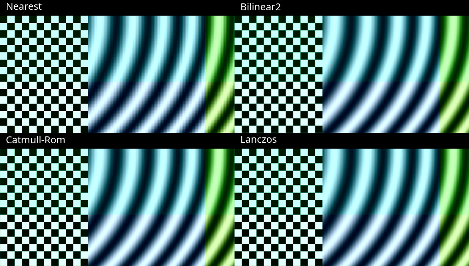

<a id="bcm70015-validation--2026-09-13"></a>

# BCM70015 hardware validation

This report records bounded hardware evidence with revision/date-specific
scope below. It is not a general codec-conformance result and does not close the
[remaining hardware matrix](TODO.md). Build-only CI, software-decoder checks and
frontend discovery are distinguished from tests that opened the CrystalHD card.

## Scope and reference system

- Card: Broadcom BCM70015 (`14e4:1615`) on a dedicated Intel ICH8 root-port
  link. BCM70012 has not been recently tested on hardware.
- Historical host: Ubuntu 25.10 with kernel `6.17.0-41-generic`, x86-64 with
  i386 userspace support. Fresh Ubuntu LTS results are recorded separately below.
- Firmware: repository `bcm70015fw.bin`, SHA-256
  `8bf3a68f5c64686358a52274e40911a88c7f8c67ecbf6cf1557a49b4d7bc67c9`.
- Library API versions: driver `3.10.0`, DIL `3.22.0`. These API values do not
  identify a source revision.
- Most codec and lifecycle tests used module source version
  `8A4E42764F14473E9562951`. The opt-in L0s comparison used
  `11356398D0730685483E554`; the MPEG-4 drain series used
  `A4FFB5BAF6FE6D4B61B2DD7`; the firmware-command change validation used
  `A4382D86E60EAC9DB865809`.
- The final Phase 1 hardware gates used source revision
  `d295011853e9acf83a97c15a5db58e47c3500054` and installed module source
  version `A4382D86E60EAC9DB865809`. The subsequent `392341b` commit changed
  only the hardware-free evidence verifier; the installed runtime was unchanged.
- Unless a result explicitly says installed path, tests selected the in-tree
  library and frontend. Full raw logs remain outside the repository; the
  representative commands, fixture identities and expected results are
  recorded below.

<a id="output-scaling-cost-2026-10-25"></a>

## Output scaling cost and VA negotiation — 2026-10-25

[#508](https://github.com/ahnhy1324/crystalhd/pull/508) tests runtime `1e58c3e`
against master `164b209`. Ubuntu 26.04.1 / Linux 7.0.0-38, T8100/BCM70015,
GStreamer 1.28.2, libva 1.23.0 and libswscale 9.1.100; the installed DIL,
module 3.10.13 and L0s-OFF policy are unchanged. This is unreleased work. The
[measurement data](tests/fixtures/issue471/scaling-20261025.json) preserve
individual samples, unsupported cases and the interrupted campaign.

An isolated UYVY 1280×720→1920×1080 `videoscale` stage used two threads,
180 timed outputs after eight warmups, three crossed/reversed method orders,
unique 50-Hz PTS and natural EOS. It runs **unpaced**, without decoding/display.
Median total-process CPU / wall milliseconds per output:

| Method | CPU ms | Wall ms |
| --- | ---: | ---: |
| Nearest-neighbor | 5.981 | 4.633 |
| Bilinear | 10.644 | 7.879 |
| Bilinear2 (Player default) | 10.647 | 7.798 |
| Catmull-Rom | 20.749 | 14.775 |
| Lanczos | 20.748 | 14.709 |

Bilinear and bilinear2 were byte-identical for this case; the other methods
produced different samples. Nearest saves about 44% of this stage's CPU,
with visible sampling steps. This synthetic pattern does not rank quality
for ordinary movies. The image shows equal, unresized 480×240 crops of the
actual outputs at (540,0), with common RGB conversion and labels:



VA NV12 VPP already uses origin-aligned nearest sampling. The change reuses a
private horizontally resampled Bob row when several output rows select the
same physical input row; it never reads the destination. Independent full
output checks retain exact Y/UV field lattices and pitch/ROI guards. Three
complete final-code, 720-output crossed rounds measured CPU ms/output:

| Private-CPU ProcessVpp case | Before | After |
| --- | ---: | ---: |
| Bob 720→1080 | 4.838 | 3.070 |
| Bob 1080→720 | 2.465 | 2.288 |
| Bob 720→720 control | 0.437 | 0.388 |

The unscaled control ranges overlap; no unscaled improvement is claimed.
The five-round campaign stopped at its 85°C thermal guard before round four's
unscaled control. Three completed rounds and the additional enlargement pair
are preserved; the remaining rounds are **NOT RUN**. No PM/clock setting was
changed. Native testing began after cooling to 70°C.

The retained #482 native 50-AU TFF API harness then compared installed VA
(source `8c75183`, unchanged through `164b209`) with the candidate, using
card 1280×720 output and FHD Bob targets. Two matched enlargement pairs
(reverse order for the second) reduce Bob-stage CPU from median **6.452 to
4.283 ms/output**. The serialized decode/public-output + Bob stage sum changes
from 53.591 to 59.789 field outputs/s; it excludes setup, pixel readback and
close and is **not a live/display rate**. One same-width centered control pair
measured 2.786→2.929 ms/output; no improvement is claimed there. Six processes
complete 18 finite decode epochs: 900 originals/1,800 Bob outputs including
warmups, EOS and reopen. Untimed pixel checks cover the first/last source and
both FHD output fields of every epoch (72 full output pictures), plus source
immutability. They do not hash every timed picture.

Stock FFmpeg traces select H.264 High/VLD, YUV420 RT format and coded
1920×1088 NV12 surfaces. Candidate DEFAULT/FAST scaling each returns all 60
original progressive pictures with identical NV12/PTS to installed DEFAULT;
FAST previously failed. FAST selects the existing nearest kernel, not a new
quality level or card filter. HQ remains rejected. The `yuyv422` output request
fails during VPP output-format negotiation before a 4:2:2 target is created;
EGL import and renderer/scanout are **NOT TESTED** by this command. Source
inspection separately confirms the NV12-only VA decode surface restriction.

Full `-Werror` VPP 107/107 and ASan/UBSan/LSan PASS; native i686/no-SSE focused
and 26 CPU-only groups PASS, plus the same focused ELF32 tests on Pentium II
QEMU with no forbidden SIMD/cache instructions. These are not 32-bit hardware
qualification. All native runs preserve zero pin/refcount, unchanged AER/PM
and clean scoped kernel logs. Physical A/V, displayed cadence, broader format
interop and #471 completion are not inferred. Player settings and algorithms
remain unchanged; no external application or installation was patched.

<a id="ordinary-nv12-vpp-2026-10-25"></a>

### Ordinary NV12 VPP follow-up — #509

Runtime `d4ee4d9` against `65e5152` on the same reference host removes full
canvas clearing before ROI overwrite, copies same-width rows and reuses
private sampled rows during enlargement. Interleaved fields keep separate
row caches; odd source crops retain their original UV phase. No destination
readback, option, format, interpolation or ownership change. The internal
self-overwrite guard precedes clearing; public raw-upload in-place rejection
is unchanged. [Data and original outcomes](tests/fixtures/issue471/nv12-scaling-20261025.json)
include the rejected common Y/UV-loop prototype, whose downscale regression
was corrected by keeping constant sample sizes in separate loops.

Three crossed private-CPU pairs, 90 timed calls after eight warmups, compare
the complete final output with an independent nearest oracle. Median process
CPU milliseconds/output:

| Ordinary VPP | Before | After |
| --- | ---: | ---: |
| 720→1080 | 8.077 | 4.952 |
| 720→720 | 3.281 | 0.648 |
| 1080→720 | 3.472 | 2.548 |

Stock FFmpeg then completes **3,360 pictures over 16 native opens**, with all
NV12/PTS equal to the respective baseline, EOS/reopen, exact selected maps,
zero terminal pins/refs, unchanged AER/PM and clean scoped kernel logs. Of
these, 3,120 traverse affected VPP. The 240-picture unchanged-FHD control is
explicit FFmpeg **passthrough**, not a copy-kernel qualification. Two reversed
pairs give startup-inclusive CPU seconds (decode + VPP + readback + hashing):

| Input→requested output | Pictures/run | Before | After |
| --- | ---: | ---: | ---: |
| 1080→720 | 60 | 2.147 | 2.078 |
| 720→1280×1080, same width | 360 | 10.469 | 9.225 |
| 720→1920×1080 | 360 | 14.330 | 13.132 |

These are finite headless batches, not display/live throughput. Full `-Werror`
VPP 109, focused/full ASan/UBSan/LSan, native strict-i686 28 CPU-only groups
and focused Pentium II QEMU tests pass; they do not qualify 32-bit hardware.

The separate **unchanged GStreamer/DIL Player** comparison uses a temporary
method override, actual Xv/Pulse and the same buffer observer in both arms.
For 30s i25 dialogue, bilinear2 CPU is 86.42/86.26% of one core versus
nearest 63.12/63.76%. It does **not** pass complete-output acceptance:
post-upscale counts are 1,494/1,500 and 1,500/1,500 for bilinear2,
1,492/1,500 and 1,500/1,500 for nearest; terminal sink snapshots retain
10/11 and 9/15 drops respectively. On one true60p pair, CPU is
98.75→74.26%, but post-upscale counts are 1,709/1,800→1,754/1,800 and sink
snapshots retain 85→97 drops. Sink snapshots do not identify every missing
buffer's stage or physical scanout. Both sources reach natural EOS and reopen
cleanly; physical A/V is not requalified. The first 60p-nearest preparation
stopped at 85°C; only that unrun arm was executed after cooling to 70°C.
The initial collector stopped on a real original-picture deficit; that
completed run was retained rather than replayed to erase FAIL. No threshold
or expected count changed. Nearest is a lower-CPU tradeoff, **not a fix for
these presentation deficits**. Player bilinear2 defaults stay unchanged;
additional settings/support promotion is deferred to #400/#91. This
comparison does not run the new VA code and cannot qualify its display speed.

<a id="player-frame-flow-2026-10-25"></a>

### Player frame-flow and renderer accounting — #91

The existing 30s H.264 1080i25 dialogue fixture has 750 original pictures and
1,500 expected progressive fields. Source `f49d99b`, installed GStreamer/DIL
payload `b913a59`, GStreamer 1.28.2 and unchanged L0s OFF were observed through
native pad probes and read-only uprobes on actual installed method addresses.
One fully reconciled run records:

| Boundary | Buffers reaching the next stage | Loss at this boundary |
| --- | ---: | ---: |
| Hardware-completed pictures handed to `finish_frame` | 750 originals | 0 |
| Decoder src | 742 originals | 8 original-picture QoS drops |
| Deinterlacer src | 1,484 fields | 0 of the received pictures' fields |
| Pre-filter passthrough converter | 1,482 fields | 2 QoS drops |
| CPU enlargement | 1,481 fields | 1 QoS drop |
| Post-enlargement passthrough converter | 1,463 fields | 18 QoS drops |
| Xv render method | 1,447 render calls | 16 sink QoS drops |

All 750 `finish_frame` calls return OK; no decoder `drop_frame` call occurs.
The eight decoder QoS warnings match the missing original PTS. The sink's
1,447 rendered + 16 dropped exactly matches its 1,463 incoming buffers; no
counter reset occurs in this run. The additional preroll call is excluded
from rendered counts. This resolves the earlier unexplained difference
between post-upscale counts and terminal sink snapshots, without establishing
physical scanout or A/V acceptance.

A separate same-workload probe attributes 98.23% of Xv `show_frame` elapsed
time to `XSync` (maximum 67.77ms). Every sink buffer already uses negotiated
`xvimage` memory; no sink-side `gst_video_frame_copy` call is observed. The
installed sink keeps its stock 5ms max-lateness and 15ms processing deadline.
`XSync` elapsed time includes the X-server round trip, scheduling and server/
driver work; it is not a measurement of GPU execution or card decode time.

Decoder-free UYVY FHD50 controls also reproduce loss: direct pattern output
renders 1,499/1,500, while adding the same CPU720→FHD packing/scaling shape
renders 1,467/1,500 (16 transform and 17 sink drops). These synthetic controls
use a system clock and no audio, not the dialogue stream or its audio clock.
They demonstrate that this class of deadline loss does not require CrystalHD;
they do not identify every source of the X-server waiting time.

Queue-before/after-resize, one scaler thread, combined conversion/scaling,
upstream-QoS disabling and native-video pilots did not establish complete
presentation or safe compatibility and are **not adopted**. In particular,
disabling upstream QoS shifts loss to the sink: 137/1,500 sink drops. All
original outcomes and the final-code checks are in the
[frame-flow receipt](tests/fixtures/issue91/player-frame-flow-20261025.json).
No external code, driver/firmware, installation, PM setting or acceptance
threshold was changed. Complete explicit-FHD presentation remains open.

Runtime `6f89962` adds only a once-per-playback warning for actual video-buffer
QoS drops; audio QoS, zero drops and unknown counters do not trigger it. It
preserves decoder/output policy, timestamps, rates, quality and EOS handling.
The decoder-pad counter remains distinct from rendered frames. This is an
observability correction, **not a throughput fix or #91 completion**.

Final `6f89962` native checks reach natural EOS/exit 0 and clean card retirement
in all three conditions; each emits exactly one warning for actual video QoS:

| Condition | Decoder-pad pictures | Rendered / expected | Complete presentation |
| --- | ---: | ---: | --- |
| i25, explicit CPU FHD | 747 / 750 | 1,453 / 1,500 | FAIL |
| i25, card720 / Xv fitting | 750 / 750 | 1,499 / 1,500 | FAIL (one converter QoS drop) |
| True60p, explicit CPU FHD | 1,734 / 1,800 | 1,469 / 1,800 | FAIL |

Every missing buffer in these checks is accounted for by a matching QoS drop;
PTS remain unique/monotonic. The one short scale-only loss does not replace
the historical longer zero-drop runs or establish a new recurring loss rate.
All scoped kernel/resource/PM checks pass. The real-bus warning regression is
RED before the change and GREEN after it; all 95 Player tests pass. Physical
A/V and long-running acceptance were not repeated for this notification change.

## 1.2.0 final-package qualification — 2026-10-23

Published [v1.2.0](https://github.com/ahnhy1324/crystalhd/releases/tag/v1.2.0)
selects `8132043`, whose tree equals qualified `f45dbdc`, bundle `1.2.0` /
module-DKMS `3.10.13`. Fresh final-source CI/build, Git-free archive/staging,
live DKMS upgrade/RC2 rollback/reinstall and installed Player/VA checks passed
in the [final execution record](https://github.com/ahnhy1324/crystalhd/issues/473#issuecomment-6353920584).
Final direct live installation was **NOT RERUN**; the unchanged RC2 installer
lifecycle was reused. RC2's 30-minute, three-hour and physical A/V results below
retain their original source and scope. [Maintainer GO and public-asset verification](https://github.com/ahnhy1324/crystalhd/issues/473#issuecomment-6355980181)
are complete. These results do not qualify post-release master development.

## 1.2.0-rc.2 qualification — 2026-10-22

Published [RC2](https://github.com/ahnhy1324/crystalhd/releases/tag/v1.2.0-rc.2)
pins `b32a94d55bc8cfec781063aca6e1a2012b31f6f3`, bundle `1.2.0-rc.2` /
module-DKMS `3.10.12`. Its squash merge `7f8ce59` has the same tree.
Fresh qualification used BCM70015 on Ubuntu 26.04.1 LTS / Linux 7.0.0-38 /
GStreamer 1.28.2, preserving `force_l0s_off=Y`, `session_l0s_off=N`.
The [execution record](https://github.com/ahnhy1324/crystalhd/issues/473)
retains commands, identities, reviews and original failures. RC1, v1.1.0 and
the Phase 1 baseline remain immutable.

PR #475 fixes a deterministic VPP lifetime defect: a Render-captured source may
survive decoder retirement only when successful close published the exact
matching completed picture. Failed or busy close, reset, destruction,
generation mismatch and public-owner rebinding still reject it. The original
RC1 Kodi Stop-time `vaEndPicture=1` / `vaSyncSurface=23` pair did not reproduce,
so it is not conclusively attributed to this fix.

| Gate or claim | Status | RC2 disposition |
| --- | --- | --- |
| Focused implementation and regression review | PASS | PR [#475](https://github.com/ahnhy1324/crystalhd/pull/475) at `3ec6b44`: direct/non-direct, queued, failed-close, reset, rebind and replay tests pass; i386/SSE2, Pentium-II scalar/no-SSE, sanitizer and that PR head's push/PR CI runs pass. Two diagnostic Kodi runs completed 40/40 Stop/reopen cycles with no VA/VPP API error. The first collector remains HOLD because it overclassified expected fallback/status lines; the saved precision runner PASS retains 19 Stop-adjacent renderer timeouts and zero unexplained warnings. This is lifecycle evidence, not physical A/V or cadence acceptance. |
| Exact-RC2 G0 identity, archive, ABI and same-SHA CI | PASS | [22/22 CI and local checks](https://github.com/ahnhy1324/crystalhd/issues/473#issuecomment-6331021802), Git-free archive/staging, ELF64/i386 stable exports, no-SSE and sanitizers pass. |
| Affected G1 native BCM70015 paths | PASS | [Installed oracle 11/11, stock FFmpeg Bob 100 fields / Weave 50 pictures and public Player 50-picture EOS/reopen twice](https://github.com/ahnhy1324/crystalhd/issues/473#issuecomment-6331433840); clean identity, pin/refcount, AER and kernel boundaries. |
| G2 selected stock Kodi 21.3 physical/lifecycle matrix | PASS, bounded | [1080p30 progressive and 720i25 Auto/Off](https://github.com/ahnhy1324/crystalhd/issues/473#issuecomment-6338561649): qualitative dialogue A/V, pause/resume, seeks, natural EOF and reopen. General FHD Auto/Bob and uniform displayed 50p are not claimed. |
| G2 stock Kodi strict Auto field count | FAIL, claim narrowed | [1,469/1,500 at 60 Hz; 1,475/1,500 at 50 Hz](https://github.com/ahnhy1324/crystalhd/issues/473#issuecomment-6334432810). All 750 originals complete; Kodi's adaptive `DROP_ANY`/`SKIPDEINT` omits second-field requests. Raw FAILs remain; the driver does not invent requests or PTS. |
| G2 paced card720/LINEAR 30 minutes | PASS | [45,000 originals / 90,000 ordered fields and Xv renders](https://github.com/ahnhy1324/crystalhd/issues/473#issuecomment-6333914052), zero drop/QoS, natural EOS in 1,803.81 s; mean CPU 37.16% of one core. Earlier contention-contaminated FAILs remain preserved. This is application cadence, not measured physical scanout. |
| G2 selected three-hour VA Bob endurance | PASS | [540,000/540,000 exact NV12/PTS fields in 10,800.107 s](https://github.com/ahnhy1324/crystalhd/issues/473#issuecomment-6342267971), followed by exact 50-picture Weave reopen. Mean CPU 72.58% of one core; RSS median growth 8,456 KiB, FD/thread growth zero. Earlier incompletely monitored run remains INCOMPLETE. |
| G3 upgrade, rollback, removal/reinstall and public archive | PASS | [Direct/DKMS v1.1.0 rollback, RC2 reinstall/removal and final restoration](https://github.com/ahnhy1324/crystalhd/issues/473#issuecomment-6343030181), Git-free asset/modes/staging and installed EOS/reopen pass. The runner's original unprivileged DKMS-cache read FAIL is preserved; focused continuation completed restoration and final Player/VA checks. |
| Stable v1.2.0 decision | HOLD | RC2 qualification is complete. The distinct final package and explicit maintainer GO remain required. |

All successful native boundaries ended at pin/refcount zero with unchanged
module/PM identity, zero AER totals and no scoped kernel fault. The physical
matrix is qualitative acceptance, not calibrated A/V offset. General FHD50,
Atom real-time, hardware deinterlacing and #470/#471 remain outside the claims.

## 1.2.0-rc.1 qualification — 2026-10-22

[#473](https://github.com/ahnhy1324/crystalhd/issues/473) is the authoritative
G0–G3 tracker. Exact qualified source
`c278c4cba5328a0dd942ae63d630734a89e24074`, bundle `1.2.0-rc.1` and
module-DKMS package `3.10.11` completed G0/G1 and was published as the immutable
[`v1.2.0-rc.1` prerelease](https://github.com/ahnhy1324/crystalhd/releases/tag/v1.2.0-rc.1).
PR #474's squash-merge tree matches that source. Stable v1.1.0, prior RCs and
the Phase 1 baseline remain unchanged. G2 found the Kodi lifecycle failure below;
G3 was not run, and no stable v1.2.0 GO was given.

| Gate or claim | Status | Exact-candidate requirement / current disposition |
| --- | --- | --- |
| G0 scope and aggregate source review | PASS | Exact-source review froze the bounded claims and excluded #470/#471 and broader research. |
| G0 ABI and package identity | PASS | Git-free archive and staged installation pass; `libcrystalhd.so.3`, all 252 stable ELF64/i386 exports and old-client relocation are preserved, with only additive `DtsGetLibraryCapabilities`; identity is `1.2.0-rc.1` / `3.10.11`. |
| G1 exact-SHA device-free build and CI | PASS | Exact-source Werror, userspace32/SSE2, scalar/no-SSE, VA CPU, sanitizer and both fresh CI runs pass, including aggregate build and ten kernel jobs per run. |
| G1 native BCM70015 short correctness | PASS | Source/installed 11-row oracle, controls, selected H.264/MPEG-2 TFF/BFF Weave/Bob, finite and LIVE ownership, FFmpeg VA Bob, EOS and reopen pass with clean resource/kernel boundaries. These are not physical A/V or sustained evidence. |
| Selected H.264 card output at width 1280 | PASS | Installed public Player scale/Weave runs preserve selected output, EOS and clean reopen. Scaling remains explicit and trades source detail for lower transfer/CPU work. |
| G2 stock Kodi 21.3 Auto/Off | HOLD | Progressive and Off paths completed; Auto-natural accounted for 750 originals and 1,500 VPP commits. Auto-controls recorded one Stop-time `vaEndPicture=1` followed by `vaSyncSurface=23`; the next reopen passed. Seek-preroll drops and renderer timeouts are retained separately. Physical A/V was not run. |
| G2 paced card720→CPU Bob 720p50 for 30 minutes | NOT RUN | The existing five-minute 15,000/15,000 result is only a baseline. The RC run must account for originals, card fields, filtered/rendered outputs and QoS under one declared zero-unexplained-loss rule. |
| G2 selected maintenance/endurance | NOT RUN | Run the exact-RC three-hour selected path and retained maintenance regression required by #473; do not relabel historical soaks. |
| Explicit FHD 50p zero-drop presentation | FAIL | Retain the 30-minute 89,826/90,000 result (174 losses). This is not a v1.2 support claim and does not become PASS through smaller-output evidence. |
| Atom real-time, general Kodi 21–23 and FFmpeg stream-loop losslessness | UNSUPPORTED | Preserve the external 73+75/750 Atom limitation and the 296/300 loop result. Compatibility evidence is not a real-time or lossless-loop claim. |
| Hardware deinterlacing, PAFF/separate fields, new/general VA mixed-mode or telecine claims, general codec interlace, FHD50/60, BCM70012 new paths, Moonlight/browser, protected playback, direct 4:2:2, #470/#471 and standalone PPB/MFD/firmware work | UNSUPPORTED | These remain explicit nonclaims or separate research; existing selected GStreamer telecine/RFF evidence is not withdrawn, and no historical result promotes a broader claim into the RC. |
| G3 direct/DKMS upgrade, rollback, archive and final artifact | NOT RUN | Test exact RC installation from v1.1.0, coexistence, rollback, reinstall/removal and Git-free archive permissions before stable GO. |

The dated development sections below remain evidence for their recorded source
SHAs only. They are not silently copied into the table's PASS rows.

## 1.2 development: CPU VA Bob — 2026-10-19

Source `b979b0bdcd9763c930ee50b765e5220f183b5ab7`, uninstalled development
VA/DIL with unchanged stable module `3.10.9`, BCM70015 and L0s parameters Y/N.
The existing 1280×720 TFF MBAFF fixture contains 50 pictures at 25 Hz; visible
height720 is processed within coded height736.

Four bounded runs pass: same-run VA Weave→CPU field reference (50 Weave and
100 field outputs), VA Bob field-rate (100), frame-rate (50), and zero-filter
Weave reopen (50). Full ordered NV12 pixels and rational DTS/PTS/durations
match the independent field reference or initial Weave, as applicable. Actual
candidate mappings/card use, normal exits, pin/ref0, unchanged zero AER and
clean kernel boundaries were independently reviewed. See
[PR #467](https://github.com/ahnhy1324/crystalhd/pull/467) for the exact scope.

The initial observer attempt remains FAIL: a redundant `/proc` FD read raced
process exit; the exit code was not captured. Its artifacts and clean close
boundary remain preserved. An observer-only correction preceded the separate
passing experiment. These two-second runs are not sustained 50fps/FHD, native
BFF, full stock Kodi/Atom, endurance or physical A/V qualification. No installation,
module reload, firmware change or PCIe tuning was performed.

An additional stock Kodi 21.3 control at `c1469b7` (unchanged production code)
uses the same 50-picture fixture and isolated profiles. Auto selects
`vaapi-bob`, submits 100 Bob fields, and creates/destroys three contexts in
total; Off selects `none`, submits no Bob fields, and balances two contexts.
Both reach natural EOF/exit0 with actual candidate/card use, pin/ref0 and clean
kernel/AER boundaries. Each preserves the expected pre-context 10-bit format
probe returning unsupported format; no other observed API call fails. These
diagnostic runs do not measure displayed 50fps, physical A/V or CPU performance.

### VA card720 to Bob/FHD and LIVE gaps — 2026-10-21

Source `e636182`, private plugin with unchanged DIL `3b81b1d`, stable module
3.10.9 and PM Y/N on the same Ubuntu 26.04.1/T8100 host. Finite and explicit
LIVE+prefeed each pass two opens of the existing FHD-TFF fixture: 200 original
pictures total, 276,480,000 exact NV12 bytes and original packet PTS. All 400
original fields are small readbacks; LIVE separately retires four small
full-height auxiliary outputs. Decoder close, pool reuse and resource/kernel
boundaries pass without changing the installed stack.

Direct CPU Bob→FHD and Bob720→CPU FHD enlargement match exact field/row
references and each other. Across both modes, 56 FHD outputs and 16 intermediate
720p outputs pass; 24 of the FHD outputs complete at four deliberate LIVE input
gaps before explicit close. No inferred EOS or changed non-IDR continuation.
Four bottom-field waits still take 153–158 ms. Separate real-DRM synthetic
FRAME/TFF/BFF resize checks pass all 12 cases without decoding on the card.
Independent review approves this bounded correctness evidence, not smooth
50/60fps, physical A/V, GPU enlargement or hardware deinterlacing.
See [usage](filters/vaapi/README.md#returning-the-small-output-as-progressive-video-or-fhd)
and the existing [receipt](tests/fixtures/issue436/card-scaled-bob.json), section
`va_scaled_return_extension`, for the failures corrected and sampled CPU costs.

### Scalar VA NV12 resizing — 2026-10-21

`9affe1f` removes the general resize loop's per-pixel wide division; field rows,
odd-crop chroma, padding and access/ownership rules are unchanged. On the same
T8100, a scalar CPU-only `ProcessVpp` comparison alternates old/new binaries
across three rounds of 30 calls per condition. Wall time is the median of the
three run medians; CPU time is the median of each run's mean CPU time per call.

| Operation | Before → after, ms/output | CPU ms/output, before → after |
| --- | ---: | ---: |
| Progressive 720→FHD | 30.003 → 7.413 | 30.170 → 7.458 |
| Interleaved Weave 720→FHD | 29.999 → 7.399 | 30.096 → 7.421 |
| Progressive FHD→720 | 13.287 → 3.201 | 13.335 → 3.231 |

All 14 benchmark conditions preserve exact active pixels, borders, source bytes
and timestamps. The permanent regression adds 18 resize/crop/extreme-width cases;
native Werror, actual i686/no-SSE, Pentium-II QEMU, ASan/UBSan/leaks and all 87
VPP API regressions pass. No new option or SIMD dependency is introduced.

The affected native finite card720→Bob/FHD route also passes two opens: 100 exact
original pictures/PTS, 16 exact FHD returns and eight intermediate720 outputs,
EOS and clean resource/kernel/PM boundaries. Its eight second-stage enlargement
API+sync samples fall from 34.410–41.988 to 11.780–16.370 ms; medians are 35.131
and 12.337 ms. These are bounded API samples, not sustained throughput or E2E.
Installed files, external applications, firmware and PM remain unchanged.

### SSE2 VA field conversion — 2026-10-21

`593a475` reuses packed same-field row-pair loads for both luma and rounded
chroma instead of reading them in separate passes. On the T8100, matched old
(`86579fa`) and new binaries alternate AB/BA/AB, each measuring 1,000 conversions
after 20 warmups. These are three-run medians on reused CPU-heap buffers:

| Full-pair YUY2→NV12 conversion | Wall ms/picture, before → after | CPU ms/picture, before → after |
| --- | ---: | ---: |
| 1280×720 interlaced | 0.731978 → 0.603503 | 0.731798 → 0.603471 |
| 1920×1080 interlaced | 3.183912 → 2.674202 | 3.169950 → 2.653090 |

Exact pixels, metadata and guards pass: 7,581 conversion checks and 737 Bob
checks on native and ASan/UBSan/leak builds; ELF32 SSE2 passes conversion.
Native i686/no-SSE and Pentium-II QEMU each pass 7,581 conversion and 535
NV12-only Bob checks. The production VA plugin builds with Werror; nothing is
installed. The legacy path is unchanged. The existing receipt retains all
samples, including a slower old720 run. Compact-field correctness is covered,
but its separate performance, actual DMA/WC surfaces, hardware/E2E latency and
clocked presentation are not measured by this CPU comparison.

### Card720 → Bob → FHD physical playback — 2026-10-21

The operator confirmed aligned speech/lip movement and no persistent playback
problem in a 30-second GStreamer run: card1280×720 → CPU `scalerbob`50 → CPU
1920×1080, synchronized XVideo and PulseAudio. The panel was 1024×768 at 60 Hz;
the dialogue source was field-preserving upsampled 720i content, not native-FHD
detail. This is separate from the new VA integrated-scaling path and is not a
calibrated latency or general FHD50 display qualification.

The strict no-drop check remains **FAIL**, independently of that qualitative
observation. An unclocked control returned all 750 decoded pictures and 1,500
Bob/FHD outputs. The clocked trace likewise completed all 750 hardware pictures;
subsequent QoS dropped one decoded picture, seven Bob fields, five post-resize
color-conversion outputs and two sink submissions. Moving color conversion to
720 made the later FHD converter a verified passthrough, but rendered 1,474
instead of the traced control's 1,484; no production change was adopted.
These playbacks reached EOS
with clean resource/kernel/PM boundaries. See `physical_gstreamer_av` in the
[existing receipt](tests/fixtures/issue436/card-scaled-bob.json).

Further clocked comparisons at checkout `4d4afe1` retain the same GStreamer,
DIL and stable module. A bounded queue after private `scalerbob` preserves all
1,500 Bob/FHD outputs, but only 1,486 reach rendering with debug logging disabled.
In the actual Player's automatic LINEAR-deinterlace path, the same queue before
resize worsens rendering from 1,480 to 1,450. No change was adopted from those
comparisons; the seven exact stage counts and rejected CPU-only
conversion experiment are in `clocked_handoff_followup` in that receipt.

A separate stock-Player run stalls after picture PTS21.12 s: its video queue
empties, input-space waiting times out, and close reports a firmware-command
timeout. The subsequent observed runs reach EOS with all 750 input pictures /
1,500 card fields released and clean boundaries; they do **not** establish that
the intermittent stall is fixed. No new human A/V acceptance is claimed.

The resulting source review found an independent free-list notification race:
an old count could overwrite a newer firmware-visible count. Fix `35b889e`
serializes counting and notification, including the ACTIVE-wake writer.
Both old-code failures reproduce in source-extracted tests; the fix passes
normal/ASan/UBSan power and RX ownership suites, independent review and current
kernel W=1/Werror builds with research support off/on.

A subsequent temporary-module trial at checkout `7b4b1cf` passes two fresh
decoder opens: all 200 scaled fields match the retained token/parity oracle,
with EOS and clean close on each open. Four subsequent 30-second stock-Player
observations each accept all 750 inputs and return/release all 1,500 card fields,
reaching EOS without a kernel error. They all **FAIL** strict presentation:

| Module / preceding test | Rendered / required fields | Sink drops |
| --- | ---: | ---: |
| Fixed `35b889e`, after the two finite opens | 1,272 / 1,500 | 53 |
| Restored installed 3.10.9 | 1,483 / 1,500 | 2 |
| Retained pre-FLL `49ac83b`, playback only | 1,491 / 1,500 | 2 |
| Fixed `35b889e`, playback only | 1,473 / 1,500 | 3 |

The pre-FLL module differs in only the three FLL source files; no new build,
application setting or queue change is used for these controls. The severe
initial loss does not repeat in the fixed playback-only run, but its cause and
the smaller timing differences remain **HOLD**. Neither run-to-run variation
nor a module regression is established, and preceding finite opens are not a
proven cause. Stage counts and original FAILs remain in the receipt. A useful
next discriminator is actual firmware FLL-write values/timing and RX intervals
against finish/QoS timing; sampled host READY/free counts are not that evidence.
The exact installed
3.10.9 module is restored with zero pins/references and unchanged PCIe policy,
device permissions and AER counters. No installed files are replaced. This
bounded trial does not establish that the earlier intermittent stall is fixed.

A later RX review fixes a separate disabled-PWM resume defect in `dc1b245`:
accepted software pause intent could survive the normal drain threshold and
strand a newly submitted buffer without another interrupt. The old-code
reproducer fails; normal/sanitized ownership and power tests, independent review
and a W=1/Werror build pass. A temporary-module trial returns all 200 exact
fields across two fresh opens, with EOS/close and clean stable-module restoration.
Its stock playback returns/releases all 1,500 card fields but renders only
1,471/1,500: 26 losses in deinterlacing, two after FHD conversion and one at the
sink. **Strict presentation remains FAIL; the earlier firmware stall remains
unattributed.** A separate stable-module passive trace also observes the pause
latch while decoding continues; that state alone does not prove a hang.
See `rx_pause_followup` in the same receipt for counts and tracing limitations.

Player fix `1ec0714` addresses a separately reproduced GStreamer 1.28.2
LINEAR QoS error: both fields are compared against the input picture PTS.
The CPU regression, for both TFF and BFF, injects a 42 ms cutoff after the
40 ms field; stock incorrectly drops its still-timely 60 ms sibling.
The workaround preserves all six reference outputs byte-for-byte, including
PTS/duration/flags, and forwards the unchanged QoS event once upstream.
It bypasses the **entire deinterlacer-local QoS cache**, not just the second
comparison; decoder, resize/conversion and sink QoS/deadlines remain active.
Only the Player's hardware-scaled, software-resized YUY2 25→50 path with
the exact affected version/default method is eligible. No new option or
external-framework patch is introduced; 71 device-free Player tests pass.

The actual-source 30-second trial returns/releases all 1,500 card fields,
but two pictures are lost before decoder output: 748 pictures reach LINEAR and
all 1,496 resulting fields reach FHD resize. Four later outputs are lost in
the conversion path, leaving **1,492/1,500 rendered, zero sink drops: strict
FAIL**. These stage counts are consistent with QoS loss but do not yet measure
the individual drop decisions or deadline margins.
The workaround is active through EOS and removed at close; device/kernel/PM
boundaries remain clean on unchanged installed 3.10.9 and qualified DIL/Gst.
This fixes the reproduced DI-local loss, not all presentation delays or the
earlier intermittent firmware stall. Rejected packing/thread/pool alternatives
and scoped results are retained in `deinterlace_qos_followup` in the receipt.

A separate sparse-drop diagnostic of the same runtime at `1400944` records
45 QoS messages accounting for all 60 missing renders: 15 whole decoder
pictures, three pre-resize converter fields, 15 post-resize converter fields
and 12 sink fields. All card output completes; no extra DI loss is unexplained.
The sink reports 25.768–44.057 ms clock lateness. Decoder/converter messages
instead report distance from their saved QoS cutoff, **not card latency**.
The strict result is 1,440/1,500, EOS and clean teardown; this diagnostic had
concurrent read-only file enumeration and is not an isolated speed comparison.
It identifies drop decisions, not the cause of the initial scheduling delay.

Two isolated follow-ups at documentation checkout `46add08` retain runtime
`1ec0714`, whose push and PR CI both pass. The two-boundary clock trace renders
1,487/1,500; the subsequent Xv-call trace renders 1,497/1,500. Both remain
**FAIL**, not evidence of a speed improvement. In the latter run all 1,500
fields reach FHD output; two are dropped by the downstream converter and one
by the sink. The dropped 3.42 s field was ready 57.793 ms early but arrived at
the sink 32.727 ms late. Immediately before it, the same output thread spends
22.641 ms inside `XSync` with 0.121 ms thread CPU, then another 16.486 ms before
the next sink input. This locates a blocking/scheduling contribution after
resize, not slow card decoding in that run; it does not distinguish X-server
waiting from descheduling, prove physical VSync, or explain the whole delay.
Both trials complete all card output, EOS and clean teardown without policy
changes. Exact clock scope and loss accounting are in `output_service_diagnostics`.

A further native service trace at `1299172` (same runtime `1ec0714`) renders
1,498/1,500: both losses occur at the final FHD packing converter's QoS check,
not in DI. FHD YUY2→UYVY packing costs median 4.163 ms thread CPU / 5.161 ms
elapsed; waiting/descheduling is not an exclusive GIL measurement. This does
not retrospectively explain the previous run's entire 16.486 ms interval.

Moving that packing before resize is pixel-exact in six CPU comparisons of
50 retained stock-LINEAR outputs: median CPU time falls from 1.463360 to
1.397416 s, elapsed from 0.879363 to 0.820634 s, including equal copies/startup.
The private 30-second native prototype then renders **1,500/1,500, zero drops**,
with every original PTS, EOS and clean teardown. DI remains YUY2; only packing
moves to 720 before the unchanged-quality UYVY FHD resize. Actual-source
candidate `b775f5c` selects this format correctly but renders 1,301 and 1,499
in two trials: **strict qualification remains FAIL**. A current-source private
control and a control without its intermediate capsfilter both render 1,500.
The observed final-buffer layout and window properties match; neither a
required capsfilter nor an allocation/selection-time cause is established.
These results are not new physical A/V acceptance or a firmware-stall fix.
See `output_packing_followup` for the separate evidence scopes and old FAILs.

Caching the unchanged DI caps policy reduces a CPU-only 1,000-event QoS batch
from median 186.031 to 124.527 ms process CPU. All forwarded event fields and
copy counts match; mutable properties/current caps are still checked each time.
This saves about 62 µs per event, not proof of fixing the native deadline misses.
All 77 Player tests pass, including renegotiation and stock-policy fallback.
Actual runtime `740ebcd` then completes **three 30-second clocked plays**:
each has 750 original pictures, **1,500/1,500 FHD render submissions, zero drops**,
exact PTS, natural EOS and clean teardown. The two repeats use documentation-only
checkout `5782d0d`; no private topology is injected. This is bounded fresh-process
repeatability, not endurance, proof that the cache caused every earlier failure,
physical presentation/A/V certification or a firmware-stall fix. Broader
acceptance remains open.

A subsequent **three-hour continuous clocked play** at documentation checkout
`26612cd`, with the same `740ebcd` Player runtime, reaches natural EOS and clean
close in 10,805.897 s. One device lifetime accepts 270,000 original pictures and
returns/releases all 540,000 card fields. Final render submissions are
**538,813/540,000: 1,187 missing (0.220%), strict no-drop FAIL**. Weighted QoS
counts explain the whole deficit: 190 decoder and two pre-DI converter pictures
(384 fields), then 16 filter-converter, seven packing, 12 resize, 514 final
converter and 254 sink fields. No additional DI loss is unexplained; received
PTS remain on-grid, ordered and unique. These counters locate drop decisions,
not the cause of the initial lateness or a new card-latency measurement.

Actual sink-input intervals are p50/p95/p99 **20.000/21.813/25.785 ms**, maximum
83.921 ms; 1,504 exceed 40 ms, none exceed 100 ms. Complete minute windows have
median 49.900 and minimum 49.133 render submissions/s. Weighted Player CPU is
91.85% of one core (all threads), sampled peak RSS 183,540 KiB, settled-to-final
60-sample median RSS growth 1,884 KiB, and FD/thread deltas zero. The highest sampled
host thermal sensor is 84°C, not card temperature. No CrystalHD/kernel fault or
AER delta occurs; module/PM and pin/ref boundaries are unchanged. A fresh-process
30-s reopen renders
1,500/1,500 with zero drops and normal EOS/close. This is bounded resource
evidence, not proof of no leak or a fix for the earlier intermittent stall.

The continuous input repeats the existing 30-s field-preserving dialogue's
unchanged H.264 packets, with once-decoded PCM audio and checked timestamp seams;
it is not native-FHD detail or the previous AAC CPU workload. Sink-input timing
is not physical scanout, A/V synchronization or E2E latency. No playback policy,
external application or installed component changed. Admission failures and
full statistics remain in `output_packing_followup.clocked_endurance_3h`.

Four subsequent 60-s deadline diagnostics retain the same runtime and timing
policy: one natural **2,974/3,000 FAIL**, two **3,000/3,000 PASS**, and one
**2,997/3,000 FAIL** with a deliberately bounded 8-s competing CPU worker.
Every run returns/releases all 3,000 card fields and reaches normal EOS/close.
The controlled load saturates the host, increases output/scaler runnable waits,
and accumulates late delivery before three QoS losses inside the load window;
neither a long individual observed GIL acquisition nor XSync call explains it.
This reproduces a host-contention path, not the unidentified competing work in
the natural failure or every loss in the three-hour run. Instrumentation is not
free; no production fix, relaxed deadline or firmware-stall resolution is claimed.
Observer scope, controls and remaining attribution are recorded in
`output_packing_followup.deadline_source_discriminator`.

A process-local **nice −10 / SCHED_OTHER** trial, with unchanged runtime and
deadlines, records **117/89,937 resolved outputs dropped (0.130%)** across a
19-minute checkpoint and a separate completed 11-minute play. This is not a
continuous 30-minute PASS: the first attempt stops at the existing **85°C host
thermal guard**, with normal close; after natural cooling, the continuation
returns/releases all 33,000 card fields and reaches EOS, but loses 43 render
submissions. Both strict results remain FAIL. The aggregate excludes unplayed
tail and in-flight shutdown frames. Weighted Player CPU is 91.37% of one core;
module/PM/AER/pin/ref boundaries remain unchanged. Priority does not eliminate
drops; the earlier 0.220% three-hour result is not a matched control. Details:
`output_packing_followup.priority_trial`; no default-priority policy change.

Six subsequent 60-s private controls isolate Player streaming callbacks using
identical native count probes, at ordinary priority and unchanged output/QoS
settings. HW order is Python/C/C/Python: render submissions are
**2,565 / 3,000 / 3,000 / 2,985**, each out of 3,000; Player CPU is
**84.76 / 81.27 / 81.47 / 84.14%** of one core. The first Python run also has
8.01% mean system iowait, versus 0.04–0.15% thereafter: it is not an isolated
Python-cost measurement. Native health/DI-QoS callbacks are a promising candidate,
not proof of the sole cause or a qualified production fix; Python control remains.
SW decode with field-preserving 720 downscale and the same common postprocessing
renders **2,594/3,000 (Python) and 2,658/3,000 (C)** at **144.07/143.58% CPU**.
This is not an ordinary unscaled SW-player benchmark: CPU decoding, 422 conversion
and downscale add work; SW/card resampling is not assumed pixel-identical.
All six reach normal
EOS/close; HW returns/releases every card field, SW never opens the card, and
module/PM/AER/pin/ref boundaries remain unchanged. Details and the SW-only private
caps-validator correction: `output_packing_followup.python_sw_comparison`.

Four warm-cache hybrid controls then keep either health or DI-QoS in Python:
native-health-only CPU is **83.42/83.06%**, native-DI-only **81.54/82.07%**;
all four render 3,000/3,000. This favors targeting DI overhead, not attributing
earlier drops to a single callback. Player `c7e0578` makes the smaller change of
reading all five mutable DI properties in one fresh call, with no new helper,
option or eligibility cache. All 79 CPU-only Player tests pass, including frozen
notifications and TFF/BFF output. A 60-s old-predicate control and actual updated
Player both render 3,000/3,000 with normal EOS/close and unchanged boundaries;
CPU is 84.11/83.48%. One pair does not establish a causal CPU gain or a long-run
drop fix. Details: `output_packing_followup.callback_attribution`.

Candidate `5af8297` moves only DI-QoS handling into the existing CrystalHD
GStreamer plugin; older plugins retain the Python fallback. Eligibility,
upstream feedback, frame deadlines and image processing are unchanged.
CPU-only checks pass: 84 Player, 10 native-DI and 88 decoder-lifecycle tests,
including removal while PLAYING and in-flight/reentrant final-owner disposal.
Four warm-cache 60-s Python/native/native/Python controls each render
**3,000/3,000** with normal EOS/close and unchanged card/host boundaries.
Mean CPU is **83.48% / 81.81%** of one core (**1.67 percentage points** lower);
each native run forwards 2,999 QoS events with no failure. These bounded runs
do not resolve the historical long-run drops or add physical A/V acceptance.
Details: `output_packing_followup.native_di_production` in the same receipt.

A subsequent uninterrupted **30-minute** run of `5af8297` (docs-only checkout
`5ad2c3c`) reaches natural EOS and clean close, but **fails zero-drop
presentation**: **89,826/90,000** render submissions, **174 missing (0.1933%)**.
All 45,000 originals finish and all 90,000 card fields return/release. Host QoS
accounts for every loss: 22 decoder pictures × 2, filter converter 3, upscale 1,
final passthrough converter 83 and sink 43. The native helper forwards all
89,868 QoS events without failure. Drop locations do not identify the source
of lateness; the passthrough drops are not evidence of costly pixel conversion.
Mean process CPU is **84.88%** of one core, peak RSS **177,556 KiB**, settled
RSS growth **460 KiB**, FD/thread growth **0/0**, and peak temperature **82°C**.
Module/PM/AER/pin/ref boundaries are unchanged; no bus errors or warnings occur.
This uses ordinary priority, unchanged deadlines/quality and the retained
continuous dialogue fixture without cache preloading. It is not a matched CPU
comparison with the short warm-cache controls or new physical A/V acceptance.
The remaining clocked QoS losses and separate intermittent firmware stall stay
open. Details: `output_packing_followup.native_di_endurance` in the same receipt.

#### Card720 output-size screen — 2026-10-21

Matched five-minute actual-Player runs at checkout `be9af67` retain runtime
`5af8297`, the same 7,500-picture dialogue/PCM input, card-side 1280x720 output,
LINEAR 50-field/s deinterlacing, Xv/Pulse sinks, normal priority, quality, QoS
and deadlines. Only the explicit host output size changes.

| Host output | Runs rendered / 15,000 | CPU, one core | Mean host iowait |
| --- | --- | ---: | ---: |
| 1280x720 | 15,000; 15,000 | 37.337%; 37.343% | 0.058%; 0.053% |
| 1600x900 | 13,362; 15,000 | 74.545%; 73.394% | 6.978%; 0.062% |
| 1760x990 | 13,053; 15,000 | 79.278%; 78.145% | 7.255%; 0.041% |
| 1920x1080 | 14,987; 14,990 | 84.139%; 84.199% | 0.114%; 0.139% |

Both low-iowait 900p/990p repeats deliver every original and field with exact PTS and
zero QoS loss. Their large earlier deficits coincide with about 7% system
iowait, so neither size is a deterministic failure threshold. A separate
RAM-buffered whole-host monitor around the passing 990p run records 0.044%
iowait, 15 MiB read and 16.72 MiB written by the SSD over 375 seconds, with no
swap-in/out. This correlation does not identify the competing work or prove
storage causation. Conversely, both FHD runs lose 13/10 fields despite low
iowait, while both 720p runs are exact and use about 47 percentage points less
CPU than FHD.

Every run reaches natural EOS and a clean card/module/PM/AER/pin/ref boundary;
all failures remain failures. This screen does not establish physical scanout,
A/V quality, 990p endurance or a new production fix. For ordinary display
playback, omitting `--software-output-size` lets the normal video sink fit the
card's smaller output and avoids the measured CPU enlargement. Explicit FHD
buffers remain available when a caller actually requires them, with the
documented no-zero-drop limitation.

A focused follow-up removes only the Player's unnecessary requirement for an
explicit software output size before installing its already guarded
GStreamer-1.28.2 LINEAR deinterlacer QoS correction. At checkout `ffe0263`, an
actual five-minute `--scale-width 1280`-only run reaches natural EOS with
7,500/7,500 original pictures and 15,000/15,000 fields at every measured
post-deinterlace and Xv input site. Xv receives UYVY 1280x720p50 and renders
all 15,000 with zero drop; the native helper inspects/forwards 14,999/14,999
QoS events with zero failure and is removed on close. Mean process CPU is
37.02% of one core, mean host iowait is 0.054%, and settled RSS/FD/thread
growth is 0/0/0 across the short, overlapping final windows; that is not leak
or endurance evidence. The card accepts/finishes all 7,500 pictures and
returns/releases all 15,000 fields; module/PM/AER/pin/ref state is unchanged.
This qualifies the public low-host-cost path, not physical scanout, A/V sync,
display interpolation quality or equivalence to explicit method-4 FHD
enlargement.

A CPU-generated GL alternative is not adopted: GStreamer 1.28.2's packed-422
shader uses integer `%`, unavailable on this 965GM's GLSL 1.20. Standard planar
Y42B repacking preserves all 4,147,200 active bytes of the first test frame and
allows the shader to run, but the bounded 50-frame draw/cadence check still
fails. This is neither a card test nor a GL throughput ceiling; no GL default,
external shader, deadline or installed setting is changed.

A CPU-only SIMD control uses the same separate YUY2 720→FHD resize
(`method=4`, `n-threads=2`) and FHD UYVY conversion, with GStreamer 1.28.2 /
ORC 0.4.42 on the T8100. Three fresh processes per variant alternate AB/BA/AB;
each handles 50 retained fields row-doubled to progressive input before timing.

| ORC path | Median wall time, 50 outputs | Median all-thread CPU time |
| --- | ---: | ---: |
| Default SSE JIT | 0.884408 s | 1.469652 s |
| Generated C backup (`ORC_CODE=backup`) | 1.551934 s | 2.544400 s |

All six runs preserve every output byte and PTS/DTS/duration/caps. Timing
includes equal appsink copies but excludes preparation, disk I/O and comparison.
The existing default saves 43.01% wall / 42.24% CPU against the backup; no new
option is needed. Backup does **not** disable all process SIMD. This isolates
resize/packing, not LINEAR deinterlacing, clocked presentation or the firmware
stall. The original aborted observer attempt and six complete samples remain
separate in the existing receipt; no earlier playback FAIL is reclassified.

### MPEG-2 Main frame-coded interlace — 2026-10-21

Source `cf3449f`, private VA plugin and unchanged DIL `3b81b1d`, stable module
3.10.9, Ubuntu 26.04.1/kernel 7.0.0-38 and Core 2 Duo T8100; PM remains Y/N.
Stock FFmpeg 8.0.1 decodes the existing 640x360i25 `mpeg2-top.m2v` and
`mpeg2-bottom.m2v` fixtures. Each cell uses two fresh FFmpeg processes with
50 inputs each: eight processes total, not same-process context reopen.

| Field order / output | Exact outputs, two runs | Compared NV12 bytes | PTS step |
| --- | ---: | ---: | ---: |
| TFF / Weave | 100 | 34,560,000 | 40 ms |
| BFF / Weave | 100 | 34,560,000 | 40 ms |
| TFF / CPU VA Bob | 200 | 69,120,000 | 20 ms |
| BFF / CPU VA Bob | 200 | 69,120,000 | 20 ms |

Every active byte matches, with zero Y/U/V field mismatches. The reference is
unchanged GStreamer `b047ce1` woven YUY2, independently converted using
same-field chroma averaging and selected-field Bob duplication. It shares the
card/DIL: this is frontend/layout agreement, not an independent software-decoder
quality oracle. All runs pass counts, PTS, hardware EOS, exit, actual candidate/card
ownership and clean pin/refcount/kernel/AER/module/PM boundaries. Focused field-pair
ASan/UBSan/leak checks pass; legacy 32-bit checks cover the assembler only.

The first TFF collector HOLD is preserved: DIL logging split a showinfo prefix
from its intact frame-25 payload, so the observer counted 49 despite 50 complete
frames/EOS. A private parser correction preceded the fresh two-run pass; this
was not a production decoding failure. That initial SD qualification did not
cover FHD; the following bounded extension does. Installed files and external
applications are unchanged.

**Selected real-capture FHD extension:** VA `e636182` (checkout `f874e9a`) passes
the existing Channel9 clean interval of 118 TFF pictures at 1920×1088/25 fps.
VA `9affe1f` passes a newly extracted US-capture interval of 61 BFF pictures at
1920×1080/30000÷1001 fps. No MPEG-2 production change was required. The latter
retains original AU bytes and all references in a contiguous first-I display
interval; the leading B picture requiring a missing earlier reference is outside
the interval. Software preflight reconstructs all 61 with no damage or missing
pictures. This does not repair or qualify the damaged full capture.

| Field order / output | Exact outputs, two fresh processes | Compared NV12 bytes | PTS interval |
| --- | ---: | ---: | ---: |
| TFF / Weave | 236 | 739,491,840 | 1/25 s |
| TFF / CPU VA Bob | 472 | 1,478,983,680 | 1/50 s |
| BFF / Weave | 122 | 379,468,800 | 1001/30000 s |
| BFF / CPU VA Bob | 244 | 758,937,600 | 1001/60000 s |

All 1,074 outputs match the corresponding unchanged GStreamer field-layout
reference byte-for-byte; zero Y/U/V or parity mismatches. Rational PTS cadence,
counts, hardware EOS, fresh-process reopen and resource/kernel/PM boundaries
pass. The reference still shares the card/DIL, so it is not an independent
software-decoder pixel-quality oracle. These paced raw-file captures are not
real-time display or peak-throughput measurements. These FHD runs do not qualify
LIVE, physical A/V, RFF, field-coded pictures, BCM70012 or MPEG-2 card scaling.

### MPEG-2 bounded mixed frame pictures — 2026-10-24

Uninstalled VA source `bdce56c`, unchanged `.so.3` and loaded module3.10.13 on
the T8100/LTS host, on battery with PM unchanged Y/N. The former code rejected
the selected mixed input at the VA submission boundary; new assembler and public
submission regressions also fail before the fix and pass afterward.

The existing 24-picture 720x480 Main I/P/B fixture supplies two flag-only TFF/BFF
variants: each starts interlaced and contains 16 interlaced/8 progressive frame
pictures. Only sequence/picture/chroma flags change, without reencoding slices.
Stock software decoding preserves all 24 stored pictures and the original
12,441,600 decoded bytes for each variant. This establishes the fixture, not
independent card pixel quality.

Three fresh stock-libavcodec VA process/context opens (TFF, BFF, TFF reopen)
return 72/72 originals, original packet/field metadata, natural EOS and clean
module/ref/pin/AER/kernel boundaries. The two initial downloads match all
24,883,200 NV12 bytes computed from separate unchanged GStreamer woven-YUY2
captures, using each source frame's progressive or same-field chroma lattice.
The reopened TFF download is byte-identical to the first. This reference shares
the card/DIL; it establishes frontend/layout agreement, not a software-IDCT oracle.

Each 24-picture VA run takes 20.72–20.76 seconds, including initialization/close.
Mixed sequences deliberately retain conservative EOS/replay rather than enabling
the progressive-only auxiliary completion path. This is bounded compatibility,
not real-time, physical A/V, Bob/presentation or general telecine acceptance.
The sequence stays interlaced across later progressive I pictures and transport
reopen. Progressive-first transitions, different macroblock-row grids, RFF,
field-coded input and Simple interlace remain unsupported. No installation,
external-app, firmware or PCIe/power changes.

### MPEG-2 interlaced synchronous completion — 2026-10-24

Uninstalled VA `782a534`, same T8100/LTS/BCM70015, unchanged `.so.3` and loaded
module 3.10.13, battery power and PM Y/N. No option, installation, firmware,
external-app or ABI change. Original picture/replay/IQ ownership is unchanged.
Private completion now tracks both compact fields by token, generation, device,
ordinal, session, metadata and parity; successful release precedes state commit.
Generated interlaced B copies use the actual paired-row grid, including 24 rows
at 360 lines. Partial EOS, duplicate/mismatched fields and release failure cannot
retire outstanding private work.

The distinction is sequence versus picture: interlaced sequences require two
lookahead pictures even for a progressive B; its own output remains a complete
progressive picture. The intermediate `573a02e` one-clone trial retained 16 EOS
cycles and took 20.03 s, with the original B's second field arriving only after EOS.
`c9b9cf6` used two only for interlaced B and retained 8 EOS and took 10.75 s; its first stall
was a progressive B inside the interlaced sequence. Both retained exact originals
and clean teardown; neither met the completion-performance objective.

One matched, untraced 720x480 TFF mixed 24-picture comparison, same stock-libavcodec
observer and source file, includes initialization/download/close. CPU is owned
process time across all threads; peak RSS is process-wide, not pool size.

| VA payload | Wall s | CPU s | Peak RSS MiB | Hardware opens / EOS |
| --- | ---: | ---: | ---: | ---: |
| `bdce56c` baseline | 20.655 | 3.062 | 218.89 | 17 / 17 |
| `782a534` | 2.337 | 0.650 | 150.29 | 1 / 1 |

Three more untraced mixed BFF/cross-flag/fresh-TFF opens take 2.283–2.291 s each.
The four opens preserve 96 originals and all 49,766,400 NV12 bytes against their
previous complete captures. Additional synchronous controls preserve all bytes:

| Existing input | Originals | Compared NV12 bytes | Wall s |
| --- | ---: | ---: | ---: |
|640x360 TFF / BFF|50 /50|17,280,000 each|3.034 /2.982|
|1920x1088 TFF clean capture|118|369,745,920|16.831|
|1920x1080 BFF clean capture|61|189,734,400|9.456|
|720x480 progressive control|24|12,441,600|2.120|

All nine untraced opens (399 originals) use one hardware open/EOS, no internal
restart, original software-observer timing/field metadata and clean kernel,
pin/ref/AER/PM boundaries. Goldens are the previously qualified complete VA/Gst
captures, not independent card-IDCT quality or new frontend acceptance. A separate
24-picture diagnostic retires all 46 private tokens (84 NoCopy release calls).
These short synchronous downloads are not physical A/V/E2E, real-time FHD,
maximum decoded/displayed fps or Atom/BCM70012 acceptance. Existing unsupported
syntax and bounded fallback remain; the earlier failure evidence is preserved.

### MPEG-2 progressive repeat flags — 2026-10-21

`fc39d09` normalizes internal TFF/RFF only for Main progressive FRAME pictures
with frame prediction and equal progressive/interlaced macroblock-row grids.
Original VA picture buffers, references, slices, IQ and caller-owned timing are
unchanged. An offline stock-FFmpeg comparison first established identical stored
pixels for two flag-only variants of a new 24-picture 720×480 Main I/P/B fixture:
48 compared pictures / 24,883,200 YUV bytes, no mismatch.

The isolated native VA plugin, unchanged DIL `3b81b1d` and stable module 3.10.9
then pass two fresh process/context opens for each case. The private observer
uses unmodified FFmpeg 8.0.1/libavcodec, requires VA frames without software
fallback, and downloads NV12 using the ordinary frame-property-copy contract.

| Input sequence | Original `repeat_pict`, repeating pattern | Sum of 24 original frame durations |
| --- | --- | ---: |
| Canonical progressive | 0 | 0.8008 s |
| Interlaced sequence, progressive pictures, soft RFF | 1, 0, 1, 0 | 1.001 s |
| Progressive sequence, whole-frame repetition | 0, 2, 4, 0 | 1.4014 s |

All six opens return 24 stored pictures: 144 total, with 120 exact comparisons
against the first canonical card capture (62,208,000 NV12 bytes). Original
packet identity, PTS/DTS, duration, repeat count and field flags match the
software metadata, including originally absent timestamps. EOS, clean reopen
and resource/kernel/PM boundaries pass. Each 24-picture open took 22.31–22.46 s
through the `fc39d09` synchronous VA path, with 17 sealed EOS batches and 16
internal restart/replays, including the canonical control. This is far below
real time. The 144 count is not internal replay responses or proof of
independent card pixel quality, real-time presentation,
physical A/V, BCM70012, field pictures or mixed sequence support.

Tests-first rejection is retained; native assembler/public-submit/replay,
ASan/UBSan/leaks, Werror and independent review pass. Actual i686/no-SSE and
Pentium-II QEMU pass the assembler tests, not native 32-bit card acceptance.

### MPEG-2 synchronous completion — 2026-10-21

`dee7182` advances eligible Main progressive output using one cloned B picture
or two backward-copy B pictures, with the accepted original's reference/IQ
state. These have private transport tokens, not public pictures or timestamps.
Their full hardware output must be released before terminal EOS; eight bounded
ownership slots and the ordinary full-device EOS/replay fallback remain.
No user option, external-application patch or library/ioctl ABI change.

On the same Ubuntu 26.04.1/T8100/BCM70015 host, unmodified FFmpeg/libavcodec
8.0.1 uses the isolated candidate VA plugin, unchanged DIL source `3b81b1d`
(rebuilt with the candidate for the 24-picture cases) and stable module 3.10.9.
PM remains Y/N. The times below include process startup, teardown, diagnostics
and pixel comparison or file output; CPU seconds include all process threads.

| Input / client scheduling | Original pictures | Wall seconds | CPU seconds | Peak RSS MiB |
| --- | ---: | ---: | ---: | ---: |
| 720×480 canonical / synchronous download | 24 | 2.281 | 0.633 | 154.48 |
| 720×480 soft RFF / synchronous download | 24 | 2.274 | 0.638 | 154.53 |
| 720×480 whole-frame repeat / synchronous download | 24 | 2.280 | 0.657 | 154.57 |
| 640×360p30 / synchronous download | 180 | 6.064 | 1.786 | 153.58 |
| 640×360p30 / pipelined stock CLI | 180 | 2.462 | 1.374 | 173.06 |

Each 24-picture case preserves all original pixels, packet identity, order,
PTS/DTS/duration/repeat/field metadata, including absent timestamps. All 32
private outputs retire, with one actual EOS and zero restarts, instead of the
historical 17/16. The 22.392-second canonical timing control also captured input
bytes, unlike these runs: elapsed reduction is not an instrumentation-identical
speedup estimate. The EOS/reopen counts establish the removed mechanism.

The existing 180-picture maintenance fixture passes both client patterns, with
all pixels matching unchanged GStreamer YUY2 after the defined rounded-UV
conversion. The synchronous observer completes each download before submitting
future input, preserves exact software-observer metadata and retires all 239
private outputs; maximum outstanding auxiliary debt is three. Whole-process
throughput is **29.68 original pictures/s**, CPU **29.46% of one core**. First to
last output spans 4.624 s / **38.71 intervals/s**; inter-output p50/p95 are
23.70/29.74 ms, with a 121.25 ms maximum including the final EOS wait.
The pipelined CLI reaches **73.10 pictures/s**, but uses only one tail auxiliary:
it is a different scheduling pattern, not a measured optimization speedup.
Both runs have one actual EOS, zero restarts and clean resource/kernel/PM
boundaries. These are unpaced host-throughput results, not displayed cadence,
physical A/V, long-run stability, FHD or 32-bit card acceptance.

The original collector HOLDs remain preserved: an incorrect 25-fps assumption
stopped before hardware; comparing ffprobe timestamps with CLI timestamps then
failed. A matching stock software CLI reproduces the CLI's raw-stream timestamp
origin exactly; all 180 PTS/duration/type/keyframe tuples match without offset
fitting. Supplemental offline validation resolves that comparison, not by
rerunning or relabelling the original receipt. The final fresh synchronous run
independently passes its same-interface metadata check.

Assembler/public-submit/replay, Werror, focused ASan/UBSan/leaks, actual
i686/no-SSE assembler and independent code/raw-result reviews pass. A private
MPEG-2 warm-channel-reuse prototype failed its second reuse with a firmware
STOP timeout and was rejected; a four-byte picture-start prefix also did not
release the held picture. The fuller-prefix follow-up below is separate.
Neither prototype is enabled by this change. Simple, interlaced/field pictures,
mixed sequence mode, post-seek performance and general repeat presentation are
not newly qualified. Installed files, firmware and PM are unchanged.

### Prefeed versus auxiliary completion — 2026-10-21

Private discriminators against checkout `2d38c1d` (production runtime
`dee7182`), unchanged qualified DIL `3b81b1d`, stable module 3.10.9
and PM Y/N; no production policy or installed file changed.

For the existing 720×480 Main progressive 24-picture sequence, send I/P/B3,
observe 200 ms, then submit only part of the actual next B4 access unit.
Wait another 200 ms before its byte-exact remainder and unchanged continuation.
All 24 original pictures have exact NV12 pixels and output tokens/order,
with final EOS/close and clean host boundaries per run.

| Actual-next-AU prefix | Original I/B3 output before remainder |
| --- | --- |
| 9, 18, 22 or 169 bytes | None in 200 ms |
| 170 bytes, still inside IQ data | 15.65 / 18.60 ms after input acceptance |
| 279 bytes, complete header/extensions, no slices | 15.70 / 18.64 ms |

The historical four-byte negative remains valid. Complete IQ data, slices
and a complete auxiliary picture are unnecessary to release these pending outputs.
The 169→170 transition aligns with normal timestamped PES sizes 183→184 bytes;
this is a source-derived transport correlation, not a measured DMA threshold.
Actual future bytes are known in this probe, unlike a caller stalled in Sync
before submitting them. This does not establish a predictable default or an
EOF replacement.

Two no-picture controls also produce no output in their 200 ms windows:
raw padding-stream PES (`00 00 01 BE 00 B2` plus 178 `FF` bytes), and 175
zero ES stuffing bytes through timestamp-zero video PES. Both are 184 bytes
at the PES level and preserve all 24 originals/EOS/close afterward. Padding
may be discarded before the video parser; zero stuffing introduces no new
picture boundary. Size alone is therefore not a sufficient kick in these cases.

For H.264 LIVE+prefeed/card720 Bob, a second AUD/filler at Sync retains the
existing prefed owner and timestamp zero. Both 170-byte and 175-byte variants
(179/184-byte PES) fail to release the missing field in all four controlled
middle/tail gaps per variant during 102.60–103.62 ms. The unchanged complete
auxiliary fallback then completes each demand. Each variant preserves all
100 original pictures/200 fields, exact NV12 bytes and PTS/order, 40 FHD
returns, eight intermediate720 outputs, all four private retirements, actual
EOS, reopen and clean resource/kernel/PM boundaries. The added wait exists only
in the private experiment.

Eligible finite H.264 already uses automatic prefeed. These results do not
justify replacing auxiliary completion or making repeated Sync kicks the
default. Partial VCL is untested; accepting an incomplete synthetic picture
would still require exact continuation, output ownership and retirement.

Private builds pass Werror; independent code/controller/raw-result reviews pass.
These are bounded native discriminators, not new throughput or physical A/V
qualification. Original negative results remain preserved.

### VA VPP color range — 2026-10-20

`18b626f` repairs accepted full-range input being converted as limited-range
NV12→ARGB. Each immediate/queued Bob/VPP operation retains its declared range;
NV12 padding uses the corresponding black level. Default/limited output is
preserved, and unsupported range changes reject before capturing source state.
Independent neutral-pixel controls fail on the old code and pass after repair.
Native VPP76/Bob670 and ASan/UBSan/leak checks pass; actual ELF32/no-SSE and
Pentium-II emulation pass VPP10/Bob468, not physical Atom/ARGB qualification.
Production `-Werror` build and independent code reviews pass.

The two `18b626f` hosted CI runs failed at test linking: four independent mock
translation units lacked the newly used swscale functions. `4d491b9` adds only
their abort-only stubs; all 22 VA build targets and 20 device-free test programs
then pass locally. Original CI failures remain recorded; later CI results belong
to their actual tested commit. No card-backed color-pixel or new color-matrix support
is claimed from these CPU tests.

### Card scaling with stock BWDIF — 2026-10-20

Checkout `18b626f`; reused unchanged GStreamer `b047ce1` and qualified DIL
`3b81b1d`, stock FFmpeg 8.0.1/libavfilter 11.4.100, stable module 3.10.9 and
the same Core 2 Duo host/PM policy. This is a new own-client integration
measurement, not a new GStreamer implementation, VA card-scaling adapter or
external-player modification. Details and all runs are in the
[existing scaling receipt](tests/fixtures/issue436/card-scaled-bob.json).

Uniform FHD TFF/BFF each pass two same-process direct scaled opens, 100 fields
per open, complete token/parity pairing and EOS/close. Five filter conditions,
each reopened in one process, cover TFF native/720/720→1080 and BFF 720/720→1080.
All 50 woven input pictures and 100 progressive outputs per epoch match their
field-derived references byte-for-byte, with 40/20 ms PTS and final-filter EOF.
The independent part is field capture/assembly; the output reference uses the
same stock BWDIF algorithm. Different output sizes are not asserted identical.

Three serial rounds per cell use the same 750-picture/30-second file, one
filter thread, no raw-pixel writes and no concurrent local builds/tests. Each
returns all 1,500 outputs; all 18 runs end cleanly. Median results:

| Path | Unpaced host outputs/s (range) | Paced CPU, one core | Paced AU→host p95 | Peak RSS, paced |
| --- | ---: | ---: | ---: | ---: |
| Native FHD + BWDIF | 77.14 (76.57–77.36) | 67.11% | 394.59 ms | 275.95 MiB |
| Card 720 + BWDIF | 107.69 (107.62–107.74) | 43.96% | 349.13 ms | 260.45 MiB |
| Card 720 + BWDIF + CPU FHD enlargement | 85.23 (76.76–86.04) | 62.52% | 378.39 ms | 263.43 MiB |

Paced means a timestamp-paced 25-picture/s finite input, not uniformly spaced
AU arrivals; output is an unclocked host sink, not a display. Wall throughput
includes startup/drain (49.63–49.77/s);
all output PTS intervals are 20 ms, but maximum host delivery gaps reach
163–175 ms. No uniform display cadence or physical A/V pass follows. The
slower CPU-enlargement round remains included. Card-720 reduces filtering and
readback work; CPU enlargement gives back much of the saving, so GPU/display
enlargement remains the preferred integration to evaluate, not a measured pass.

Retained paced-run timestamps show up to 160.67 ms between AUs **before** the decoder.
For 1,498 of 1,500 outputs per run, BWDIF also waits for the next copied picture;
the final pair is drained at EOF. Thus neither output gaps nor matched latency
measure card-only or filter-only time. DTS and pre-pacer timings were not logged,
so clock pacing versus upstream/downstream backpressure is not isolated.

The file's stream label is TFF and SEI counts are 16 top-first/734 bottom-first,
but a separate full software census and every hardware run deliver 750 BFF
pictures. The earlier two-second mixed-SEI fixture likewise has 50 BFF decoded
pictures in fresh software and retained native metadata. Neither is evidence of
changing decoded field order. Uniform TFF and BFF controls remain distinct.
All observed card mappings, pin/refcounts, kernel/AER and module/PM boundaries
are clean. Atom, physical playback, network E2E and hardware deinterlacing are
not measured; installed files and external applications are unchanged.

### Compact first-field Bob and ARGB borders — 2026-10-20

Source [`1aaa437`](https://github.com/ahnhy1324/crystalhd/commit/1aaa4374e1bbb2cae344b157341a3ef762ff0cc7)
stores only the selected first field in the operation-private NV12 view;
public decoded surfaces and completion/ownership rules are unchanged.
On Core 2 Duo T8100 / Ubuntu 26.04.1, the private 1920×1088-backed view's
allocation and capacity fall from **3,133,440 to 1,566,720 bytes**. This halves
that allocation/initialization, not total process memory or PCIe traffic.

An isolated CPU comparison against `aa4488c` uses coded height 1088 / visible 1080,
both parities, `-O2 -msse2`, one CPU, two warmups and three alternating rounds
of 16 calls. The timed interval includes `PrepareFirstFieldBob`, `ProcessVpp`
and private-view destruction; fixture creation, comparisons and file writes
are outside it. Builds, other tests and hardware runs were idle. Median
thread-CPU milliseconds per call:

| Output | Top field, old → new | Bottom field, old → new |
| --- | ---: | ---: |
| 1280×720 NV12 | 5.737 → 4.897 | 5.500 → 4.713 |
| 1280×720 ARGB | 8.368 → 7.864 | 8.306 → 7.848 |
| 1920×1080 NV12 | 4.381 → 3.793 | 4.386 → 3.790 |
| 1920×1080 ARGB | 14.343 → 13.864 | 14.319 → 13.879 |

All 48 runs match a complete-pair reference, and all 24 old/new output pairs
are byte-identical. CPU medians improve 3.08–14.65%; one 720-ARGB/top round
has only 0.22% CPU improvement and slightly worse wall time. These synthetic
helper measurements include the ARGB border repair below; they are not an
isolated compaction-only effect, hardware/live throughput, E2E latency or Atom
performance. Raw runs remain in the local `compact-bob.t2G5uc` evidence cache.

Expanded pixel tests also reproduced a pre-existing ARGB border fault:
22×8 output inside 23×9 backing let a vectorized scaler row tail overwrite
the black right border. Private padded rows and post-conversion border
restoration fix both ordinary and Bob paths. Original failing controls are
retained. Werror Bob (646 checks), full replay (including 1,170 conversions) and VPP (71 cases)
pass; Bob and full replay also pass ASan/UBSan/leak checks. Actual ELF32 and
Pentium-II/no-SSE emulation each pass 8 VPP cases and 456 NV12-Bob checks; this is not a
physical legacy-machine acceptance or 32-bit ARGB qualification.

A separate bounded own-VA-client run uses this plugin, unchanged `3b81b1d`
DIL and installed stable module 3.10.9. A finite 50-picture FHD TFF fixture under the
existing LIVE+LL policy completes both Bob parities at an input gap and EOF,
then all 50 original NV12 pictures/PTS match the retained same-fixture oracle.
Hardware EOS occurs only at explicit close; exit 0, actual candidate/card use,
zero final pins/references and unchanged kernel/AER/module/PM boundaries pass.
This is a source-picture/lifetime regression, not a fresh native Bob-target
pixel oracle, displayed cadence, physical A/V or general release acceptance.
No external application or installed component was changed.

### Exposed-target reuse in stock Kodi

The later 30-second FHD Auto control at `ca5f6826` remains **FAIL**: all 750
decode submissions succeed, but 1,482 Bob attempts include six End failures
(1,476 successes), two during playback and four near EOF. Previously exported
targets with pending sources cannot establish an asynchronous write fence.
Natural EOF and clean close did not make that run a pass.

Source `b8d04b31d5be19ff65770dcf134bd7f198db0c23` completes such requests
synchronously, within the existing bounded wait, only when fencing is
unavailable and CPU cleanup succeeded. Ownership/cancellation remain guarded;
CPU-access and partial-import failures still reject. All 62 VPP regression
groups pass natively and under ASan/UBSan. Fresh BFF pixel/clock/reopen controls
also pass. In the new stock Kodi21.3 FHD control, Auto completes 750 decode
and 1,500 Bob submissions (750 per physical parity); Off completes 750 decode
and no Bob. Both reach natural EOF/exit0 with balanced contexts/device calls,
actual candidate/card ownership and unchanged pin/ref/AER/kernel/module/PM
boundaries. Instrumented playback-window CPU is 70.439%/50.296% of one core
for Auto/Off; sampled peak RSS is 357,604/357,280 KiB. These API/resource
observations do not establish displayed field order/cadence, physical A/V or
latency. The earlier throughput batch below retains its original source and
measurements, not a fresh performance result for this fix.

### Decoder-close follow-up and headless endurance

Runtime `49e2b7b4632bc4d1acddf9aec58a261fb4af6d04`, tested at documentation
HEAD `8818f69`, passes a separate three-hour 1280×720 TFF25 continuous-concat
experiment at 50 Bob outputs/s: 100 same-run Weave-derived CPU oracle outputs,
**540,000 exact ordered full-NV12/clock Bob outputs**
in 10,800.099 seconds, natural EOF/exit0, then all 50 fresh Weave-reopen pictures.
Actual candidate/card use, clean pin/ref/AER/kernel/module/PM boundaries and
resource guards pass independent review; sampled peak RSS is 233,232 KiB.
This is headless endurance, not displayed cadence, physical A/V or observed
decoder-context/firmware continuity. Default FFmpeg `-stream_loop` still fails
the separate 300-output criterion at 296 outputs. The first endurance collector
FAIL and earlier driver failures remain preserved in
[#445's execution record](https://github.com/ahnhy1324/crystalhd/issues/445#issuecomment-6257714172).

Fresh stock Kodi21.3 controls on the same runtime complete pause/resume, both
seeks, natural EOF and both reopens with no decode/Bob/Sync API errors and clean
shutdown. The raw result remains **HOLD** for seek/Stop buffer-wait and timer
warnings, seek-preroll drops and roughly 4.5–4.9-second seek clock recovery;
these observations do not establish instant seeking or physical A/V.

A separate 30.918-second diagnostic on the same runtime (documentation HEAD
`b80de70`) directly traces stock Kodi21.3's buffer-wait return branches. Both
reproduced seek/Stop warnings select cancellation **before** the deadline;
neither selects deadline expiry. Same-thread trace/log pairs agree within
0.168 ms. This does not retrospectively classify earlier warnings: the new raw
result also remains **HOLD**, retaining 84 seek-preroll drop messages, a timer
warning and libva trace-bookkeeping errors. Ownership and kernel/resource
boundaries close cleanly. The fixture's keyframes at 0.021/10.021/20.021 s explain
why backward demux seeks to 10.000/5.000 s land at 0.021 s; the multi-second
processing delay and displayed cadence remain separate limitations.

At runtime `3fee55e` / checkout `95b1f8c`, a separate passive Kodi21.3
observation captures all **1,500 successful post-processing outputs / 750 pairs**
from the 30-second FHD fixture, with natural EOF/exit0 and clean resource/kernel
boundaries. Both outputs in every pair have identical PTS; inter-picture deltas
are 39,999–40,001 microseconds. Zero temporal references and 750 skipped
second-field PTS adjustments are directly observed, not inferred from the
earlier tracker pattern. This is metadata, not scanout or physical A/V proof.

One further 21.789-second diagnostic on that same payload directly observes
Kodi's 5,000 ms cache-startup fallback after seeking: cache INIT moves to DONE
while video is still STARTING and audio is waiting for sync. Initial playback instead
takes the normal INIT-to-PLAY branch. This identifies the selected wait/exit
mechanism, not why video startup remains pending or a five-second decoder call.
The raw **HOLD** retains 59 dropped-output messages and one buffer-wait warning;
exit0, ownership and kernel/resource boundaries remain clean. Original collector
HOLDs and previous control failures are preserved in
[#445's execution record](https://github.com/ahnhy1324/crystalhd/issues/445#issuecomment-6257714172).

### BFF, FHD throughput and admission follow-up

Selected physical A/V follow-up uses runtime `3fee55e` / checkout `8485b41`,
stock Kodi21.3, the existing 30-second 1280×720i25 dialogue, a 60 Hz panel and
analog-stereo speakers. The maintainer confirms aligned speech and acceptable
motion, then continued alignment without persistent black picture/freeze after
pause/resume and forward/backward seeks. Both plays naturally reach EOF/exit0
with actual Bob/candidate/card ownership and clean pin/ref/AER/kernel boundaries.
The controls retain two seek-adjacent buffer warnings and two output-drop log
rows; their return branches were not traced. This is qualitative selected-clip
acceptance, not calibrated A/V, a displayed-frame census or FHD/Atom acceptance.
The separate [native Atom report](https://github.com/ahnhy1324/crystalhd/pull/467#issuecomment-6272584392)
passes tests and TFF/BFF Bob pixel controls but reports Kodi timing and LIVE-EOS
failures; these remain open compatibility work, not superseded by this result.

Fresh follow-up source `ca5f682662baf11b07b28feb6648d636287fc7d1` uses the
uninstalled candidate VA/DIL and unchanged stable module/PM settings above.
The retained 1280×720 BFF fixture passes the same four controls: 50 Weave
pictures, 100 field-rate Bob outputs, 50 frame-rate outputs and 50-picture
Weave reopen. Full NV12 and rational DTS/PTS/durations match the independent
same-run Weave-derived field reference, not a software-decoder golden.

A separate unpaced 1920×1080i25 batch decodes all 750 input pictures to a
headless NV12/null sink, with one filter and one output-encoder thread:

| Path | Outputs | FFmpeg real time | Input pictures/s / output frames/s | Process core CPU / peak RSS |
| --- | --- | --- | --- | --- |
| Weave | 750 | 18.640 s | 40.236 / 40.236 | 103.670% / 246,572 KiB |
| CPU Bob, field rate | 1,500 | 30.145 s | 24.880 / 49.759 | 108.240% / 253,980 KiB |

These are single startup-inclusive batches, including decode, transfer, CPU
processing and null output; CPU is FFmpeg user+system time divided by real
time, with 100% representing one core. Bob narrowly misses 25 input/50 output
per second even without audio/display, so this does not demonstrate real-time
50p headroom, isolated decoder speed, frame latency or physical cadence/A/V.
Both runs reach natural EOF/exit0 with actual candidate/card use and clean
pins/refcount, AER, kernel and module/PM boundaries. Endurance and Atom/client
presentation acceptance remain open.

The same source contains the bounded [#468](https://github.com/ahnhy1324/crystalhd/issues/468)
extended-H.264 admission mitigation, independently checked on native hardware:

| Case: assembled AU bytes | Candidate disposition | Fresh normal reopen after campaign |
| --- | --- | --- |
| Real IDR356: 2,849,998 | All 698 luma/absolute-PTS records match software | 698 complete |
| Real IDR356: 2,875,000 | Policy rejection / VA status18 / exit251; 354 correct prefix pictures | 698 complete |
| Real IDR250: 2,958,968 and 2,960,468 | Both policy-rejected / exit251; 248 correct prefix pictures | 698 complete |
| Synthetic: 3,014,656 | All 75 luma/absolute-PTS records match software | 75 complete |

The rejected AU itself never reaches DMA; earlier input/prefeed may exist.
The formerly working 2,958,968-byte case is deliberately rejected by the
conservative policy, not relabelled a firmware failure. Correct-prefix rejection
and fresh reopen do not prove full playback or same-context continuation.
The extended-only 2,093,056-byte de-escaped estimate is not a measured 4 KiB
firmware reserve or physical limit; ordinary assembled units at/below 2 MiB
remain unchanged. Original failures and the precise reclamation question stay
in #468; these controls do not claim full chroma or physical A/V qualification.

### H.264 input-retention investigation

Separate observations use the unchanged installed v1.1.0 payload
(`85f426d`), not the development containment above. Same-owner reads measure a
2,097,152-byte compressed-input CDB and compare the actual target's first
64 de-escaped bytes before FIRST, after FIRST and after LAST, before following
input or STOP. Healthy and failing rows come from separate completed captures;
both LAST checkpoints include an 80 ms observation delay, not a
firmware-completion guarantee.

| Assembled IDR356 AU | De-escaped IDR NAL, header included | Prefix after FIRST / LAST | Runtime result |
| --- | --- | --- | --- |
| 2,849,998 bytes | 2,088,072 bytes | Exact match / exact match | 698 correct pictures, exit0 |
| 2,875,000 bytes | 2,104,740 bytes | Exact match / 64 zero bytes | 356 correct prefix pictures, exit251 |

The failing NAL exceeds the CDB. Its source-derived complete AU contains only
AUD, SPS, PPS and that final IDR, with no later or in-band start delimiter.
The normal firmware GetNAL path needs subsequent lookahead; its control-return
path is not partial-slice decoding. This establishes the narrowly measured
input-retention compatibility limitation, not a universal NAL-size threshold.
Host enqueue-to-DMA bytes match, and fresh normal reopen produces all 698
pictures with unchanged resource/kernel/module/PM boundaries.

Each LAST pass in both completed captures reports HOLD=0; that does not
establish its earlier state.
The exact internal release/reset branch, ring-generation continuity and
same-context recovery in those installed-stack captures remain untraced. The
development guard remains a conservative, separately qualified rejection policy,
not a full playback cure
or a newly derived 4 KiB firmware reserve. Original UNKNOWN observations and
the independent reviews remain in [#468](https://github.com/ahnhy1324/crystalhd/issues/468#issuecomment-6258808286).

A separate development-runtime `49e2b7b` test at HEAD `13de1bf` processes all
698 compressed packets but uses stock FFmpeg's metadata-only selection before
download to discard client frames before the next actual IDR. All 192 suffix pictures
match the original luma/absolute-clock oracle, including its timestamp gaps.
The single VA context instance/generation and DIL lifetime survive rejection;
548 accepted inputs and outputs complete, with only the expected 150 rejected
End calls, no driver reset, device reopen or `DtsFlushInput`, exit0 and clean
resource boundaries.
Independent offline reconciliation preserves the initial collector HOLD
(an unused constraints config was incorrectly counted as another decoder).
This is deliberate-client-skip recovery, not default-player or general
B-pyramid recovery. That runtime's peak sampled RSS is 901,164 KiB; source and
backlog accounting identify 658.125 MiB of eager storage at 288 pending pictures,
without attributing the entire RSS plateau.

Follow-up runtime `3fee55e` recycles only unobservable superseded CPU backing
after a successful progressive H.264 rebind, retaining pending identities and
the existing eager-allocation failure contract. Captured/direct/VPP/experimental
pictures are excluded. The same native selected-suffix check passes with
548 accepted inputs/outputs, 150 expected rejections and all 192 original-oracle
luma/clock records, no reset/reopen/flush, natural exit0 and clean boundaries.
Peak sampled RSS falls to 271,912 KiB, **69.8% lower in this bounded case**;
peak accepted-bind-minus-output backlog rises from 288 to 333 pictures.
11.573 s versus 11.608 s elapsed is not a steady-state performance claim.
Focused Werror lifecycle, VPP, replay, backing/cache and buffer tests pass;
ASan/UBSan/leak checks pass for lifecycle/VPP/replay. Selected normal-i386 and
Pentium II/no-SSE mock lifecycle runs each pass 28 groups / 183,751 checks.
This does not establish general client recovery, new endurance or physical A/V.

## 1.1.0 final-package qualification — 2026-10-19

Published [v1.1.0](https://github.com/ahnhy1324/crystalhd/releases/tag/v1.1.0)
on 2026-10-19, source `85f426d5545a53cc63dd512b355ab6f6c9668d61`,
bundle `1.1.0` / module-DKMS `3.10.9`. The
[final execution record](https://github.com/ahnhy1324/crystalhd/issues/430#issuecomment-6256652744)
contains actual fresh results, independent reviews and maintainer GO.

The final delta from qualified RC5 is bundle/package metadata and
documentation, not driver/DIL/GStreamer/VA/firmware implementation changes.
The exact source diff and byte-identical DIL/GStreamer/VA binaries confirm the
reuse boundary. RC5 functional/endurance results below keep source `7f78d01` and their
original counts/times; they are not new final-package measurements. Even this
metadata-only change alters the compiled module identity and registered DKMS
revision; the fresh final-source checks below qualify those changed identities.

| Check | Result | Measured scope |
| --- | --- | --- |
| Final build / compatibility / archive | PASS | Fresh full W=1, i386/VA CPU, no-SSE QEMU and 11/11 CI jobs at `85f426d`; Git-free build and restrictive-umask staging/uninstall. |
| Direct / DKMS and RC5 rollback | PASS | Nine actual installation/removal/rollback/restoration stages; seven installed states each complete 360-picture EOS plus 360-picture reopen, 5,040 pictures total. Prior source/cache bindings preserved; final 3.10.9 selected. |
| Installed component checks | PASS, scoped | 3,350 exact native pictures; three VPP controls; stock Kodi progressive P0; HW/SW Weave and loopback HTTP 50 each. Four Kodi seek/Stop warnings and an EOF-adjacent audio-stall log remain recorded, not physical Kodi A/V certification. |
| Final VA worker / reopen | PASS, short | Three finite 12-second plays, 1,080 pictures in 36.371 s, then 360-picture reopen in 13.176 s; exact clock/repeated NV12 and clean resource/kernel/identity boundaries. Not a new two-hour soak. |
| Endurance / functional reuse | RC5 evidence retained | Source `7f78d01` owns the long 720p/native/scaled/VA and lifecycle results below. The unchanged-code impact review does not relabel them as new final-source runs. |
| Publication / public source | PASS | Maintainer GO; immutable final tag/source mapping and downloaded public source archive equal to the tested archive. No older tag or asset was replaced. |

The final app collector's original `INCOMPLETE`/tool143 is preserved despite
all six inner checks completing PASS; a separate independently reviewed
post-close identity/accounting/kernel check passes. This records the scoped
evidence, not an outer-collector PASS. Final CI belongs to `85f426d`; this later
documentation-only status update changes no runtime, version, tag or asset.

G0 retains the explicit separate-backup exception, not independent restore/boot
PASS. RC5's HTTP observer raw FAIL and source-blocked Moonlight NOT RUN remain
explicit dispositions, not converted passes. Selected local-player subjective
A/V does not certify calibrated offset, other frontends, hardware or general
deinterlacing. Published RC5 and all older baselines stay unchanged.

## 1.1.0-rc.5 qualification — 2026-10-19

Published [RC.5](https://github.com/ahnhy1324/crystalhd/releases/tag/v1.1.0-rc.5)
pins `7f78d01e8103082bd08a62f459c8e20f77a1ec74`, bundle `1.1.0-rc.5` /
module-DKMS `3.10.8`. Fork merge `5a05ac1` has the same tree; the public source
asset matches the tested Git-free archive. Fresh installed checks use real
BCM70015 on Ubuntu 26.04.1 LTS / Linux 7.0.0-38 / GStreamer **1.28.2**, with
the existing L0s workaround unchanged. The
[execution record](https://github.com/ahnhy1324/crystalhd/issues/430#issuecomment-6247676972)
owns exact commands, identities, references, independent reviews and failures.

| Check | Result | Measured scope |
| --- | --- | --- |
| G0 recovery | EXCEPTION | Maintainer instructed skipping a separate backup; independent-media restore/boot NOT RUN. Existing rollback payloads retained. |
| Build / compatibility / archive | PASS | Fresh full W=1 suite, 22/22 CI, i386/VA CPU and no-SSE QEMU checks; Git-free build and restrictive-umask staging/uninstall. Native ELF32 VA gives 698+75 exact ordered luma/clock pictures through x86-64 COMPAT, not an Atom/native-i386-kernel or physical no-SSE-CPU result. |
| Actual installation / rollback | PASS, Gate A | 15 direct/DKMS stages, including first install, removal, stable/RC4 rollback and reinstall. Each post-install check completes 360 pictures/EOS plus 360 reopened pictures; historical sources/caches restored, RC5 selected. The separate final post-endurance handoff below also passes. |
| Installed decode / interoperability | PASS, bounded | FHD 900/MBAFF 750/large-AU 25 each twice: 3,350 reference-equal pictures/EOS/reopen. Selected MPEG-2/MPEG-4/VC-1/WMV3 and modern/old-DIL controls, VA upload/scale, HW/SW Weave 50 and loopback HTTP 50 pass. Not a full-chroma software golden or general interlace/network coverage. |
| Stock Kodi / VLC | PASS, bounded | Kodi 21.3 strict progressive 120-second EOS, pause/resume, both seeks, Stop/reopen and clean exit; three seek/Stop buffer-wait warnings retained, no 10-second stall. VLC 3.0.23 two complete 12-second hardware plays/EOS/reopen. Physical A/V NOT VERIFIED. |
| Physical A/V — crystalhd-play | Subjective PASS, selected dialogue clips | On the installed RC5 with a 60 Hz panel and analog-stereo speakers, the user reports aligned dialogue for progressive 1280×534p24/MP3 playback, including pause/resume and ±10-second seeks, with no persistent problem after controls. The separate 1280×720i25/AAC HW Weave clip also has generally aligned speech. The 120-second progressive and 30-second Weave runs reach natural EOS; reopened progressive playback closes normally, with final card idle and kernel check PASS. This is not a measured millisecond offset, motion-quality verdict or Kodi/VA/Moonlight acceptance. |
| Maintenance oracle | PASS | Fresh installed 11/11 exact-count/PTS/pixel/field/EOS checks with the exact-1.28.2 manifest; cleanup and identity checks pass. |
| 720p30 maintenance 3 h | PASS | 324,000/324,000 pictures/EOS in 10,801.329 s. Existing clocked timing/resource bounds and kernel/accounting checks pass; not physical A/V certification. |
| Native 1080p30 2 h | PASS | 216,000/216,000 pictures/EOS in 7,201.301 s, with existing timing/resource/identity/kernel/accounting checks. |
| 1080p30 →1280×720 2 h | PASS, separate | 216,000/216,000 pictures/EOS in 7,201.286 s; geometry/PAR/barcode/PTS and runtime/resource checks pass. This supplemental stage is not included in the historical core aggregate. |
| Core lifecycle / aggregate | PASS | Ten controls; 1,000 sessions with 180 pictures each; five representative codec fixtures ×100 cycles =500 runs; normal idle reload with 180 pictures before/after. Exact-manifest maintenance-3h aggregate and separate scaled-runtime comparison independently reviewed. |
| VA event-worker admission / endurance / reopen | PASS | Admission: 1,080 pictures over three finite 12-second plays, 36.3859 s. Endurance: 601 finite 12-second plays /216,360 pictures in 7,212.700 s; the same event worker is observed early/late. Repeated-hardware NV12 and absolute-clock checks pass, duplicate/drop 0; RSS growth 12,689 KiB, FD/thread counts stable. Immediate 360-picture reopen passes in 13.158 s. Not an uninterrupted decoder context, software-pixel golden or physical A/V test. |
| Affected large-AU replay / seek | PASS | Ten paced replays ×698 =6,980 exact retained software-luma/unshifted-clock pictures; NV12 consistency against fresh replay 1. Four seeks return 12 exact pictures each with eight retained old owners. Outer guard 341.691 s; cleanup/accounting/kernel/identity checks independently reviewed. |
| Long HTTP / reopen | FAIL / OBSERVED_NOT_PASS; playback completed | Natural EOS after 3,551.770 s, 85,248 hardware outputs; 12-second reopened observation advances 12.173 s with 345 outputs. Kodi exits 0, two balanced device opens/closes and no decode/sync errors. One buffer-wait warning follows normal Stop/renderer close, not uninterrupted playback or natural EOS; its exact return branch was not traced. The raw result remains unchanged, not an unconditional gate PASS or physical A/V test. |
| Retained Moonlight modes | NOT RUN / source BLOCKED | A fresh RC5 source preflight fails after 48.717 s with Sunshine 503 capture/encoding/display initialization failure, then closes normally with clean accounting. No ready card-backed preview was established. Three 60-minute modes and short reopen remain NOT RUN; this is not an attributed CrystalHD decoder failure. |
| Final installed handoff | PASS | Current installed RC5 completes 360-picture EOS plus 360-picture immediate reopen, 36.077 s overall. Module/build-note, DIL/GStreamer/VA bytes, installed permissions/discovery and final identity/accounting/kernel checks pass. No installation, removal or reload was performed for this handoff. |

All completed native stages include clean owner/refcount, folded pin-balance,
PCI/AER, scoped kernel and installed-identity checks; no compiler contention
was introduced during timed playback. Earlier FAILs remain unchanged. The
codec interoperability outer collector's `INCOMPLETE`/tool143 record is
preserved separately from its completed native checks and independently
reviewed final postcheck in the execution record, not relabelled PASS.

The long-HTTP observer reconciles 85,593 successful EndPicture and 171,188 Sync
calls with zero errors. Its sole warning occurs after requested renderer
closure; independent review finds no demonstrated new driver blocker, without
claiming the untraced abort branch or changing the raw FAIL disposition.
Ten-minute average RSS grows 6,406 KiB; the host peak is 80°C. The AC3 track was
locally muted, so these measurements are not physical A/V acceptance.

**Stable v1.1.0 remains HOLD.** Core and VA qualification are complete;
the HTTP observation and blocked Moonlight assessment retain their explicit
dispositions despite the completed final installed handoff. Headless correctness,
clocked A/V intervals and hardware ownership do not establish physical
speaker/display sync, exact Kodi presentation or Moonlight payload age.
BCM70012, reporter-host RC5 acceptance and general deinterlacing remain outside
these results. Published RC4, stable and Phase 1 baselines are unchanged.
This later documentation/usage follow-up does not change the frozen runtime
or package; the CI results above belong to `7f78d01`, not a new document commit.

## 1.1.0-rc.4 qualification — 2026-10-18

Published [RC.4](https://github.com/ahnhy1324/crystalhd/releases/tag/v1.1.0-rc.4)
pins `a1492c0824fa38748804e92de435da22d99d85de`, bundle `1.1.0-rc.4` /
module-DKMS `3.10.7` (srcversion `287221A03F284BCA2A3C04B`). Fresh checks use
the installed stack on Ubuntu 26.04.1 LTS / Linux 7.0.0-38 / GStreamer
**1.28.2**, real BCM70015, and the unchanged L0s workaround. The
[Gate A receipt](https://github.com/ahnhy1324/crystalhd/issues/430#issuecomment-6230790018)
and [Gate B execution record](https://github.com/ahnhy1324/crystalhd/issues/430#issuecomment-6231208771)
retain commands, fixture identities, private evidence locations and failures.

| Check | Result | Measured scope |
| --- | --- | --- |
| G0 recovery | EXCEPTION | Maintainer-approved RC4 installation/rollback exception; independent-media restore/boot NOT RUN. |
| Installed correctness / compatibility | PASS | Fresh 11-entry exact-1.28.2 oracle; Gate A native i386, QEMU no-SSE, selected MBAFF and large-AU controls remain separately recorded. QEMU is not physical no-SSE hardware. |
| VA event-RX endurance / reopen | PASS | 216,360 ordered pictures over 601 finite 12-second plays, 7,212.642 s; same actual event worker early/late; immediate 360-picture reopen. Not one uninterrupted decoder context or an independent software-pixel golden. |
| Multi-codec lifecycle / reload | PASS | 100 complete admitted-codec cycles (500 stages), idle module reload and native reopen; actual installed identities and cleanup. |
| Scaled controls / native reopen | PASS | 1080p →1280×720 pause/resume, forward/backward seek, 0.5× and 360-picture final replay/EOS; native-default controls/reopen also pass. Native-FHD 2× is outside the qualified scope. |
| Large-AU replay / seek | PASS | Ten 698-picture Sintel replays, four seeks and eight retained owners across flush/teardown; 343.57 s. Exact software luma/absolute PTS plus repeated-hardware NV12 consistency; no software-chroma equality claim. |
| Stock Kodi 21.3 progressive P0 | PASS | Post-install 120-second 1080p30 playback, advancing picture/clock, natural EOS, pause/resume, seeks, stop/reopen and exit0; strict/default actual CrystalHD VA path. Kernel/pin/AER/owner checks pass. Physical A/V NOT RUN. |
| Stock VLC 3.0.23 | PASS, bounded lifecycle | Two complete 12-second files, actual installed CrystalHD VA/card ownership, natural EOS, process reopen and clean teardown; not cadence or physical A/V certification. |
| G5 RC4 package paths | PASS | Built Git-free archive: direct first install, DKMS clean installed-stack first install using retained cache, removal, stable3.10.3↔RC4 upgrade/rollback, installed decode/EOS/reopen; all seven original sources/eight caches and both kernel selections restored. |
| Retained Moonlight scenarios | NOT RUN; source blocked | Paired Desktop preparation returned Sunshine503 (capture/encoding initialization failed). Three 60-minute RC4 sessions and short reopen have not started; historical LTS rates below are not new RC4 results. |

The G5 restore's original final FAIL is preserved: its successful restore and
decode checks were followed by a private-runner directory-permission error.
Restoring the saved directory metadata fixed ordinary-user DKMS visibility;
a separate final identity/accounting/kernel postcheck passed without repeating
installation or decoding. An early postcheck helper assertion failure is also
retained; neither failure changes the production payload.

**Scoped unchanged-code reuse, not fresh RC4 measurements:** RC3 runtime
`51e5cdf` with tools `e60c354` passed 720p30/AAC 3 h /324,000 pictures,
native1080p30 2 h /216,000, scaled1280×720 2 h /216,000, 1,000 session cycles
and ten control cycles on this same LTS host. Diff review found the library,
firmware, GStreamer H.264/scaling paths and hardware/DMA/session implementation unchanged;
the kernel delta is package-identifying log text. MPEG-2 and VA changes receive
the fresh checks above. Original revisions, times, fingerprints and earlier
FAILs remain intact; no mixed-revision RC4 aggregate is claimed.

Stable v1.1.0 remains **HOLD** pending the outstanding qualification/final-package
work and separate maintainer GO. No published tag or baseline is replaced.

**Separate reporter and development follow-up:** the
[RC4 Atom N280/native-i386 report](https://github.com/ahnhy1324/crystalhd/issues/429#issuecomment-6241916960)
and [stock-Kodi-22 matrix](https://github.com/ahnhy1324/crystalhd/issues/445#issuecomment-6241919027)
add scoped acceptance, not primary-host or physical A/V results. Subsequent
process-local, uninstalled VA candidates remove redundant VPP teardown wakeups
([#458](https://github.com/ahnhy1324/crystalhd/pull/458), `1d0d088`, merged after
33/33 CI checks) and improve bounded H.264 admission
([#459](https://github.com/ahnhy1324/crystalhd/pull/459)). Source `c7ac219` gives
698/698 ordered software-luma/PTS matches for both unchanged padded Sintel with
the modern DIL and original Sintel with the retained old DIL; each immediately
reopens for 75/75 pictures. Exact 3,014,656-byte progressive input gives 75/75;
cap+1 explicit-PTS input preserves the correct 50 selected pictures and PTS.
That `c7ac219` source passes 23 hardware-free groups, 47 VPP regressions and the
existing no-SSE target. The later allocation-free marker `90d5964` passes
24 hardware-free groups / 182,783 checks natively and under Pentium-II QEMU.
Integrated `5962e47` repeats both 698-picture paths and the selected 50-picture
overflow control, each with a 75-picture immediate reopen.
Earlier `d5dab7e` stopped after 354 correct pictures:
its required 548-picture rejection recovery remains FAIL, not retroactively
passed. These are headless development results, not physical A/V acceptance
or changes to the published RC4 payload; full records remain in #429.

## 1.1.0-rc.3 qualification — 2026-10-16

Published RC.3 pins `51e5cdfe4c720da92dec54c72fc4f47c8382e43a`, bundle
`1.1.0-rc.3` / installed module-DKMS `3.10.6`, on the Ubuntu 26.04.1 /
Linux 7.0.0-38 / GStreamer 1.28.2 reference host. These are new candidate
results, not inherited v1.0 passes; the
[execution record](https://github.com/ahnhy1324/crystalhd/issues/430#issuecomment-6192074709)
owns the full Gate B status.

| Check | Result | Measured scope |
| --- | --- | --- |
| Maintenance oracle | PASS | 11/11 installed-path entries, exact counts/PTS/pixels/EOS and cleanup checks. |
| 720p30/AAC 8-hour soak | FAIL | 28,801.394 s; 864,000/864,000 video pictures and EOS. Final audio interval `[28800.000000, 28800.010000]` s did not overlap the final video interval ending at 28800 s as required by the existing criterion. |
| Subsequent Gate B stages in that stopped campaign | NOT RUN | Fail-fast orchestration stopped; no FHD/scaled/lifecycle/VA endurance or aggregate pass is inferred from that run. Later campaigns are recorded separately in #430. |

The audio-interval failure is preserved for investigation; reaching the video
count does not make the gate PASS or establish physical A/V synchronization.
No production fix, changed fixture or relaxed criterion is implied here.

<a id="new-lts-qualification--2026-10-12"></a>

## New LTS qualification — 2026-10-13

The revised [#369](https://github.com/ahnhy1324/crystalhd/issues/369) /
[#371](https://github.com/ahnhy1324/crystalhd/issues/371) decision requires
G0–G6 before stable publication. The bounded RC table below is historical;
its earlier extended-test deferral is superseded, not a current waiver.

New environment: Ubuntu 26.04.1 LTS, Linux `7.0.0-38-generic`, BCM70015,
GStreamer 1.28.2, FFmpeg 8.0.1, libva 2.23.0 and Mesa 26.0.8, LXQt/X11.
The existing `force_l0s_off=1`, `session_l0s_off=0` policy is unchanged.
Source RC `79c7cc9` retains bundle `1.0.0-rc.1` / module `3.10.2`;
[PR #373](https://github.com/ahnhy1324/crystalhd/pull/373) initially changed
only qualification tools/documentation (`c4daff8`). Subsequent admission found
[#374](https://github.com/ahnhy1324/crystalhd/issues/374), a scaled GStreamer
caps-negotiation defect; its focused fix changes that frontend, not the
kernel, library ABI or firmware. Long tests use an explicitly fixed candidate.

| Gate / check | Result | Evidence and remaining work |
| --- | --- | --- |
| G0 recovery | Initial FAIL; subsequently PASS by explicit maintainer exception. | The retained live pre-upgrade copy is on the same physical SSD; rescue-media access and native restore boot are NOT RUN. The maintainer accepted this limitation and directed qualification to continue; no additional recovery work or destructive operation is implied. |
| G1 same-RC build / identity | PASS with documented platform limitations. | Clean RC rebuild succeeds; loaded/selected module identities match; `crystalhd-check`: 11 OK, 2 WARN, 0 FAIL. Native FHD returns 360 frames/EOS. VA returns 180 frames with PRIME/seek/retained-frame checks; VLC 3.0.23 actually selects CrystalHD VA and Mesa EGL DMA-BUF. Constrained scaled caps initially fail before decoding (#374); fix `3a0f9a2` passes scaled controls/final replay 360/360 and native reopen 360/360 with clean kernel/ownership. |
| G2 probe build | Initial FAIL; corrected build PASS. | FFmpeg 8 removed the codec/VA seek probes' `FF_PROFILE_*` names. Test-only compatibility aliases in #373 preserve older headers; both `-Werror` builds and the codec self-test pass. |
| G2 correctness / compatibility | PASS with exact platform timing disposition. | Frozen candidate `58ccd96` passes all 11 entries of `maintenance-oracle-gst-1.28.2.tsv`, including exact counts/metadata/pixels, EOS and released ownership. The original metadata FAIL remains recorded: only 59 upstream durations differ by 1 ns; both older manifests and all fixture/count/pixel expectations remain unchanged. Fresh LTS native i386 and sanitizer/lifecycle checks pass. CI run [38192568532](https://github.com/ahnhy1324/crystalhd/actions/runs/38192568532) passes all 11 jobs, including older GStreamer, no-SSE emulation and kernel matrices. |
| G3 core endurance / lifecycle | PASS on fixed `58ccd96`. | Fresh LTS 720p30/AAC: 28,801.352 s, 864,000/864,000 pictures; native 1080p30: 7,201.312 s, 216,000/216,000. Sequence/PTS, EOS, existing timing/resource limits and kernel checks pass. Controls ×10, session churn ×1,000, codec round-robin ×100, final idle reload/reopen and maintained-manifest aggregate pass. These are headless checks, not physical lip-sync certification. |
| G4 retained paths | Scaled and VA endurance PASS on fixed `58ccd96`. | Progressive 1080p30 →1280x720: 7,201.336 s, 216,000/216,000 pictures; scaled controls and native-default reopen pass. Paced VA: 216,360/216,360 exact pictures, 7,209.809 s of positive progress over 7,212.828 s; the same event worker has actual card `POLLIN` wakes near both ends. Resource/kernel/teardown checks and immediate 360-frame reopen pass. The VA workload is 601 finite 12-second plays, not an unbroken decoder context or independent software-pixel golden. |
| Experimental disposition | Moonlight hardware/lifecycle/resources PASS; physical A/V and payload-age behavior remain limited/unverified under #369 §3. | Three 60-minute target sessions and the corrected short reopen complete; results and source/display conditions below. No full-support or physical-sync claim follows. VLC hardware/EGL path admission passes and reaches EOF/clean close, but late-picture notices preclude cadence certification. |
| G5 installation / rollback | PASS on package payload `f41ca40`, bundle `1.0.0` / module-DKMS `3.10.3`. | Archive build/staged install and live direct first install/update/RC rollback/removal pass. DKMS first install/cached-RC rollback/update/removal/reinstall pass; the 6.17-kernel 3.10.2 installation is restored and older caches are retained. Installed identity, decoded output/EOS and clean reopen pass. The original restrictive-umask installation FAIL is preserved in #377; its focused fix passes installation under umask `077` without changing the caller's mask. |
| G6 final artifact | PASS; release approved and published. | Exact `f41ca40` [push CI](https://github.com/ahnhy1324/crystalhd/actions/runs/38353236609) and [PR CI](https://github.com/ahnhy1324/crystalhd/actions/runs/38353241811) pass 22/22 jobs. Final installed scaled controls pass with a 360-picture final replay; native reopen returns 360 pictures/EOS. VA checks pass 180 reference pictures, seek, PRIME and 8 retained frames across flush/new input/context teardown. Final refcount/pin balance are zero and the kernel check passes. Guide checks, independent review and the release notes are complete; the exact-commit handoff is in #369. |

The H.264 duration difference agrees with
[GStreamer 1.28.2's upstream-duration preservation change](https://gstreamer.freedesktop.org/releases/1.28/#1.28.2).
An offline reconstruction reproduces both metadata digests by changing only
those duration values. The maintainer authorized this narrowly reviewed
platform disposition; the new exact manifest does not normalize measurements
or alter production timing. Its full 11-entry hardware run passed on `58ccd96`.

[Stable `v1.0.0`](https://github.com/ahnhy1324/crystalhd/releases/tag/v1.0.0)
was published on 2026-10-13 after explicit maintainer GO. Its downloaded public
tag archive passes build and restrictive-umask staged install/discovery/uninstall
checks without `.git` ([publication evidence](https://github.com/ahnhy1324/crystalhd/issues/369)). Original
failures, exact metadata comparison and follow-up results
are tracked in [the #371 evidence entry](https://github.com/ahnhy1324/crystalhd/issues/371#issuecomment-6115915038).
Long-duration runtime evidence remains on `58ccd96`; final package evidence
uses `f41ca400357c088366938f21f7710cc4478a3761`. The intervening metadata and
[#377 installation-permissions fix](https://github.com/ahnhy1324/crystalhd/issues/377)
do not change decoding behavior, so affected packaging/installed-path checks
were repeated, not the completed endurance runs. The approved release commit
`2e91a4a612efe236e566362022bf986c1d81c67b` adds only documentation after that
tested payload and is preserved by the stable tag. Published RC/Phase 1 tags,
firmware, fixture expectations, ABI and production defaults remain unchanged.

### BCM70015 deep-S3 recovery — 2026-10-13

The bounded power-management work in
[#395](https://github.com/ahnhy1324/crystalhd/issues/395) and
[PR #397](https://github.com/ahnhy1324/crystalhd/pull/397) completes the
BCM70015 deep-S3 portion of #91 on Linux `7.0.0-38-generic`. Alongside the
[previously recorded idle/recent-session pass](https://github.com/ahnhy1324/crystalhd/issues/91#issuecomment-6148231193),
two consecutive active H.264 runs on exact final PR head `015bbc3` resumed
through session reconstruction.
Each returned 3,002 post-resume pictures over a 100.033-second PTS span,
reached final PTS 120.100 seconds and EOS without statuses 14/11, released the
owner/refcount, and completed an immediate MPEG-2 180/180 reopen. No new
CrystalHD or gate-matched kernel fault was observed.

Recovery may discard pre-epoch or in-flight data until the next valid H.264
synchronization point, so this is not gapless continuity. It also does not
establish BCM70012, s2idle, hibernation, suspend endurance, or removal/fault
behavior. The installed module and Link Control values were restored after
the bounded native runs.

### Moonlight LTS sessions — 2026-10-13

Unmodified Moonlight Qt 6.2.0 used the fixed candidate above, indirect VA-API,
live+prefeed, V-sync **off** and frame pacing **off** throughout. The receiver
was the same X61/i915 at 1024x768; display refresh is explicit in each row.
Durations below are post-admission measurement windows; FPS values are
Moonlight's whole-session counters, including startup and orderly close.

| Stream / matching | Display | Measured window | Received / decoded fps | Renderer submissions/s | Result |
| --- | --- | ---: | ---: | ---: | --- |
| 720p30 / default exact | 50 Hz | 3,600.123 s | 29.98 / 29.98 | 29.97 | Hardware/lifecycle/resources PASS |
| 720p60 requested / `previous,0`, original source | 50 Hz | 60 minutes | 30.00 / 30.00 | 30.00 | Lifecycle/resources PASS; **not a 60 fps load test** |
| 1080p30 / `previous,0` | 50 Hz | 60 minutes | 29.98 / 29.98 | 28.91 | Hardware/lifecycle/resources PASS; submissions below input rate |
| 720p60 / `previous,0`, moving-overlay source | 60 Hz | 3,600.413 s | 59.98 / 59.98 | 59.71 | Hardware/lifecycle/resources PASS; actual incoming rate exceeds the declared 58 fps minimum |

All rows used a buffered, looping 120-second 1080p30 H.264/AAC A/V-cue
fixture. The corrected 60 fps source added canvas motion with approximately
120 browser animation callbacks/s; the underlying video remained 30 fps.
Thus the last row establishes a 60 fps received/decoded stream, not 60 unique
native-video frames/s or measured physical scanout. These are separate
workloads, not a matched default-versus-previous performance comparison.

The 60 fps hour used 49.68% of one CPU core on average, with RSS growth
1,239 KiB, no FD/thread growth and a maximum reported temperature of 58°C.
Moonlight reported network drops of 0.04% and jitter-related drops of 0.42%.
The CrystalHD kernel checker passed, ownership/refcount were released, and
exposed pin/AER counters remained zero. The raw log also contains `iwl4965`
`BUG_ON` warnings **after** the final CrystalHD close; no causal attribution
to CrystalHD or the in-session network drops is established. This is not an
all-kernel-messages-clean claim.

The original 12-second reopen failed its resource-growth comparison because
its early window included pre-decoder initialization. That FAIL is preserved.
With the baseline starting at sustained hardware/backend admission and the
same growth limits, the affected reopen passes over 12.486 s: RSS +558 KiB,
FDs 92→92, threads 41→41, normal exit, kernel check PASS and refcount/pin/AER
zero. No production fix or repeat of the completed endurance runs was needed.

The user reported no obvious problem early in the 720p30 session. No complete
start/end physical A/V observation set or optical timing measurement exists
for all targets; payload age/progression was not instrumented in this LTS
series. These remain **limited/unverified**, not an experimental full-support
PASS. Graceful close/reopen is covered; forced connection-loss recovery is not.

## 1.0 candidate qualification — 2026-10-12

This is the bounded maintenance qualification in
[#369](https://github.com/ahnhy1324/crystalhd/issues/369) and
[PR #372](https://github.com/ahnhy1324/crystalhd/pull/372), not a repeat or
replacement of the frozen Phase 1 release. The initial installed runtime was
`9865202`, bundle `1.0.0-rc.1`, module/DKMS `3.10.1`; the gate and maintenance
oracle were at `25ccbf4`. It used the reference host above, installed library
and plugins, and the qualified `force_l0s_off=1`, `session_l0s_off=0` policy.
The first eight rows below belong to that runtime. The later rows identify
the affected-scope requalification after the isolated module fix.

| Check | Status and result | Scope |
| --- | --- | --- |
| Maintenance codec oracle | PASS: 11/11 entries match counts, metadata and pixels; expected EOS/drain completion. | Uses [maintenance-oracle.tsv](tests/maintenance-oracle.tsv), not an edited Phase 1 baseline. |
| Paced H.264 High/AAC | PASS: 720p30 and 1080p30, 120 seconds each, 3,600/3,600 pictures and EOS. Maximum lateness 5.027 / 2.493 ms; process-reported maximum RSS 89,840 / 98,796 KiB. | Clocked headless playback; scheduling skew is not physical A/V synchronization. |
| Open/decode/close | PASS: 20/20 sessions, each 180/180 pictures, empty pending/ready queues and successful cleanup. | Bounded churn, not the 1,000-session gate. |
| Codec transitions | PASS: 10 five-codec cycles, all 50 H.264/MPEG-2/VC-1/WMV3/MPEG-4 sessions. | Not the 100-cycle gate. |
| Playback controls | PASS: two cycles each at 720p and 1080p, pause/resume, forward/backward seek, 0.5x and restored 1x; 720p also passes 2x. Replay and immediate reopen each complete 360/360 plus EOS. | Native 1080p 2x deliberately excluded. |
| Idle reload | PASS: one normal reload, 180/180 pictures before and after, preserving both L0s options. | No forced unload, reboot or suspend claim. |
| Installed VA-API | PASS: two 1080p H.264 B-frame runs, 360/360 with finite EOF, matching PTS/pixels between runs and no retained module reference. | Repeated-run agreement, not a software-pixel golden or display test. |
| Scaling and reversal | PASS: 360 pictures at native 1920x1080, 1280x720 (PAR 1:1) and 130x74 (PAR 592:585), plus explicit 1280-to-1920 software enlargement. A 6-second flushing seek preserves all 240 surviving frames; native reopen matches the original output. | Counts, geometry, PTS, EOS, teardown and sparse pixel inspection/reference checks; not a throughput test. |
| Fixed monitor close / L0s | PASS on `b57f903`, package `3.10.2`: opt-out, monitor close, ordinary rejected API call, three session-scoped decode cycles, force precedence and final restoration. Each decode returns 60/60 plus EOS; kernel check passes. | Endpoint/root-port LinkCtl returns to its original `0042/0042`; saved configuration and BIOS unchanged. |
| VLC 3.0.21 | PASS on `3.10.2`: two complete 12-second H.264 files, actual installed VA-API ownership, EOF and normal exit/refcount zero. | Qualified DRM/EGL/X11 combination only. |
| Moonlight Qt 6.2.0 | Bounded lifecycle completes on `3.10.2`: exact 720p30 and `previous,0` 720p60/1080p30, 60 seconds each, then a 12-second exact reopen. All release ownership normally. Initial automated kernel result is FAIL, disposition below; the remaining sessions pass it. | Requested rates, not measured cadence certification. Startup queue-overflow notices occur; physical A/V and forced-loss recovery are NOT RUN. |
| Software enlargement cost | PASS on `3.10.2`: 360/360 and EOS in each case. Card output 1280x720: 6.84 s wall / 2.02 s process CPU; explicit bilinear enlargement to 1920x1080: 6.86 s / 5.12 s. Peak RSS 113,968 / 119,216 KiB. | Same 1080p H.264 fixture, unpaced `fakesink`, two resize threads, no pixel hashing. About 53 fps in both; not display/audio throughput or a decoder-only limit. |
| Installation / rollback | PASS: archive build and staged direct install/uninstall; isolated DKMS transition; native `3.10.0` cached rollback/decode and `3.10.1` restore; subsequent `3.10.2` upgrade, loaded/source identity and plugin discovery. | Matching completed packaging checks are reused; registered old source and module builds are preserved. No Secure Boot or second-host claim. |
| Extended qualification | DEFERRED: new 8-hour/2-hour soaks, 1,000-session churn, 100 codec cycles and LTS hardware run. | [#371](https://github.com/ahnhy1324/crystalhd/issues/371); old long-duration passes remain historical. |

The initial frozen-oracle run failed on Robotica WMV3 duration metadata. The
[#341](https://github.com/ahnhy1324/crystalhd/pull/341) next-PTS repair changes
41 formerly missing durations to the container's 41/42 ms cadence; all 60 PTS
and decoded pictures and the final 19 explicit durations remain unchanged.
The failure is retained as a failure. The separate maintenance oracle records
this intended correction; `phase1-oracle.tsv` and the immutable baseline stay
unchanged. The GStreamer lifecycle suite, including the new 60-frame WMV3
regression, passes 59/59 tests.

A subsequent native L0s-lifecycle test exposed a monitor/unconfigured-handle
close warning: no TX queues had ever been allocated. Commit `b57f903` fixes
that path without bypassing DMA stop or IRQ synchronization and advances the
module/DKMS package to `3.10.2`. The old failure remains recorded; the affected
native paths now pass. Ordinary and ASan/UBSan TX runs each pass 8,097 checks,
including partial-queue and fatal-stop cases; command-PM passes 80 groups.
The unchanged playback paths reuse the earlier evidence, rather than claiming
that every long or bounded test was repeated on the revised module.

The unchanged userspace reuses #370's completed device-free, i686/no-SSE and
archive checks. Required final-commit CI status remains in PR #372; pending
jobs are not passes. Exposed endpoint/root-port AER counters did not increase,
and all final module references returned to zero.

Moonlight's first kernel scan matched Linux's
[WEXT deprecation advisory](https://github.com/torvalds/linux/blob/v6.17/net/wireless/wext-core.c#L616-L641),
not a CrystalHD/DMA fault. The original automated FAIL is retained and this
external advisory is a reviewed non-blocking exception; the checker is unchanged.
The three main sessions reported incoming/decoded rates of 13.00, 20.97 and
12.57 fps, respectively, on the unchanged 50 Hz display. Startup overflows
preceded the timed intervals. These runs establish bounded hardware use and
normal release, not a new 30/60 fps benchmark or a sender-versus-receiver
bottleneck diagnosis. Existing timing limitations remain in [MOONLIGHT.md](MOONLIGHT.md).

Reproduction of this historical table uses the existing
[gate](tests/phase1-release-gate.sh) and
[RC's declared bounded counts](https://github.com/ahnhy1324/crystalhd/blob/v1.0.0-rc.1/RELEASING.md#qualify-the-candidate), without `--rc`.
From the candidate source root, with matching installed components and an idle
card, set `fixture_root` to the absolute retained fixture directory and
`result_dir` to a new absolute external path:

```sh
sh tests/phase1-release-gate.sh oracle --runtime installed \
  --manifest "$PWD/tests/maintenance-oracle.tsv" --fixture-root "$fixture_root" \
  --results "$result_dir" --timeout 60
```

Use the same gate's `soak`, `churn`, `round-robin`, `controls` and
`reload-sanity` modes for the table's explicit limits. New full-duration soaks
and the Ubuntu LTS campaign were originally **DEFERRED**, not PASS, in
[#371](https://github.com/ahnhy1324/crystalhd/issues/371). This qualification
predates the mandatory pre-stable decision above and does not certify
physical streaming A/V synchronization, input latency or
forced-loss recovery. The five user-guide journeys in #369 pass maintainer
review; no unfamiliar-reader usability test is claimed.

## Frozen Phase 1 behavioral reference

The annotated tag `phase1-baseline-2026-09-29` names the exact legacy source
state that Phase 2 must use for comparison. It freezes legacy `/dev/crystalhd`
ioctl behavior and UAPI layouts, the `libcrystalhd.so.3` ABI, ownership by one
active playback session, zero PTS as a valid timestamp, genuine firmware
EOS and documented bounded-drain behavior, seek/flush/reopen semantics, the
codec/profile boundaries in this report, and the exact representative frame
counts, geometry, field/timestamp metadata and active-row pixel hashes in the
[11-entry oracle](tests/phase1-oracle.tsv). It also freezes the native 32-bit
and scalar i686 policy and the documented installation, diagnostic and
uninstall behavior. Resolve the immutable commit locally with
`git rev-parse phase1-baseline-2026-09-29^{commit}`.

The archived Phase 1 hardware gates ran the runtime at `d295011`. Changes from
that revision through the baseline tag are limited to the evidence verifier and
documentation plus the Linux 5.15 compile floor, CI entries and support-floor
wording. The version guard remains inactive on the tested Linux 6.17 path, and
no driver, library or frontend runtime behavior for Linux 6.1 and newer changed,
so the archived evidence remains applicable without repeating the gates. Linux
5.15 CI is compile/API evidence only, not hardware certification.

This baseline does not establish BCM70012 operation, a current Ubuntu LTS
hardware run, physical display/speaker synchronization, suspend/resume,
removal/fault behavior or browser hardware decoding. Those remain follow-up
coverage and do not move the reference.

## Validation method

Before a hardware test, close every other CrystalHD client and verify that the
loaded module matches the intended build:

```sh
modinfo -F srcversion ./driver/linux/crystalhd.ko
cat /sys/module/crystalhd/srcversion
sudo fuser -v /dev/crystalhd
```

Hardware tests are serialized because the card supports one playback session.
Successful runs require the expected picture count and EOS or documented drain
completion, not merely accepted input. Pixel evidence is a SHA-256 comparison
with another complete hardware run or a PSNR comparison after conversion to a
common YUV420p format. Chroma conversion makes the PSNR checks non-bit-exact.

Kernel log windows are checked for new CrystalHD, DMA, PCIe, AER, oops, BUG and
hung-task errors. Module references must return to zero. Global
`nr_foll_pin_acquired` and `nr_foll_pin_released` counters are compared only in
controlled windows because unrelated system activity also changes them.

The kernel, GStreamer and VA-API builds use `-Werror`; CI also builds the module
with `W=1`. `make check`, sanitizer tests and i386 builds exercise code paths
without proving card operation. DMA ownership rules and unvalidated fault paths
are documented in [DMA.md](DMA.md).

## Current result matrix

| Area | Tested result | Boundary |
| --- | --- | --- |
| H.264 | Constrained Baseline, Main and High complete at 640x360 and 1920x1080 through GStreamer and VA-API. Selected seek, replay, retained-picture and one resolution-change sequence pass. High-profile MBAFF TFF/BFF at 720x480 and TFF at 1920x1080 also complete through the installed GStreamer path with the expected field metadata. On source-path commit `63562e07ce6397217847a44626230993f0a01187`, a BCM70015 1080i25 TFF strict run returned 50/50 pictures plus EOS, 50 unique NV12 hashes, bit-exact software-reference luma and 45.343330 dB aggregate PSNR, followed by a clean reopen and module reference count zero. | Selected progressive and MBAFF 8-bit 4:2:0 fixtures; not PAFF, pulldown, arbitrary streams, 1080p60 or general physical-display coverage beyond the documented primary-host checks. Explicit live mode is experimental for finite files: the same test returned 47/50 with `CRYSTALHD_VAAPI_LIVE_H264=1` and 48/50 with live plus low latency before the ten-second surface-sync timeout. |
| MPEG-2 | Main progressive SD/FHD, 640x360 TFF/BFF, one 720x480 TFF hard-telecine fixture, and one 720x480 progressive soft-RFF fixture complete. The installed GStreamer path preserves the measured soft-RFF field/repeat cadence. The hard-telecine video produces identical decoded pixels as an elementary stream and inside MPEG-PS with AC-3; selected field-order and mixed-resolution transitions preserve the expected output. The v1.2 source path also passes selected Main frame-coded TFF/BFF Weave/Bob and progressive synchronous-completion controls; exact-RC status is in the table above. | Not broad profile, chroma, DVD navigation or general interlace/pulldown conformance. |
| MPEG-4 Part 2 | BCM70015 Simple and Advanced Simple complete native-library, GStreamer and VA-API SD/FHD tests and repeated drains. One installed-GStreamer ASP gate also preserves reference PTS/YUY2 identity across four in-flight flush/accurate seeks and finishes its final 90/90 epoch with EOS; a separate immediate process completes 90/90 plus EOS. | Progressive 4:2:0 levels 3/5 only; no DIVX311, sprites/GMC, quarter-pixel, partitioning or interlace. |
| VC-1 / WMV3 | Selected progressive raw VC-1 and ASF-framed WMV3 SD/HD inputs complete through the library and GStreamer. The FFmpeg-demuxed probe also completes the SD `.rcv` fixture; selected VA-API subsets complete. | RCV is not a direct plugin/library input. The HD WMV3 fixture is 1440 pixels wide; no interlaced or general syntax conformance. |
| GStreamer controls | Ten 720p control cycles pass pause/resume, forward/backward seek, 0.5x, restored 1x and 2x; a final immediate reopen also completes. An 8-hour 720p30 H.264/AAC run returns 864,000/864,000 pictures and EOS. | Headless sinks do not prove visible output or audible lip-sync. |
| VA-API | Complete tails, bounded replay, retained old pictures, real DMA-BUF reads and selected codec seek checks pass. The v1.2 source path adds real CPU Bob for bounded origin-zero interleaved NV12 TFF/BFF input with NV12/ARGB targets; exact-RC FFmpeg/Kodi status remains in the table above. | Experimental client subset outside the selected contract; synchronous clients can be slow and this is not a display-driver conformance test. No hardware Bob or general client claim. |
| Full HD throughput | Default link configuration remains below 30 fps on the tested host. After the event-driven RX change, a crossed L0s/WC recheck averaged 27.33 fps with L0s enabled and 43.04 fps with the opt-in L0s disable; the established 2-hour 1080p30 run completed 216,000/216,000 pictures and EOS. Physical display and perceptual speaker synchronization passed on the primary host for pause/resume, forward/backward seek and 0.5x to 1x controls. | Host/link-specific opt-in; Full HD 2x remains unsupported, and the speaker result is perceptual rather than a measured sync tolerance. |
| Decoder-coupled scaling | Progressive BCM70015 output width is selectable per session through GStreamer and `crystalhd-play`. Selected H.264, MPEG-2, MPEG-4 Part 2, VC-1 and WMV3 streams returned exact counts, EOS and clean teardown at reduced width. The v1.2 source path separately passes selected H.264 field-coded scaling to width 1280 through Player/GStreamer and explicit VA integration; exact-RC and 30-minute status remain in the table above. | Native output remains the default. The interlaced candidate claim is H.264-only and explicit; it does not establish other-codec interlaced scaling, BCM70012 scaling, standalone SCL operation, physical 50-Hz scanout or recovered detail after software enlargement. |
| Browser and VLC | Local Chrome software playback controls pass. Stock VLC 3.0.21 completes the focused BCM70015 H.264 VA-API/DRM/EGL acceptance in [#329](https://github.com/ahnhy1324/crystalhd/issues/329). | Chromium hardware decode and live YouTube A/V sync remain unvalidated; the VLC result covers one host, codec and display path rather than general conformance. |

## Codec fixtures and exact output

### H.264

The SD fixtures are six seconds, 640x360, progressive YUV420p at 30 fps with a
one-second closed GOP. Each contains 180 pictures.

| Profile | Input MP4 SHA-256 | Post-fix complete active-row YUY2 SHA-256 |
| --- | --- | --- |
| Constrained Baseline | `3fdd8b30ef7a51fe302e21e4355b09dbf4dc73fd3b4312ff59eba7bdf6ebf7f7` | Not retained after the fix |
| Main | `7d6a455a7ee86545a65d7357b9b1d9d7bd957012fca68593485c86cc1abb7999` | Not retained after the fix |
| High | `1b6ad927b660238dfabc4c25531439d4ea16d0742f249427784bc575e6270eec` | `3aace3af0e846833059e2f07739e558ce64cb68dac9baf07ef5569f905e714e1` |

The three initial output hashes were captured before `a8980e6`, when a status
peek could replace the first four bytes of every picture with a PIB line
marker. They are historical corrupted-capture hashes rather than pixel
oracles. The High value above is the post-fix Phase 1 oracle; no replacement
hash is inferred for the two profiles that were not retained post-fix.

Those initial runs returned 180/180 pictures, drained, and repeated identically
after seek to zero. Their YUV420p-normalized average PSNR was 44.579019,
44.558400 and 44.558024 dB; luma exceeded 63 dB for every profile.

The corresponding 1920x1080 fixtures also return 180/180 VA-API pictures. The
coded surface is 1920x1088 and the visible result is 1920x1080.

| Profile | Input MP4 SHA-256 | Complete NV12 SHA-256 | Average PSNR |
| --- | --- | --- | ---: |
| Baseline | `c7a8594170d38e4f788a75d82d5979e1d29e73de0d54a227a987ad0106261a82` | `c3540ab3862aa42a39749425b856cb7fa170bec85071bc3377ef968a14163228` | 48.123116 dB |
| Main | `1a4ee560f0d8940eab80b549b9b3ba4da5f0f092b7c556027e1d6aa794291dac` | `edc2d64714323398d90eba9ad553ce866b009f92b6b82594b9733912aaf74d09` | 48.078183 dB |
| High | `9539d6e10e989f2c4228596410c4d78e78d251ce403d7227cfd95cf34de294e1` | `96e076a80e468cb4f4c16ccfa8533277b6ddb7387e6626964215565b9fb4e67b` | 48.079038 dB |

The GStreamer YUY2 hashes for those FHD profiles are respectively
`e9c294eea09b384ae89725c66ed713bdd89c777b0d171b5ce3530054cb28c614`,
`360612d9b85916ad3cc9b847e4d200c961ddd8d756a6728b30acfc03f3d800e1`
and `1152371d956a0b3a8811f6dfbff61590ab8085934118392eeb81da20da224c5d`.

A raw 640x360 -> 1280x720 -> 640x360 transition returns 30+30+30 pictures
with complete old tails. VA-API reports matching geometry and PTS for all 90
pictures; each plane checksum matches a separate hardware decode of the same
segment. The combined input SHA-256 is
`0214da0d0b489302100e2416142f94e0b2e641e279ddfb5388ae6387b180261b`;
the complete GStreamer YUY2 SHA-256 is
`35fbdf12015173b04400ac88f714bcd28819fe6187dde6026afd5071942ba5d3`.

An ephemeral stream-copy MPEG-TS carrying the same 30+30+30 transition also
completes twice through the installed `tsdemux` path. Both runs preserve the
30 fps PTS cadence and expected geometry; each epoch's YUY2 output matches a
separate single-resolution TS reference. Both reach EOS, the immediate reopen
succeeds and teardown is clean. The generated transport is not retained.

Temporally distinct libx264 MBAFF fixtures also complete through the installed
GStreamer path with `interlace-mode=mixed` caps and per-picture TFF/BFF flags.
Each run returns 60/60 pictures and EOS; same-session seek-to-zero replay and a
second independent run after teardown/reopen preserve the metadata and
active-row YUY2 hashes:

| Order and geometry | Input SHA-256 | Metadata SHA-256 | YUY2 SHA-256 | Full-frame normalized PSNR |
| --- | --- | --- | --- | ---: |
| TFF 720x480 | `6414da007402cab6b29675557e5223a99ca0c27cd5ea7b1c96d227964a138867` | `d3f0268cd96db5885a434878617bd790bd9184b6e9d812350d0c5e52b00f0fcc` | `48eb127ac8884ab11578c196342fefc9c754ddb51b487058675bd5f9f88ed3e8` | 37.655115 dB |
| BFF 720x480 | `68da9a13b88127c9790c6ab5e65577904b94350ca1a2ced7ecf08c9203e575fd` | `06c1ccdb0d16b5150fa85cc3c07afd0ad56588a1953c6db6921c2bc8db61a488` | `25dd431f48923286ef4a9d15b5cad920f5eb0f394300e851a963a08659a6458a` | 37.526671 dB |
| TFF 1920x1080 | `b001d4ae8503dfca2e3ed5fadc950c046dc1573a1c6efba2d03b9468fc8f681f` | `b5d797823c1794d0a6f610cd782381280328bfe6adad4d54fbf3a16478b8abb0` | `d1f5868d486a67a2bf23e069dbda74cd8b466e4c573265df8f27b9f206fe820e` | 37.121160 dB |

The fixtures have `frame_mbs_only_flag=0`,
`mb_adaptive_frame_field_flag=1`, `field_pic_flag=0`, the expected TFF/BFF
`pic_struct`, and nonzero field-coded macroblocks. After YUY2-to-YUV420p
normalization, hardware and software luma are bit-exact for the complete frame,
top-field and bottom-field comparisons; the remaining differences after
normalization are confined to chroma. This is libx264 MBAFF evidence, not PAFF,
repeat-field, pulldown, deinterlacing-quality or general interlace conformance.

A separate [2026-10-15 single-field experiment](tests/fixtures/issue436/native-single-field.json)
confirmed stock BCM70015 `SET_SINGLE_FIELD`: 50 uniform-TFF 1080i pictures returned
100 fields normally or 50 selected fields; 60 BFF 720x480 pictures returned
120 or 60. Every retained field matched the same input/polarity in the normal
capture byte-for-byte, with alternating top/bottom selection across pictures.
EOS, STOP/reset/CLOSE and the subsequent normal reopen passed; baseline and
recovery pixels/metadata were identical. The measured packed payload halved,
but this is field omission, not full-height/full-rate Bob or a measured speedup.
For uniform TFF the selected content samples imply alternating 60/20 ms spacing,
not a measured display cadence. Decoder-mediated 960-width scaling also passed:
960x270 packed fields, 100/50/100 outputs and exact selected-field/recovery bytes.
The original FHD sample was later found to have mixed per-picture TFF/BFF SEI;
the linked receipt preserves that correction and the new uniform-TFF control.
The unchanged VA Weave adapter rejects single-field output because consecutive
fields belong to different pictures. A separate synthetic 1280x720i25 input
returned 50 full-height Weave pictures in either mode, with all luma rows exact
to software decode. Its raw PIB flags `0x48` become API `0x70/TOPFIELD`; the
unchanged VA adapter also rejects this case (status 23). Native EOS/teardown and
subsequent progressive VA recovery passed. This is not hardware Bob or a new
frontend support claim. The probe is research-only; physical presentation/A/V,
other codecs and firmware revisions remain unverified.

A subsequent source-only VA candidate (`17e93a0`) recognizes whole-picture
storage from completed extents, trailers and raw PIB identity, while retaining
normal field pairing and ownership checks. TFF/BFF 1280x720 and uncropped
1280x736 readback each completed 50/50 with every NV12 byte matching a
field-aware direct hardware reference. Existing FHD output stayed identical,
SD BFF luma matched all 60 software frames, and progressive recovery passed
180/180. The linked receipt separates this candidate from the unchanged
installed RC and the earlier failures; that VA-only qualification did not
establish Kodi/GStreamer or Bob support.
Indexed MKV and MPEG-TS each also passed the existing 100-picture lifecycle
probe: four exact 12-frame seeks, with eight retained pictures verified after
flush/new input and context destruction. TS required a focused test-harness
PTS-to-key-DTS seek correction (`8cc1ae2`); the original software/VA failures
are preserved, and requested PTS, pixels, counts and IDR admission were not relaxed.

A GStreamer follow-up (`e3186fa`, GStreamer exactly 1.28.2) shares the same
validated storage classifier with VA. The unmodified plugin failed the 720-row
case with different-input field identities; the candidate instead completed
TFF/BFF 1280x720 and TFF 1280x736 at 50/50 each, with every YUY2 byte exact to
matching direct hardware captures. Existing compact-field TFF FHD (50 pictures)
and BFF SD (60) also matched complete native line-weave references. TFF/BFF MP4
seek-to-zero replay preserved all 50 pictures, pixels, PTS and order flags;
the progressive 180-picture replay matched the existing 1.28.2 oracle exactly.
A 50-picture VA readback stayed byte-identical after classifier extraction.
Werror builds, 76 GStreamer lifecycle cases, VA replay and Astra review passed.
The linked receipt pins this source-only result; installed RC, interlaced-scaling
restrictions and BCM70012 behavior are unchanged. Kodi, hardware Bob and physical
presentation/A/V remain separate, unverified acceptance items.

The earlier unpublished v1.1 RC.2 payload `f4d99d5` was also checked with the
original 30-second 1920x1080i25 TFF fixture from #414 (SHA-256
`0beeb66fe0bb81ad6d1b6787759ec2112add89aa5e0cebc7b0f3c71e0362d9d9`).
Full unpaced `hwdownload,format=nv12` consumption into `framemd5` completed
750/750 pictures, PTS 0..749 and natural EOS twice in 33.58 and 32.82 seconds,
with maximum RSS 302,716 and 307,624 KiB. The two hardware frame sequences were
byte-identical; all 750 luma planes were bit-identical to software decode.
Field-aware chroma downsampling was deterministic but not bit-identical to the
FFmpeg software-decoded reference after common YUV420p normalization:
`PSNR y:inf u:40.959402 v:38.853163 average:44.551042`. Teardown returned the
module reference count to zero with no new firmware, DMA, PCIe/AER or kernel
fault. A bare non-consuming VA-to-null burst can instead accumulate private
pictures; that diagnostic is not a failure of the materialized Weave output.

FFmpeg 8.0.1 CPU BWDIF after CrystalHD readback emitted 1,500 progressive
frames at 50 fps from those 750 input pictures and reached EOS while writing
`framemd5`. On the Core 2 Duo T8100 that checksum run took 33.95 seconds for 30
seconds of media, used 157% process CPU and 325,296 KiB maximum RSS. Null or
display output was not timed separately, so the measurement neither certifies
nor rules out real-time presentation. Stock Kodi 21.3 progressive hardware
video separately passed 3,600/3,600 pictures, natural EOS and control/lifecycle
checks; physical flash/click A/V timing was not accepted. Explicit Kodi BWDIF
and Render Bob methods were selected, but each logged 312 status-23 decode
failures with stalls and decoder restarts. Teardown and a subsequent
progressive recovery run remained clean. The working direct Weave and
standalone FFmpeg BWDIF paths prove paired-field output exists; Kodi/CrystalHD
VA decode, readback and post-processing scheduling remain incompatible in this
case without proving the first failing component. [Issue #436](https://github.com/ahnhy1324/crystalhd/issues/436)
tracks the proposed v1.2.0 follow-up separately from hardware-deinterlacing
research.

Subsequent bounded stock-Kodi diagnostics with the source-only candidate
(`e3186fa`) separated two failures. Default TS playback repeatedly sealed and
replayed complete batches before audio starvation; its first internal error
was non-IDR admission after automatic seek. An indexed stream-copy MKV removed
that error cascade but not replay/stalls. Explicit `LIVE_H264=1` removed replay,
yet stopped after three paired pictures and the first field of picture four:
Kodi's 2-second output-message wait preceded a 10-second exact-surface sync
timeout. A copied-profile NONE/CPU-copy control reproduced the wait without
BWDIF. These are bounded diagnostics, not full-file or presentation passes;
the linked receipt preserves stop methods and distinguishes the TS process
deadline kill from graceful MKV quits. Refcounts/kernel checks stayed clean,
and subsequent progressive playback passed 180/180 with the unchanged oracle.
Enabling the existing explicit `LIVE_H264=1` + `LOW_LATENCY_H264=1` AUD/filler
prefeed advanced to 535 paired tokens plus half of token 536 without replay,
instead of stalling at token four. This is raw progress, not a complete-pixel
or 750-picture pass: final queue drain overlapped the external deadline,
sync/close did not finish within its grace, and the process was killed.
Six new TFF/BFF ownership/ghost/flush unit scenarios passed before that trial;
post-trial progressive recovery again passed. No runtime default was changed.
A quiet-EOF repeat allowed the final queues to drain without TERM/Quit: the
same last-picture sync timed out ten seconds after demux EOF, before any
shutdown request. Kodi then ended playback and quit cleanly, refcount zero.
Thus the tail wait is reproducible, not solely a deadline artifact; neither
application EOF nor the partial raw count establishes complete input acceptance.
The existing CLI lifetime probe with the same live+prefeed policy and unchanged
750-frame requirement also failed its reference readback: 750 actual inputs,
749 complete raw field pairs and half of the last picture, then sync/drain
status 23. This isolates a finite-tail contract problem beyond Kodi/BWDIF,
not a proven firmware defect. No EOS or incomplete-frame acceptance was added.

The later source candidate `ec77b71` separates AUD/filler prefeed from live-gap
handling and enables it for validated finite BCM70015 MBAFF frame AUs. Both
explicit finite prefeed and the new default complete all 750 pictures with
the prior strict native pixel oracle, verified timestamp cadence/normalized
output PTS and real
hardware EOS; standalone BWDIF produces all 1,500 unchanged output pictures.
Whole-Weave TFF/BFF and progressive controls remain intact. The `5cf0919`
native harness proves a pending surface survives a measured 357 ms input gap
without inferred EOS, resumes the unchanged non-IDR packet, and matches all
750 pictures against a fresh no-gap replay. Explicit context close drains the
tail before eight retained surfaces are downloaded, followed by clean reopen
and four exact seeks. Finite retained-frame/flush/context-destruction checks
also pass. Default stock-Kodi TS/MKV now completes every admitted field pair
and real EOS without status 23 or the former ten-second tail timeout, but
source-picture drops/resync and audio/render warnings remain; it is not a
750-picture Kodi or physical A/V pass. A separate metadata-only admission
trace accounts for all its inputs without attributing missing frames to the
hardware. The existing [receipt](tests/fixtures/issue436/native-single-field.json)
pins each revision, negative control and qualification boundary. Installed
RC/module/firmware/PM remain unchanged; scoped kernel/refcount checks pass.

### RC.3 interlaced null-output throughput (2026-10-16)

Installed v1.1.0-rc.3 (`51e5cdf`, module 3.10.6), Ubuntu 26.04.1 / kernel
7.0.0-38-generic, Core 2 Duo T8100 and FFmpeg 8.0.1 were measured with
`-filter_threads 2`, no experimental environment overrides and unchanged
`force_l0s_off=Y`, `session_l0s_off=N`. The original 30-second FHD MBAFF
fixture (stream-level TFF, not a uniform-parity acceptance case) and 720i25
dialogue fixture each supply 750 input pictures; the latter is derived from
24p material, not native 50-distinct-field broadcast motion.

Each row summarizes three unpaced, consuming VA hardware-decode/readback runs
to FFmpeg null output: no audio, display, checksum or cache eviction. Every
accepted run returned exactly 750 pictures (`send_frame`/Weave) or 1,500
progressive outputs (`send_field`) and exited normally. Wall time and process
CPU percentage are medians; RSS is the maximum across those repetitions.
CPU 100% means one core, not the whole two-core machine.

| Input | Readback/filter | Wall seconds | Input pictures/s | Output frames/s | Process CPU | Peak RSS KiB |
| --- | --- | ---: | ---: | ---: | ---: | ---: |
| 1920×1080i25 | Weave NV12 | 19.09 | 39.29 | 39.29 | 104.7% | 282,584 |
| 1920×1080i25 | Weave YUV420p | 19.62 | 38.23 | 38.23 | 117.7% | 286,936 |
| 1920×1080i25 | CPU BWDIF `send_frame` | 23.24 | 32.27 | 32.27 | 127.9% | 299,332 |
| 1920×1080i25 | CPU BWDIF `send_field` | 26.50 | 28.30 | 56.60 | 137.7% | 297,520 |
| 1280×720i25 | Weave NV12 | 9.33 | 80.39 | 80.39 | 90.1% | 218,324 |
| 1280×720i25 | Weave YUV420p | 9.38 | 79.96 | 79.96 | 104.8% | 220,140 |
| 1280×720i25 | CPU BWDIF `send_frame` | 10.68 | 70.22 | 70.22 | 121.2% | 226,000 |
| 1280×720i25 | CPU BWDIF `send_field` | 12.29 | 61.03 | 122.05 | 127.9% | 224,332 |

Best observed NV12 Weave output rates were 39.60 FHD and 81.08 720p frames/s;
field-rate BWDIF reached 56.99 and 122.15 progressive outputs/s. These are
bounded pipeline throughput observations, not physical presentation, a pure
decoder ceiling, hardware Bob or a general support claim. In particular, 56.60
FHD output frames/s means 28.30 complete input pictures/s, not 56.60 decoded
interlaced pictures/s. Startup/drain, transfers, conversion and CPU filtering
are included; subtracting these pipeline wall times does not isolate a
per-frame filter latency. The [usage example](USAGE.md#interlaced-h264-weave-and-ffmpeg-bwdif)
shows the explicit readback, YUV420p conversion and two-thread BWDIF command.
The older RC.2 checksum measurements and failures above remain historical,
separate results.

For a separate CPU-filter comparison, all 750 hardware-decoded NV12 pictures
were captured once per size (22.64 seconds FHD, 10.64 seconds 720p); those disk
writes are excluded from the primary throughput table. The first 18 raw-file
filter trials passed, but FHD format-only wall time varied from 3.98 to 8.20
seconds with uncontrolled disk/cache effects, so subtracting those wall times
would not isolate filtering. A further 18 successful trials replayed the full
captured input from RAM, three repetitions per row, without opening the card:

| Captured size | CPU path | Median wall seconds | Median user + system CPU seconds |
| --- | --- | ---: | ---: |
| 1920×1080 | NV12 → YUV420p control | 3.70 | 6.77 |
| 1920×1080 | Control + BWDIF `send_frame` | 7.46 | 13.02 |
| 1920×1080 | Control + BWDIF `send_field` | 10.97 | 19.90 |
| 1280×720 | NV12 → YUV420p control | 1.75 | 3.10 |
| 1280×720 | Control + BWDIF `send_frame` | 3.48 | 5.57 |
| 1280×720 | Control + BWDIF `send_field` | 5.16 | 8.53 |

Relative to the format-only control, differences of medians over the full
750-picture batch were **+3.76/+7.27 wall seconds** and **+6.25/+13.13 CPU
seconds** for FHD frame/field BWDIF; 720p differences were **+1.73/+3.41 wall
seconds** and **+2.47/+5.43 CPU seconds**. These are aggregate incremental
costs, not per-frame latency or amounts to add to/subtract from the hardware
pipeline's measured time. RAM reads, conversion and process overhead remain;
the raw trials use fixed `parity=tff:deint=all` solely to time filtering after
raw output has lost its field metadata, not to qualify parity or image quality.

Accepted runs passed scoped kernel checks and returned module references to
zero. The earlier pin-boundary failure is retained and excluded; its replacement
used refreshed VM statistics with exact before/after balance. See
[the snapshot method](RELEASING.md#qualify-the-candidate); no failed long-soak
result was reclassified by these throughput measurements.

### MPEG-2

A progressive 640x360 Main fixture returns 180 pictures and 82,944,000 YUY2
bytes. Input SHA-256 is
`32d8ca6ddf8ad529ae3875ee9b7e904630c633bfef6d74ba40d7b1040d20820b`;
output SHA-256 is
`d09417c749fd6460667e4e1c3b6d4c1d66af81e85426f825cfbaf1a39f1ae8d1`.

A progressive 1920x1080 Main fixture returns 60/60 pictures and 248,832,000
YUY2 bytes. Input SHA-256 is
`490ac1ebce80484a4afc95f08f105d5bd07fff026ca9aee609cc4f2defe9c8e6`;
output SHA-256 is
`a8de222f61b5359c9e50fa47e6c518d738df24cc4aaaff05c8e6dd7ada4ea4fe`.
Its normalized average software-comparison PSNR is 48.674699 dB.

TFF and BFF 640x360 fixtures each return 50 paired pictures from 100 fields:

| Order | Input SHA-256 | Complete YUY2 SHA-256 |
| --- | --- | --- |
| TFF | `524a0e92a943b04bfdc4f94814b81bb773b76053ad7d2fccffdaa56a89d47045` | `24d413e2424851fe7dba248172e25751b23adbd482f8f90854854371bb216f64` |
| BFF | `03293a1e388d4a0397a8472ea4583ad93209f5ff8736e950976a59e76d8a94cd` | `3b1ea98965ec178549352fda5e80330f1c8690c289a2d82e2c2733050d637a02` |

| Transition | Input SHA-256 | Complete YUY2 SHA-256 |
| --- | --- | --- |
| TFF -> BFF -> TFF, 150 pictures | `4e0db8e035a4d2de35aaafa61ee0ad9bf4de60ceae6e2d4be5c135f7f086aa0b` | `ae5ea3fde492a86abc91184fccb34f62dda237bc396341957caf08ee9db8a4d2` |
| TFF -> 1080p progressive -> BFF, 50+60+50 | `e56bb3c336d431d92221463a544fd78d942632bd6dd7d6a809de95f797760eca` | `6b67e78e9158e997fe0f4639bc3f62d6561eb7f1d1e1d133ac00fdee513b4bd4` |

A deterministic NTSC DVD-like Main@Main fixture contains 300 hard-telecine
720x480 TFF pictures at 30000/1001 with I/P/B coding and no repeat-field
flags. The MPEG-PS/VOB SHA-256 is
`b78ec3621a130c73915e624cf75e1b55900a2776c6bc30e674ae8fa03388517f`;
the extracted elementary-video SHA-256 is
`719756b292cb857e570816eda455184bb986c5d50d7777dc21155207319989ff`.

The installed GStreamer path returns 300/300 pictures and EOS from both the
elementary stream and the explicit MPEG-PS demux path. Two elementary runs,
each with seek-to-zero replay, and two independent MPEG-PS opens reproduce
`interlace-mode=mixed`, TFF flags, metadata SHA-256
`4d38596c6610c215a250dc36917d3754e4d199e91002fae2eec8e71f65a4a650`
for the elementary path, and complete YUY2 SHA-256
`b8f774a58e027a40041fc54bcd0b89975d05226e4f2a1f9dc9c3455593de0bd6`.
The MPEG-PS AC-3 branch returns 312 audio buffers; every video running-time
interval overlaps at least one recorded audio interval. This is a pipeline
timestamp result, not physical speaker/display synchronization.

After explicit format, time-base and PTS normalization, hardware/software
full-frame, top-field and bottom-field luma PSNR is 72.630869, 72.634117 and
72.627623 dB. Crossed top-to-bottom and bottom-to-top luma comparisons are
27.422738 dB, confirming top/bottom field placement against the software
reference. Same-session MPEG-PS seek timestamp reproducibility is outside this
acceptance result. The result covers hard telecine, not soft-RFF pulldown or
DVD navigation.

A deterministic 720x480 Main@Main elementary stream contains 120 stored
progressive I/P/B pictures with the `(TFF,RFF)` cadence
`(1,1),(0,0),(0,1),(1,0)` repeated 30 times; its SHA-256 is
`5390bcb8d8e2b9b54b797d831adae05647d505ee4eed651b9858432e8d56dc0a`.
The software-reference YUY2 SHA-256 is
`353a023bfc6e032a7ef22bb20b76efe3fe4e69e6b8daca5b7026b08351908dd2`.
Firmware returns pulldown `5,4,6,3`, not 150 materialized pictures. With no
plugin or library path override or software fallback, the installed GStreamer
path returns 120/120 YUY2 pictures and EOS with `interlace-mode=mixed`, the
same cadence, initial metadata SHA-256
`6aa875916a487e66638898b0e3a862ebfb320906cf2d0face8d903f408f87521`,
stable post-seek metadata SHA-256
`5a5bb7c1e6a0517f60c8276202a121da49479a09109267a18fb325f896ffecfc`,
and YUY2 SHA-256
`34b3acd8ae258d86c9fc2128b98016f9214d68a342a52b53afb93246dd1f2fac`.
Two flushing seek-to-zero replays match the measured software timing states
and decoded pixels, and teardown/reopen reproduces the initial result.
Full/top/bottom luma PSNR against software is 70.555285, 70.393039 and
70.723827 dB; crossed-field controls are about 32.12 dB. This validates this
elementary-stream soft-RFF fixture only, not DVD navigation, VA-API RFF
submission, deinterlacing quality or general pulldown conformance.

### VC-1 and WMV3

| Fixture | Input SHA-256 | Complete hardware YUY2 result |
| --- | --- | --- |
| [`SA00040.vc1`](https://fate-suite.ffmpeg.org/vc1/SA00040.vc1), VC-1 Advanced, 176x144, 15 pictures | `898035e63cfe0ddb1cc2c8749d7dafdfcc1b12fe5dac7e5b65941e6c4e41c860` | 760,320 bytes; `9eae4bd1d1b6e412d4efa8eaf444d0bc00281e484522c13e2beeee91fdbce652` |
| [`SMM0015.rcv`](https://fate-suite.ffmpeg.org/vc1/SMM0015.rcv), WMV3 Main, 720x576, 25 pictures | `67baabd762ed35f70cd70c492e83e8744d068a5a567d9b19cc509851bf9f1d44` | 20,736,000 bytes; `322269ffe747b8bad344c8e11a45987a0816d7a95fcb077a456857a72ff8728c` |
| `vc1-fhd-scene60.vc1`, VC-1 Advanced L3, 1920x1080, 60 pictures | `972335121a97d9bb5b3639c2e59e9f9fc04eb64c7a355c73d2d8814eb0e75edb` | 248,832,000 bytes; `42ff0b5765c099d642f1acd7e546cebe716b8d984245b59c8502e621cf45be08` |
| `Robotica_1080-first60.wmv`, WMV3 Main, 1440x1080, 60 pictures | `f271bfef767317adf478cd74a68c0e30a303e476a9cb87a09b78eee16f099284` | 186,624,000 bytes; `265df004fd9c397a11e35d5370065b28016965f89ca7d92065d4282138c10830` |

Supported ordinary GStreamer and direct-library paths return complete picture
counts with EOS/empty-queue cleanup. For `SMM0015.rcv`, only the FFmpeg-based
demuxed-packet probe reads the RCV container and supplies complete WMV3 picture
packets. Normalized average PSNR is 49.712871 dB for the SD VC-1 fixture,
58.655288 dB for SD WMV3, 45.654708 dB for HD VC-1 and 66.439935 dB for HD
WMV3.

The HD selections come from FFmpeg's
[`vc1-with-truehd.m2ts`](https://samples.ffmpeg.org/A-codecs/TrueHD/vc1-with-truehd.m2ts)
and [`Robotica_1080.wmv`](https://samples.ffmpeg.org/V-codecs/WMV9/highdef/Robotica_1080.wmv)
samples and preserve compressed packet payloads. Their source SHA-256 values
are `6be3d4610db236096ca2cb48619393f46a857e4607c7f3300c180b329110647b`
and `542f702876f239373b93199b2ca2cedabb58bddc0d041c07dcd9082347ad956b`.
Recreate the tested selections without transcoding:

```sh
ffmpeg -nostdin -n -ss 3.003 -i vc1-with-truehd.m2ts -map 0:v:0 \
  -frames:v 60 -c:v copy -an -sn -f vc1 vc1-fhd-scene60.vc1
ffmpeg -nostdin -n -i Robotica_1080.wmv -map 0:v:0 \
  -frames:v 60 -c:v copy -an -sn Robotica_1080-first60.wmv
```

### MPEG-4 Part 2

| Profile | Geometry and pictures | Input SHA-256 | Repeated direct-library result |
| --- | --- | --- | --- |
| Simple | 640x360, 60: 5 I / 55 P | `0497714bc4584417c45985a8881f6561193bd1892b5c9663faa3c9aa861008b2` | 12/12 sessions complete |
| Advanced Simple | 640x360, 60: 6 I / 15 P / 39 B | `e2db13784e1397352648d12a7f21c4d4e097aa20f363c69c7a9606d1c8922d93` | 12/12 sessions complete |

Every session returns 60/60 pictures with all submitted timestamp tokens,
empty pending/ready queues and successful cleanup. GStreamer and VA-API also
complete Simple and Advanced Simple at 640x360 (90/90) and 1920x1080 (60/60).
VA-API lookahead checks complete a reference decode and four seeks with 12
matching PTS/NV12 hashes for each combination; a Simple run also retains eight
old frames across flush, new-input and decoder-context destruction.

The Phase 1 codec round-robin completed 100 cycles and 500 sessions. All 100
MPEG-4 sessions returned 90/90 pictures, matching metadata/YUY2 hashes,
`EOS=yes` and a zero stage exit status. Of those, 86 logged `Found EOS`; the
other 14 explicitly logged that the marker was missing and completion occurred
after the bounded idle fence. This does not claim that the firmware marker is
present on every MPEG-4 drain.

## Frontend and lifecycle evidence

| Test | Result |
| --- | --- |
| Native and compat ioctl validation | 43 checks per architecture, including malformed requests, permission checks, guarded copies and partial/failed capture pinning. |
| 32-/64-bit library hardware open | Both ABIs open firmware, query version/capabilities, change YUY2/UYVY, and close. This open/close probe is not itself a complete decode. |
| Scalar i386 library decode | An isolated `LEGACY_CPU=1` library returns 180/180 H.264 High 1920x1080 pictures, firmware/output EOS markers, empty pending/ready queues and clean close. The demux preserves 180 access units with payload SHA-256 `5ab1e66ba7099fd4d0f2866451f04d572973e85f7db87f0bd0ae97356c7cdd9d`. This ran on an SSE2-capable host; it is not pixel, real-time, physical no-SSE CPU or full 32-bit frontend evidence. |
| Competing clients | A second playback client is rejected with status 13 without disturbing the first; a later standalone decode completes. |
| Idle unload/reload | Native/compat probes, three-profile drain/replay and busy-client recovery repeat after normal unload/reload. The final release gate also returns 180/180 pictures before and after reload. |
| Firmware commands | Normal/sanitized regressions cover serialization, timeout quarantine, late IRQ retirement, reset recovery, hardware-suspend exclusion and modeled PCI PM ordering/failures. The matching BCM70015 module at default `force_l0s_off=N` completes the established 720p decode/control smoke suite, clean unload/reload/reopen, balanced pin counters and no monitored kernel fault. Actual timeout/late-IRQ injection and system suspend remain untested. |
| Phase 1 oracle and churn | The committed 11-fixture codec oracle matches every metadata and output hash. All 1,000 open/decode/EOS/close churn sessions return 180/180 pictures and release their resources. |
| Codec round-robin | 100 H.264/MPEG-2/VC-1/WMV3/MPEG-4 cycles complete 500 sessions and 49,000 pictures without a stale frame or hash change. MPEG-4 marker behavior is recorded above. |
| GStreamer controls | Ten numbered 720p H.264/AAC cycles pass pause/resume, seeks, 0.5x/2x/restored 1x and complete replay; one subsequent immediate-reopen check returns 360/360 pictures and EOS. |
| Sustained 720p | The 8-hour clocked H.264/HE-AAC run returns 864,000/864,000 pictures, 675,000 audio buffers and EOS. Maximum video lateness is 13.683 ms and maximum sampled scheduling skew is 6.667 ms. Early-to-late sample-window average RSS rises from 140,752 to 164,255 KiB (+23,503 KiB); the corresponding file-descriptor/thread averages are unchanged at 13.0/8.0. |
| Sustained 1080p | With `force_l0s_off=Y`, the 2-hour clocked H.264 High run returns 216,000/216,000 pictures, 337,499 audio buffers and EOS. Maximum video lateness is 5.915 ms and maximum sampled scheduling skew is 2.667 ms. Early-to-late sample-window average RSS rises from 114,607 to 125,498 KiB (+10,891 KiB); the corresponding file-descriptor/thread averages are unchanged at 13.0/8.0. |
| VA seek/lifetime | H.264 High complete reference plus four 12-picture PTS/hash checks; retained-frame mode verifies eight old pictures after flush/new-input and context destruction. |
| VA image/export | Real DRM NV12 owner/alias upload and readback, image-handle round trips and synchronized PRIME exports pass. This is CPU-visible exported-pixel evidence, not EGL presentation. |
| Resolution change | GStreamer and VA-API preserve the 30/30/30 H.264 transition described above. |
| DMA cleanup | Controlled playback/close windows end with no retained module reference or observed pin imbalance. Fault injection, suspend and physical removal remain separate work. |

The numbered 360p and 720p control fixtures have SHA-256 values
`2d5da56ed842b2ba3f4c62d1e8dda8ab87df7317456099ee30a970c9d09a1ad3`
and `b720fc07659f3026504d8d2058b72eecbe90d196b06bcdac312604c54e481b3b`.
The final release-gate control fixture SHA-256 is
`37e332a2e4bee0290edf0ec2dbcf6ec2c86e6ce3bf9feed0cbd78c62371302c8`.
The 8-hour 720p fixture SHA-256 is
`dd7aef1746c62989624679d149cde544cf11169a06e2e2eef048aa0ab350264f`;
the 2-hour 1080p fixture SHA-256 is
`52e28b46e597a7f5a171292ad46604af6ff228852e8bd8362041311834b8bb68`.
They contain deterministic repeated numbered video with continuous audio, not
diverse natural content. The release-gate kernel filter found no monitored
fault and exposed AER counters did not increase; module references and pin
accounting returned to zero after every gate. Only the 1080p soak used
`force_l0s_off=Y`; the other final gates used the default `N`.

The local Chrome barcode fixture passes software playback, pause, rates and
seeks through the final frame with `FFmpegVideoDecoder`. Hardware attempts do
not establish Chromium GPU-sandbox access, asynchronous VPP fencing or hardware
frame identity. Keep browser hardware decode experimental.

Stock VLC 3.0.21 passed the focused [#329](https://github.com/ahnhy1324/crystalhd/issues/329)
path on the primary BCM70015 host: the installed CrystalHD VA driver and
library decoded a 120-second H.264 actor/dialogue fixture through DRM/EGL/X11,
with perceptual dialogue synchronization before and after pause/resume and
forward/backward seeks, followed by natural EOS and clean device release. This
does not establish other codecs, display hardware, general VLC conformance or
a measured synchronization tolerance.

## PCIe L0s isolation (2026-09-27)

The controlled comparison identifies an L0s-related performance limit on this
BCM70015/ICH8 link, not a general PCIe Gen1 x1 bandwidth ceiling. The firmware,
library, module and 900-picture 1920x1080 H.264 High fixture were unchanged.
Both link ends initially enabled L0s and L1. Each experiment changed only the
named ASPM bit while preserving link speed/width, common clock, MPS and MRRS.

| Direct-library 900-picture run | Wall time | Mean picture submission-to-completion |
| --- | ---: | ---: |
| Original L0s/L1 enabled | 33.05 s | 34.741 ms |
| L1 disabled, L0s retained | No material improvement | 34.724 ms |
| Original settings restored | 33.06 s | 34.741 ms |
| L0s disabled, L1 retained | 21.13 s | 21.562 ms |
| Original settings restored again | 32.95 s | 34.735 ms |

Every trace pairs 902 submissions and completions: 900 pictures plus two
160-byte control outputs. All pictures, firmware EOS, empty ready queue and
cleanup pass.

A current-stack RX-delivery trace on 2026-10-11 localized that difference.
Two runs per state used the same 180-picture 1920x1080 High fixture. A temporary
kernel probe measured from successful return of
`crystalhd_flea_hw_fire_rxdma()` (after the RX mailbox doorbell, with a decoded
picture already advertised in PicQ) to `crystalhd_rx_pkt_done()` at DMA-complete
IRQ handling. The two small control transfers were excluded, leaving exactly
180 full-picture samples per run:

| Link state | Mean RX delivery, runs 1 / 2 | Combined equivalent payload rate |
| --- | ---: | ---: |
| L0s enabled | 34.865 / 34.845 ms | 119.87 MB/s |
| L0s disabled, L1 retained | 21.620 / 21.573 ms | 193.46 MB/s |

Each packed 1920x1088 output is 4,178,080 bytes. L0s therefore adds 13.259 ms
to this device-to-host delivery window and reduces its equivalent payload rate
by 38.04%. The matched 900-picture VA trace put almost all of the difference
before hardware output dequeue: input-return to output-dequeue averaged
428.80 ms with L0s and 248.71 ms without it under the same multi-picture queue,
while output-dequeue to NV12 materialization averaged only 7.95 and 7.17 ms.
Those queued input latencies are not single-picture service times; they are
included only to establish the boundary. The direct RX probe shows that the
dominant host-specific bottleneck is completed-picture RX delivery
(firmware doorbell handling, PCIe DMA and completion IRQ), not compressed-input
admission, H.264 execution or the userspace YUY2-to-NV12 conversion. It does not
separate PCIe wire time from the device's post-doorbell scheduling time.

Two stronger boundary experiments were rejected and should not be repeated as
throughput candidates. Coalescing one Full-HD capture from 1,022 scatter-gather
descriptors to about 219, then 64 and finally 1-2 descriptors left L0s-on RX
delivery at about 34.7-34.8 ms. A separate alternate-list prefeed reached two
simultaneously owned RX lists (`max_active=2`) but still completed at 34.782 ms
on average (28.75/s); bypassing the firmware PicQ association also produced an
invalid picture and left a speculative descriptor pending at teardown. Neither
descriptor count nor a second unassociated RX list supplies the missing
Full-HD 30-fps margin. The exact
[descriptor-collapse result](https://github.com/ahnhy1324/crystalhd/issues/362#issuecomment-6108033178)
and [alternate-list POC with recovery checks](https://github.com/ahnhy1324/crystalhd/issues/362#issuecomment-6107913935)
remain attached to #362.

Uninstrumented VA-API decode/download improves from 27.26 fps / 33.59 s to
41.55 fps / 22.29 s with L0s disabled. Both runs deliver 900/900 pictures with
no drop or duplicate. Fresh 180-picture output is identical before and after:
559,872,000 NV12 bytes, SHA-256
`3297f0792877072ea4f4cddf3ec4149ae52b1e42516465218a0b7d52156488f4`.

The driver option `force_l0s_off=1` reproduces 41.20 fps / 22.37 s for the same
900-picture VA-API run. With the option omitted, both Link Control words remain
unchanged. On this BIOS-owned link the raw fallback restores the saved L0s bits
on unload. The PCI-core-owned policy path is deliberately sticky and was not
exercised on this host. Use the option only on a BCM70015 with a dedicated
root-port link; it can increase power use.

The later `session_l0s_off=1` implementation keeps the same performance policy
only for an owned decoder session and restores the freshly captured endpoint
and root-port bits after clean release. On the reference host, Link Control was
`0x0043/0x0043` while idle, `0x0042/0x0042` throughout a Full-HD decode, and
`0x0043/0x0043` again after close. Ten consecutive 60-picture Full-HD VC-1
sessions returned 600/600 pictures, firmware EOS, empty pending/ready queues,
clean close and module refcount zero; a monitor-only open did not change the
link. This verifies link-policy lifetime, not an electrical power saving:
whole-system wattage remains unmeasured, and concurrent external ASPM policy
changes during a session are unsupported.

### Full-HD input with decoder-coupled scaling (2026-10-11)

A direct-library benchmark used a 900-picture progressive 1920x1080 H.264 High
Annex-B stream with B pictures and four reference pictures (31,394,145 bytes,
SHA-256 `301d48f8d64ddaf71f5b164a242ac5a6b714d657c86a86a6252637c36a8e9ebd`).
It leaves the compressed input unchanged and asks the BCM70015 decoder-coupled
scaler for progressively smaller packed-YUY2 output. Each L0s-disabled cell is
the median of three complete runs made in forward, reverse and rotated width
order. The L0s-enabled controls are one complete run per shown width. Rate is
calculated across the 839 timestamp intervals from picture 61 to picture 900,
so startup is excluded. Input was submitted as quickly as the public API
admitted it, with no media-clock pacing;
`PHASE1_PROGRESS_FILE` was unset for these runs, and benchmark mode disables
per-picture progress writes regardless so file I/O cannot alter the intervals.
Parentheses show the three-run minimum and maximum. `Bytes/picture` is the
reported `YBuffDoneSz * 4`, not active-pixel or PCIe on-wire byte accounting.

| Requested width | Observed output | Bytes/picture | L0s disabled, steady fps | L0s enabled, steady fps |
| ---: | ---: | ---: | ---: | ---: |
| 0 | 1920x1080 | 4,147,360 | 45.823 (45.802-45.841) | 28.514 |
| 1600 | 1600x900 | 2,880,160 | 62.995 (62.993-63.013) | - |
| 1280 | 1280x720 | 1,843,360 | 64.729 (64.715-64.739) | 60.472 |
| 960 | 960x540 | 1,036,960 | 64.744 (64.726-64.745) | 64.727 |
| 640 | 640x360 | 460,960 | 64.725 (64.719-64.734) | - |
| 320 | 320x180 | 115,360 | 64.736 (64.733-64.741) | 64.722 |

All runs returned 900/900 pictures with exact geometry, token retirement,
firmware EOS, an empty ready queue and clean close. The ready-list sample never
exceeded one picture, so the reported steady rate is not a userspace dequeue of
a previously accumulated output burst. Separate 180-picture payload-reading
runs at 1280, 960, 640 and 320 widths produced cumulative pixel hashes and
satisfied frame count, exact geometry, EOS and cleanup before timing. Those
runs did not compare against a software pixel reference. The benchmark itself
never reads or hashes the pixel payload; it records only output metadata
immediately after `DtsProcOutputNoCopy` succeeds. A representative fresh
960-width run used 11% process CPU on the two-core reference host and completed
in 15.43 seconds.

The 1280-through-320 L0s-disabled medians span only 0.019 fps while output size
changes by about 16x between 1280 and 320. With L0s enabled, 960 and 320 still
reach the same plateau, while 1280 remains link-sensitive and unscaled Full HD
falls to 28.514 fps. This establishes an observed approximately 64.73 fps
plateau for this fixture and harness across public-library input admission,
decode, on-card scale, residual output transfer, status polling and host
dequeue. It neither identifies the limiting stage nor proves uninterrupted
decoder-input saturation. It is not a theoretical scaler or AVD-core maximum
and must not be generalized to other codecs, streams, firmware or hosts
without a matched measurement.

The lowest-transfer width was then repeated across selected ordinary codec
paths. Every cell below is three complete runs at requested width 128 with
validated EOS, empty pending/ready queues and clean close. H.264, MPEG-2, VC-1
and WMV3 observed the firmware EOS marker; MPEG-4 completed through the
library's bounded EOS/idle-fence contract. Rates are the range of the steady
picture-61-to-last metric; the short SD MPEG-4 values are compatibility and
lifecycle evidence, not a comparison with the Full-HD rows.

| Codec and selected progressive input | Output | Pictures per run | Steady fps range |
| --- | ---: | ---: | ---: |
| H.264 Constrained Baseline, 1920x1080 | 128x72 | 180 | 68.361-68.388 |
| H.264 Main, 1920x1080 | 128x72 | 180 | 66.052-66.108 |
| H.264 High with B pictures, 1920x1080 | 128x72 | 900 | 64.717-64.732 |
| MPEG-2 Main, 1920x1080 | 128x72 | 300 | 53.555-53.562 |
| MPEG-4 Part 2 Simple / Advanced Simple, 640x360 | 128x72 | 90 | approximately 338-348 |
| VC-1 Advanced, 1920x1080 | 128x72 | 120 | 52.922-52.963 |
| WMV3 Main, 1440x1080 | 128x96 | 480 | 73.105-73.141 |

A separate 3,600-picture ordinary-content H.264 High Full-HD control returned
3,600/3,600, firmware EOS and clean teardown at 64.735 steady fps. Because that
input is not a retained fixture, it is corroborating evidence rather than a
support baseline; the reproducible selected fixtures above carry that claim.

The integrated GStreamer path also completed 900/900 pictures and EOS at native
1920x1080 (45.566 fps), 960x540 (64.628 fps) and 1280x720 (64.677 fps). Adding
an explicit two-thread multi-tap bilinear resize from 1280x720 back to
1920x1080 completed at 64.321 fps and used 83.9% of one CPU core in the unpaced
process measurement. Against the native hardware Full-HD output, that result
measured 34.684 dB average PSNR and 0.969764 SSIM. A 960-to-1920 bilinear result
was lower quality (24.069 dB / 0.946721) and slower (58.416 fps), so 1280 was
the better measured reference-host compromise; it remains a user-selected
example rather than a hardcoded policy.

An actual flushing mid-stream seek retained 1280x720 caps, restarted near the
requested timestamp, reached EOS and was followed by an independent 900/900
reopen. A 30-fps clock-paced comparison completed native output in 32.24 s at
17% CPU and 153 MiB maximum RSS, versus 31.34 s at 61% CPU and 97 MiB maximum
RSS for 1280-wide card output resized to Full HD. These are process-level
measurements, not whole-system power or physical display-quality results.

The hardware-free parser and metric tests are part of `library-drain-test`.
After building that target, this example emits the same metrics for an
equivalent local fixture; it does not recreate the exact fixture or link state
used in the table:

```sh
LD_LIBRARY_PATH="$PWD/linux_lib/libcrystalhd" \
  tests/library-drain-test --hardware fixture.h264 900 60 1 \
  --scaler-benchmark 960
```

Establish and record L0s policy separately using the
[safe test and rollback procedure](USAGE.md#full-hd-pcie-workaround); do not
infer it from this command.

A numbered 1920x1080 H.264 High plus AAC-LC clocked-sink test exposes the
real-time effect. With L0s enabled it stops after 81 pictures at a sampled
106.667 ms A/V scheduling gap. With the opt-in module, the 120-second fixture
passes 3,600/3,600 pictures in PTS/barcode order, 5,624 decoded audio buffers,
EOS and 121.069 s wall time. The maximum measured A/V interval gap is 2.667 ms;
the final audio interval `[119.957333,119.978667]` overlaps the final video
interval `[119.966667,120]`. Exact 1920x1080 geometry and the nonblack top-row
marker pass on all 3,600 pictures.

These clocked sinks establish timestamp-continuous decode/download headroom for
the tested stream, not visible display, audible lip-sync, Full HD 2x controls or
other hosts. Endpoint AER totals and kernel logs remained clean, and the saved
link settings were restored after temporary comparisons.

To test the opt-in path after safely loading that module:

```sh
sample_dir=$(mktemp -d)
sh tests/generate-browser-sample.sh "$sample_dir/av1080.mp4" --av-1080p
ffmpeg -nostdin -hide_banner -loglevel error -n \
  -stream_loop 9 -i "$sample_dir/av1080.mp4" \
  -f lavfi -i sine=frequency=440:sample_rate=48000:duration=120 \
  -map 0:v:0 -map 1:a:0 -c:v copy -af volume=0.02 -c:a aac -b:a 96k \
  -t 120 -movflags +faststart "$sample_dir/av1080-120.mp4"
GST_PLUGIN_PATH="$PWD/filters/gst/gst-plugin-1.0" \
LD_LIBRARY_PATH="$PWD/linux_lib/libcrystalhd" \
GST_REGISTRY="$sample_dir/registry.bin" \
timeout --signal=TERM --kill-after=5s 195s \
  filters/gst/gst-plugin-1.0/gstreamer-controls-test \
  "$sample_dir/av1080-120.mp4" --audio --expect-geometry 1920x1080 \
  --sustain 120 --timeout 180
```

The tested 120-second fixture SHA-256 is
`17746617b1124dd6b9e253e9aa381b547e0b572cc98ec06b626346354ff502cf`.

A separate 12-second fixture, SHA-256
`8ce899ffead96af6ef99c6e0e52fa153b2c3a103afacb085606f5dc27afeb4a0`,
passes exact 1920x1080 geometry, pause/resume, forward and backward flushing
seeks, 0.5x, restored 1x, all 360 final-replay pictures and EOS. Every decoded
picture also passes a nonblack marker in source rows 0 through 7; this rules out
the reported full-width black-first-lines defect for this H.264 fixture, not a
border added later by a display compositor. Sampled A/V interval skew is
0.000 ms and the fresh kernel-log scan is clean. The 2x phase is deliberately
reported as skipped in this run because the separate unchanged all-frame test
fails its scheduling bound, consistent with the measured 41.20 fps being below
the 60 fps all-frame demand.

The BCM70015 firmware fast-forward command is not a safe workaround. After a
2x interval and the required 1x restore before drain, 180 submitted pictures
produced 164 output tokens while the public drop and discontinuity counters
remained zero. On the numbered Full HD B-frame fixture, a returned picture was
also observed with the adjacent picture's PTS, and `picture_number` gaps did not
identify presentation-order omissions. The public API therefore cannot retire
skipped GStreamer frames without risking wrong pixels or timestamps. This
frontend keeps the firmware in normal decode mode and treats Full HD 2x as an
explicit limitation on the tested path.

### Card-scaled interlaced H.264 and host Bob (2026-10-20)

GStreamer/player source `b047ce1`, isolated DIL `3617c4e`, GStreamer 1.28.2,
Ubuntu 26.04.1 / kernel 7.0.0-38, Core 2 Duo T8100 and the installed stable
3.10.9 module were used. `force_l0s_off=Y`, `session_l0s_off=N`, installed
libraries and firmware were unchanged. This is a 1.2 development path, not
new qualification of installed 1.1 or VA Bob.

The existing uniform-TFF FHD fixture supplies 50 pictures. Direct normal-API
scaling returns 100 fields of 1280x360, reported as 1280x720 pictures, with
exactly one top and bottom per input token. Active pixels total 92,160,000 B;
reported RX completion is 92,176,000 B including trailers, not PCIe wire
traffic. Active data is 4/9 of the retained unscaled field capture. A fresh
GStreamer scaled-Weave run matches every active byte against those captured
fields, preserves all 50 PTS/durations, reaches EOS and closes cleanly.

The existing 30-second FHD MBAFF dialogue supplies 750 pictures per run. Each
path produces all 1,500 GStreamer `deinterlace method=scalerbob fields=all`
outputs, with 20 ms PTS steps, EOS and NULL shutdown. One bounded run per cell:

| Card output | Unpaced host Bob outputs/s | Paced CPU (% of one core) | Paced AU→appsink p50/p95 |
| --- | ---: | ---: | ---: |
| Native 1920x1080 | 83.25 | 42.68% | 215.22 / 339.86 ms |
| Card-scaled 1280x720 | 107.52 | 30.98% | 194.85 / 303.39 ms |

Paced input is 25 pictures/s; Bob output caps/PTS describe 50 pictures/s,
not independently timed scanout. CPU and wall timers include PLAYING startup
through EOS, excluding pipeline construction and close. Latency joins input
AU PTS at the decoder sink to host appsink arrival; it includes buffering and
is not card-only, network or physical E2E latency. No display/audio acceptance,
power measurement, sustained maximum or Atom result is claimed.

Actual candidate/card mappings and unchanged pin/ref/AER/module/PM boundaries
were verified for every run. The four dialogue runs each retain four matching
GStreamer metadata WARN rows (ignored Matroska TrackEntry 0xec and encoded
chroma-site defaults), with no bus WARNING/ERROR or kernel fault; this is not
a warning-free release-gate claim. The first collector's final caps-object
comparison failed after all 50 pixel checks; that failure is retained, and a
device-free reproduction proves the content-string correction before the
fresh successful run. Production code was unchanged between these two runs.
The [compact receipt](tests/fixtures/issue436/card-scaled-bob.json) records
source identities, measurements and limits. Device-free checks pass: 88 full
GStreamer lifecycle groups, 12 sanitizer scaling groups and 65 player tests;
independent production/test review approves the scoped admission.

**VA decode-processing follow-up (2026-10-21):** source `87e0306`, unchanged
isolated DIL `3b81b1d` and the same module/PM pass two finite direct-libva
opens of the uniform-TFF fixture: 100 complete 1280x720 NV12 pictures match
138,240,000 independently assembled reference bytes exactly. All 200 card
field records report 921,760 bytes (921,600 active), with no full-size output
record; this is not a PCIe wire measurement. Explicit `VA_DEC_PROCESSING`
keeps coded-size originals as opaque reference handles and exposes only the
scaled additional output. Original read/export refusal, reuse, EOS and clean
boundaries pass. A second two-open run connects first/last pictures, both
parities, to ordinary CPU VA Bob: eight outputs / 11,059,200 bytes match the
field-row oracle, with source pixels unchanged. This corrects the earlier
receipt's inference that every original must be host-readable, not its
historical measurements. Physical PPB leasing remains unresolved. The receipt's
`va_decode_processing` section scopes this result: no stock FFmpeg/Kodi,
LIVE, hardware DI, physical A/V, power or maximum-throughput claim.

**Continuous source-live follow-up:** the same 750 parsed AUs are repeated
without seek, flush, segment restart or decoder reopen. `appsrc is-live=true`
does not select firmware `LIVE_DECODE`: the channel remains in `PLAYBACK`.
Each measurement lasts exactly 60 seconds with no EOS; the pre-EOS receipt
is saved before a separate bounded drain. DTS remains unknown where the
parser supplies none; PTS advances by 30 seconds at each repetition.

With input paced at 25 AUs/s, both sizes deliver exactly 750 Bob outputs in
each 15-second steady window (10–25 and 40–55 seconds): 50 outputs/s before
EOS. Process CPU is 58.03% native and 42.77% scaled; matched AU-to-appsink
p95 is 342.10→341.66 ms and 331.89→332.97 ms respectively, with no growing
steady backlog. Both finish with all 1,500 AUs / 3,000 outputs. Arrival gaps
still approach 80 ms: average throughput is not uniform 20 ms presentation.

Removing the input pacing measures continuous host-pipeline capacity,
with bounded appsrc/ingress queues and an unclocked, non-dropping sink:

| Card output | Pre-EOS outputs/s, early / late | CPU (% of one core, 60 s) | Accepted AUs / final outputs |
| --- | ---: | ---: | ---: |
| Native 1920x1080 | 88.00 / 88.20 | 72.20% | 2,803 / 5,606 |
| Card-scaled 1280x720 | 116.13 / 116.27 | 64.90% | 3,623 / 7,246 |

The queues remain supplied; accepted pictures waiting inside the decoder are
counted separately from source queues. These are one-minute pipeline
observations, not a card-only maximum, low-latency mode or endurance result.
The original scaled run is retained but excluded from this comparison:
an independent review's CPU work may have overlapped it. Only that cell was
repeated without the background calculation. No output from the final drain
is added to the pre-EOS rates. CPU includes PLAYING startup and collection,
but excludes preload, drain and close. All accepted PTS map to exactly two
final field outputs, including partial-GOP endings.

A separate scaled, clocked-sink control finds automatic pipeline latency
40 ms while the decoder reports zero added latency. A **private 350 ms
scheduling allowance**, with identical post-Bob queues, changes steady
callback lateness p95 from 159.31 to 1.65 ms and output-gap p95 to 20.86 ms;
decoder readiness remains comparable. This is a scheduling discriminator,
not faster decoding or a new recommended option. Startup lateness remains
in the receipt. A qualified codec-specific latency model is still needed;
neither pending-token depth nor the measured maximum justifies a universal
decoder latency constant. The shipped player already handles LATENCY bus
messages. No network, physical display/A/V or VA/Kodi acceptance follows.

All new runs preserve runtime identities, pin/ref/AER/PM boundaries and clean
EOS/NULL close, with no kernel faults or bus WARNING/ERROR. Four known
metadata WARN rows remain per run; the first paced native run additionally
has 18 plugin-scanner WARN rows. The same compact receipt separates the
finite, source-live paced, clocked-control and saturation observations.

**Fixture-only prefeed experiment:** the production GStreamer plugin does not
automatically use VA's 170-byte AUD/filler prefix. An isolated copy of `b047ce1`
does so only behind external proof of this fixture's complete MBAFF frame AUs
and byte-identical ingress. The next real AU consumes the prefed token with
transport timestamp zero; original bytes and media timestamps are unchanged.

In the same 60-second, 25-AU/s source-live test, late-window AU→host p50/p95
falls from 176.85/332.97 to 141.69/299.46 ms. Both steady windows improve by
at least 33 ms; decoder inflight depth falls from six to five. Observed process
CPU is 42.77% versus 43.02% of one core. Each new window contains 748 outputs
in 15 seconds (49.87/s), not an exact 50/s claim; all 3,000 PTS-matched outputs
complete, with eight after the separately requested EOS. Approximately 80 ms
arrival bursts remain. All 1,500 prefixes and 1,499 timestamp-zero successors
are observed, with no prefix errors or pending real pictures at close.

A fresh finite comparison of the first 50 AUs verifies all 100 Bob outputs:
every active YUY2 byte (184,320,000 B), PTS/duration and field metadata matches
the unmodified plugin. This is not an all-3,000-pixel or software-golden oracle.
Both close cleanly; the live trial retains 18 scanner plus four metadata WARN
rows, with no bus, callback, close or kernel error. No installed payload,
firmware, PM setting or production default changes. General automatic prefeed
still needs runtime SPS/PPS/slice admission and qualified format/recovery epoch
handling; neither this fixture experiment nor the private clock allowance
supplies that contract.

## VA-API decode and game-stream baseline (2026-10-10)

For the user-facing Moonlight verdict, setup and safe starting configuration,
see [MOONLIGHT.md](MOONLIGHT.md). This section retains the detailed evidence
and measurement boundaries.

This series used the installed module, library and VA driver built from
`f1fef0253e440ba253f63e8678d759a3b9343dc5` on the reference host above. The
existing `force_l0s_off=Y` opt-in remained fixed for every run; this series did
not toggle PCIe policy. The display was X11 at 1024x768 and 60 Hz. Local tests
used FFmpeg 7.1.1, and live tests used unmodified Moonlight 6.2.0 with H.264,
indirect VA-API presentation and a separately measured software control.

The local capacity fixture was a 900-picture, 60 fps, progressive H.264 High
stream with no B pictures and one reference picture. Each row below is the
median of three complete decode-and-NV12-download runs. `live+prefeed` means
that both `CRYSTALHD_VAAPI_LIVE_H264=1` and
`CRYSTALHD_VAAPI_LOW_LATENCY_H264=1` were enabled; it does not isolate the
effect of either option. Process CPU can exceed 100% when more than one host
core is busy.

| Visible size | Strict replay fps | Live+prefeed fps | Process CPU, strict to opt-in | Peak RSS, strict to opt-in |
| --- | ---: | ---: | ---: | ---: |
| 640x360 | 185.95 | 193.98 | 65.9% to 61.0% | 164.2 to 158.8 MiB |
| 854x480 | 139.65 | 144.30 | 76.6% to 67.0% | 170.9 to 161.1 MiB |
| 1280x720 | 82.25 | 82.96 | 80.9% to 70.7% | 188.7 to 167.0 MiB |
| 1600x900 | 56.39 | 57.13 | 82.8% to 70.8% | 207.9 to 172.6 MiB |
| 1920x1080 | 41.54 | 41.94 | 84.1% to 71.6% | 230.3 to 180.2 MiB |

The same easy, no-B-picture fixture decoded in software at 877.01, 583.64,
296.22, 202.49 and 144.10 fps respectively. Process CPU rose from 160.8% at
640x360 to 180.6% at 1920x1080, while peak RSS rose from 58.0 to 76.1 MiB.
This synthetic throughput comparison shows lower average process CPU
utilization at different output rates, not a per-frame CPU-cost reduction or
representative natural-content player performance. A separate 1920x1080
High-profile fixture with B pictures reached 41.93 fps and 80.8% process CPU through CrystalHD,
versus 116.10 fps and 176.2% in software.

Additional boundary runs placed the observed 60 fps decode/download limit
between 1536x864 (61.94 fps) and 1568x882 (59.13 fps); 1584x892 reached 58.71
fps. The 1568x882 output used a 1568x896 padded buffer, so this is a tested
bracket rather than a universal maximum-resolution formula. At 1280x720,
5.14, 9.38 and 20.00 Mbit/s inputs produced 82.34, 82.96 and 82.42 fps. That
near-constant result locates the limit after compressed input admission. A
1920x1080 output buffer transfers 4,178,080 bytes per picture; 60 fps would
require 250.68 MB/s before PCIe packet overhead, already beyond the useful
payload of a PCIe Gen1 x1 link. The current output path must therefore exclude
1080p60 as a practical target.

The live comparison below used a moving desktop workload. Capacity runs
disabled Moonlight V-sync and frame pacing; paired runs with both enabled did
not remove the presentation limit. CrystalHD trace latency is measured from a
real access-unit call to its matching `DtsProcOutputNoCopy` completion after
discarding the first 60 outputs. It includes card, kernel, library and polling
queues and is not firmware-only latency. Card output rate is calculated from
the same steady trace window.

| Requested stream | Incoming fps | Card output fps | Client render fps | Input-to-output p50 / p95 | Reported component sum | Process / system CPU | Peak RSS |
| --- | ---: | ---: | ---: | ---: | ---: | ---: | ---: |
| Hardware 720p30 | 29.00 | 30.00 | 28.09 | 20.9 / 22.1 ms | 39.12 ms | 34.0% / 29.1% | 238.0 MiB |
| Hardware 720p60 | 56.66 | 59.40 | 33.68 | 21.4 / 30.4 ms | 45.57 ms | 45.1% / 35.9% | 238.3 MiB |
| Hardware 1080p30 | 28.33 | 30.00 | 15.40 | 44.4 / 52.2 ms | 68.21 ms | 42.2% / 32.2% | 247.8 MiB |
| Hardware 1080p60 | 30.38 | 32.45 | 0.85 | 1233.6 / 2777.9 ms | 1036.58 ms | 41.3% / 30.3% | 620.6 MiB |

| Software control | Decoded / rendered fps | Reported component sum | Process / system CPU | Peak RSS |
| --- | ---: | ---: | ---: | ---: |
| 720p30 | 30.52 / 30.35 | 25.86 ms | 47.1% / 34.6% | 160.1 MiB |
| 720p60 | 60.19 / 39.82 | 54.12 ms | 54.6% / 38.4% | 160.3 MiB |
| 1080p30 | 30.45 / 30.45 | 31.44 ms | 53.7% / 38.1% | 163.1 MiB |
| 1080p60 | 45.29 / 27.38 | 94.85 ms | 65.7% / 44.6% | 173.0 MiB |

`Reported component sum` is the sum of Moonlight's average host-processing,
network, decode, frame-queue and render fields. It is a diagnostic accounting
value, not camera-measured input-to-photon latency. Client render fps counts
render submissions, not physical panel scanout. Each live condition is one
bounded sample stopped by a timed signal; it does not establish long-run or
reconnect reliability. Moonlight drop and jitter categories can include
downstream backpressure, so they are not reported as LAN packet loss.

The card sustained the requested output cadence for 720p60 and 1080p30 while
the client presentation rate did not.

### Repeated 60 Hz presentation follow-up

A later matched 1280x720p60 series kept Moonlight V-sync and frame pacing
enabled. Each mode below has three complete sessions with a 10-second warmup
and 60 one-second resource samples; Moonlight's FPS counters cover the full
approximately 75-second sessions, not just that resource window. Values are
medians; parentheses give the three-run render-submit range. `live-only` sets
`CRYSTALHD_VAAPI_LIVE_H264=1` with low-latency prefeed unset;
`live+prefeed` enables both H.264 options. `100%` process CPU is one logical
CPU.

| Decoder mode | Received / decoded fps | Render-submit fps | Decode / queue / render time | Reported component sum | Process / system CPU | Peak RSS |
| --- | ---: | ---: | ---: | ---: | ---: | ---: |
| Software | 59.66 / 59.66 | 41.33 (41.06–41.43) | 10.35 / 19.95 / 22.95 ms | 58.75 ms | 62.39% / 41.52% | 163.0 MiB |
| CrystalHD live-only | 58.86 / 58.86 | 19.14 (18.94–19.15) | 2.25 / 0.36 / 41.08 ms | 50.97 ms | 38.02% / 31.65% | 251.1 MiB |
| CrystalHD live+prefeed | 59.13 / 59.13 | 33.42 (32.05–35.49) | 1.72 / 15.66 / 16.16 ms | 39.84 ms | 45.28% / 35.63% | 249.4 MiB |

Software controls bracketed the onset of sustained presentation loss between
720p38 (37.95 rendered fps, 0.19% client drops) and 720p40 (39.39 rendered
fps, 1.79% client drops). A 360p60 control rendered 40.68–40.94 fps despite
its lower decoder cost. During a separate 15-second software trace,
`SDL_RenderPresent` returned 674 times and spent 13.675 seconds inside the
call: 20.29 ms per call, versus Moonlight's 21.97 ms mean render component.
This locates the largest measured software-path delay at the SDL/OpenGL
presentation boundary, but does not distinguish swap, compositor and physical
scanout.

A separate paired CrystalHD trace discarded the first 60 outputs of its final
continuous streaming epoch, then measured 60.02 outputs/s with live-only and
60.00 with prefeed. In the same steady window, real access-unit to
matching-output p50/p95 fell from 36.05/45.12 ms with live-only to
21.25/25.13 ms with prefeed. Prefeed therefore reduced hardware-path latency
and improved Moonlight render submissions materially, but did not reach the
software render-submit rate. The trace latency includes the card, kernel,
library and polling queues; it is not firmware-only or input-to-photon
latency.

The result is mixed: the software controls demonstrate an SDL/OpenGL
presentation limit with V-sync/pacing enabled, not a ceiling for other settings,
while the live-only versus prefeed comparison
demonstrates an additional hardware-path effect whose exact VA/EGL wait site
remains unresolved. Render fps remains a submission count rather than observed
panel scanout, and the reported component sum remains diagnostic accounting
rather than physical end-to-end latency. All six retained hardware sessions
closed with module reference count zero, `force_l0s_off=Y`, and only normal
CrystalHD open/close messages in the scoped kernel log. These bounded runs do
not establish long-run reliability or 60 fps support. A future implementation
must preserve surface identity, synchronization, EOS, teardown, ABI and
default behavior, and must reach at least 57 render submissions/s in repeated
720p60 runs without stale pixels, unbounded queues or new kernel faults.

### READY-head status-polling follow-up (2026-10-10)

Three matched sessions per condition (10-second warmup plus a 60-second
resource window) compared the unchanged `2f2a05e` path, software decoding,
and BCM70015-only READY-count polling at `9d0de83`. The table reports the
three-run medians. The benchmarked pre-publication code tree at `d738bc9` is
identical to `9d0de83`. The last path avoids the READY-head peek and DMA
synchronization used only to answer availability polls; BCM70012 retains its
legacy repeated/garbage-picture filtering. It does not change decoded-picture
DMA, firmware, PCIe policy, the UAPI or the libcrystalhd ABI. `100%` process
CPU is one logical CPU; system-active CPU is averaged across both online CPUs.

| Decoder / revision | Requested stream | Decoded / render-submit fps | Process / system-active CPU |
| --- | ---: | ---: | ---: |
| Software | 720p30 | 30.04 / 30.01 | 52.62% / 35.80% |
| CrystalHD `2f2a05e` | 720p30 | 29.56 / 29.25 | 33.86% / 31.67% |
| CrystalHD `9d0de83` | 720p30 | 29.68 / 29.37 | 34.14% / 30.62% |
| Software | 1080p30 | 30.16 / 30.16 | 62.54% / 40.00% |
| CrystalHD `2f2a05e` | 1080p30 | 29.69 / 15.14 | 43.15% / 32.82% |
| CrystalHD `9d0de83` | 1080p30 | 29.56 / 16.03 | 43.06% / 33.09% |

Two approximately 12-second isolated function traces of actual 1080p30
Moonlight playback counted 11,410 status calls and 232 READY-head peeks
(21.34/s) on `2f2a05e`, versus 11,080 status calls and zero peeks on the new
path, with no trace loss. One 60-second diagnostic trace per revision and
resolution gave input-to-materialized pixel p50/p95 values of 27.78/29.64 ms
versus 27.94/29.57 ms at 720p30, and 52.45/58.33 ms versus 52.61/58.98 ms at
1080p30. The CPU and internal-latency differences are within run-to-run noise:
this establishes removal of the redundant peek with no observed regression,
not a measurable user-facing speedup.

The 1080p30 hardware sessions also had 43.73--48.28% Moonlight pacer-drop
accounting, so their render-submit values do not isolate the polling change.
Software and hardware use Moonlight's SDL and EGL/GLES presentation paths,
respectively. All 18 resource sessions and four diagnostic traces completed
without CrystalHD/PCIe errors or leaked module references, and
`force_l0s_off=Y` remained unchanged. Physical input-to-photon latency and
physical A/V synchronization were not measured; the internal trace and
Moonlight component fields are not substitutes for either measurement.

### Experimental READY remap benchmark (2026-10-11)

A 144-session Moonlight 6.2.0 matrix covered 720p and 1080p at 30 and
60 frames/s, three presentation settings (V-sync/pacing off, V-sync only, and
V-sync plus pacing), software, live-only and remap-off live+prefeed controls,
and `previous`/`latest` READY selection at 0, 16667, 33333 and 50000
microseconds. All 144 retained sessions completed their 10-second warmup and
20-second sample. Eleven of twelve stream/presentation cells also passed the
before/after control-drift gate; 720p60 with V-sync plus pacing remained
unstable. A pacing-only negative control was rejected because Moonlight disabled
pacing when V-sync was off.
Nonzero waits showed no consistent advantage in the screening matrix, so only
the zero-microsecond policies advanced to the repeated finalist comparison.

The table reports means from three 60-second repetitions with V-sync and
pacing off. Process CPU uses 100% for one logical CPU; system-active CPU is
`100 - idle` for the whole two-logical-CPU host, and peak RSS is the highest
sample across the three runs.

The retained repeated finalists are `p0`, `l0` and software. The earlier
screening included remap-off hardware, but its per-cell numeric results are
not available in the retained summary. Do not substitute 33.42 from the earlier
ON/ON series, or the older 15-16 submissions/s measurements, for an OFF/OFF
exact-identity control, or infer a remap speedup from those separate series.

| Stream | Decoder path | Render-submit fps | Process CPU | System-active CPU | Peak RSS |
| --- | --- | ---: | ---: | ---: | ---: |
| 720p60 | `previous`, 0 us (`p0`) | 58.63 | 53.3% | 38.8% | 268560 KiB |
| 720p60 | `latest`, 0 us (`l0`) | 58.87 | 54.4% | 39.6% | 262676 KiB |
| 720p60 | Software | 59.81 | 62.8% | 39.5% | 176072 KiB |
| 1080p30 | `p0` | 28.58 | 55.4% | 36.1% | 282572 KiB |
| 1080p30 | `l0` | 28.82 | 56.5% | 36.4% | 298164 KiB |
| 1080p30 | Software | 29.71 | 64.0% | 37.3% | 179412 KiB |

Hardware paths used EGL/GLES while software used SDL, so process CPU is an
end-to-end Moonlight comparison rather than a decoder-only saving. Whole-system
CPU was nearly equal and the hardware paths used more resident memory.

At 720p30 the remap-off live+prefeed control was already near 30 frames/s and
remapping added CPU without a useful throughput gain. At 1080p60, a bounded
confirmation produced about 0.27 render submissions/s for that control and
`p0`, 12.77 for `l0`, and 60.03 for software; the CrystalHD path is not usable
at that setting. A proposed contiguous-plane NV12 copy was also withdrawn after
a crossed three-run A/B showed no repeatable 1% improvement.

Internal identity traces found no duplicate, reversal or stale resurrection.
All 209 `p0` commits used the immediately preceding payload
(`submission_drift=1`). `l0` sometimes selected payloads 2--17 submissions
old, so `p0` is the more predictable experimental candidate. Both policies
deliberately attach an older decoded picture to the requested surface and
timestamp; neither is standards-compliant surface identity. Exact identity
therefore remains the default, and the remap remains explicit BCM70015-only
opt-in. ABI, UAPI and PCIe policy are unchanged.

A separate static-marker comparison measured local key injection through the
remote desktop and back to a local X Present notification. Each entry is the
median of three runs of 100 valid increments:

| Stream | Decoder | p50 | p95 |
| --- | --- | ---: | ---: |
| 720p60 | `p0` | 59.05 ms | 73.57 ms |
| 720p60 | Software | 47.50 ms | 83.11 ms |
| 1080p30 | `p0` | 72.60 ms | 100.76 ms |
| 1080p30 | Software | 51.77 ms | 67.56 ms |

This metric includes browser repaint, Sunshine capture/encode, network,
decode, the differing Moonlight renderers and X11; it is not CrystalHD-only or
physical input-to-photon latency. Formal, finalist and DMA A/B sessions had no
scoped kernel fault, closed normally, returned the module reference count to
zero and retained `force_l0s_off=Y`. Moonlight still commonly logged
`Video decode unit queue overflow` in hardware modes. One retained live-only
matrix session and three bounded 1080p60 sessions (two remap-off live+prefeed
controls and one `p0`) also logged `vaSyncSurface() failed: 23`, so these
results are not an error-free support claim. Physical A/V synchronization and
power were not measured.

### Nonblocking receive experiment (2026-10-11)

Issue [#360](https://github.com/ahnhy1324/crystalhd/issues/360) tested an
optional try-fetch ioctl and library path on base revision
`52a8a8756991d23cf44c047dc605a99f79abc62d`. Both comparison modes used the
same experimental build. The values below are arithmetic means from three
60-second runs per mode, except for the two-run frequency-cap condition;
`100%` process CPU is one logical CPU. Every 30 fps run produced 1,800 frames
and every 60 fps run produced 3,600 frames.

| Local FFmpeg condition | Legacy process CPU | Try-fetch process CPU | Difference |
| --- | ---: | ---: | ---: |
| 720p30 | 46.328% | 46.344% | +0.016 percentage point |
| 720p60 | 70.123% | 70.596% | +0.473 percentage point |
| 1080p30 | 71.542% | 71.379% | -0.163 percentage point |
| 720p60, one logical CPU | 45.621% | 45.885% | +0.264 percentage point |
| 720p60, one logical CPU capped at 1.6 GHz | 50.419% | 50.614% | +0.195 percentage point |

Three 360-frame identity traces per mode had no missing, duplicate or reordered
output. Across the selected central 669 frames per mode, input-to-output
p50/p95 changed from 22.585/27.365 ms to 22.541/27.216 ms. Targeted
status/fetch ioctl calls fell from 7,456 to 7,052 (5.4%), but neither CPU nor
internal latency met the retention threshold. These timestamps are not network
or physical end-to-end latency. The one-CPU and frequency-cap runs are
sensitivity checks on the same primary host, not Atom, native i686 or no-SSE
hardware validation.

All bounded hardware runs completed with the expected frame count, no scoped
kernel fault and module reference count zero. The L0s policy was unchanged and
the CPU configuration was restored. The candidate was therefore not retained.
This negative result is limited to replacing the status/fetch sequence. The
event-driven follow-up is evaluated in the next section.

No direct wattage result is available. AC was online, the battery power
counter read zero, and this Core 2 platform exposed neither usable RAPL nor
`turbostat` energy measurement. CPU use and temperature are not substituted
for power.

### Event-driven receive and bounded memory/write screening (2026-10-11)

Issue [#362](https://github.com/ahnhy1324/crystalhd/issues/362) compared the
one-millisecond VA receive fallback at base revision
`d49da424d3a217927bf96303be23f10e86bfceb3` with interrupt-backed driver
readiness, a separately wakeable VA worker and 0-to-1 ready-queue wake
coalescing. Each table row is an A-B-B-A comparison with two observations per
side. Task time is user plus system CPU time; these are process measurements,
not physical latency.

| Comparison | Bounded workload | A task | B task | Task change | Voluntary context-switch change | Peak-RSS change |
| --- | --- | ---: | ---: | ---: | ---: | ---: |
| 1 ms fallback to event RX | paced 720p60, 900 pictures | 5.510 s | 5.165 s | -6.3% | -52.4% | +0.5% |
| 1 ms fallback to event RX | paced 1080p30, 180 pictures | 2.080 s | 1.865 s | -10.3% | -61.7% | +0.03% |
| 1 ms fallback to event RX | saturated 720p60, 480 pictures | 2.340 s | 2.185 s | -6.6% | -30.6% | +0.9% |
| RX pool 16 to 8, event stack | paced 720p60, 900 pictures | 5.275 s | 5.270 s | -0.1% | no material change | -11.7% |
| i915 WC off to on, event stack | 720p60 readback, 900 pictures | 7.875 s | 7.570 s | -3.9% | no material change | +0.06% |
| i915 WC off to on, event stack | surface-only, 480 pictures | 2.225 s | 2.220 s | -0.2% | no material change | +0.4% |

The event wait and coalesced wake are retained as the negotiated default;
older libraries or drivers retain the fallback. An eight-buffer RX pool and
the i915 WC/GTT ownership path are retained only as explicit opt-ins. No new
SIMD/ISA requirement, persistent RX mapping, affinity or realtime default was
adopted; native i686 and scalar no-SSE builds remain supported. The WC path is
limited to VA-owned i915 dumb surfaces. WC acquisition failure immediately
uses the ordinary DMA-BUF ownership path; a GTT completion failure rejects the
current frame and selects that ordinary path for later writes.

For output correctness, WC off/on and RX pools 16/8 produced byte-identical
360-picture 1080p B-frame `framemd5` output. The combined pool-8 plus WC path
also matched all PTS and SHA-256 values for a complete 240-picture PRIME2
export and twelve forward/backward seek samples, including export without a
prior `vaSyncSurface`. Repeated close/reopen returned the module reference
count to zero, emitted no scoped kernel fault and left `force_l0s_off=Y`.

The final stack also completed the 240-picture 720p30 B-frame fixture three
times at its eight-second input cadence and reproduced all 360 reference
`framemd5` entries for the default-policy 1080p30 B-frame tail. With every
FFmpeg thread confined to one 2.1 GHz core, two paced 900-picture 720p60 runs
completed in 15.10--15.11 seconds with 4.85--4.91 seconds of task time. At a
restored-after-test 1.6 GHz cap, two more completed in 15.19--15.20 seconds
with 5.10--5.18 seconds of task time. This is primary-host sensitivity
evidence, not validation on a native low-end or no-SSE machine, and no
affinity or frequency policy is enabled by the driver.

One final 129-second Moonlight 720p60 session used the ordinary unset H.264
policy, hardware VA-API, V-sync and frame pacing on the 60 Hz panel. It had no
VA status 23, hardware decode error or reconnect; four queue-overflow/IDR
requests occurred during renderer startup and one after the intentional exit.
Moonlight reported 1.8 ms host processing, 2 ms network, 2.82 ms decode,
0.15 ms queue and 68.52 ms render averages, whose 75.29 ms sum is only a
software component proxy. The source/network cadence yielded 21.27 decoded
and 10.56 rendered frames/s, so this run establishes bounded stability rather
than 60-fps presentation or physical input-to-photon latency.

An unrestricted 900-picture surface-only live submission reached the existing
512-picture outstanding-history bound in both the fallback and event builds,
then failed around pictures 636--650 with VA status 23. The saturated A/B was
therefore bounded to 480 pictures. This common limit is neither an event-path
regression nor an ordinary-playback success claim.

The default bounded H.264 policy was also corrected so only actual no-progress
time spent inside VA synchronization calls is accumulated after restart
history has retired; time between calls is not treated as EOF. Exact
finite-tail, gap, pause and IDR-continuation behavior is covered by the VA
replay tests. Physical input-to-photon latency, physical A/V synchronization
and power were not measured in this screening.

### Post-event L0s and i915-WC cross-check (2026-10-11)

The installed driver, library and VA backend matched the final event-driven RX
source. A crossed `N -> Y -> Y -> N` module sequence repeated an unpaced
900-picture 1920x1080p30 H.264 High VA decode and NV12 download with the
default DMA-BUF ownership path and with
`CRYSTALHD_VAAPI_EXPERIMENTAL_I915_WC=1`. The latter was separately confirmed
to enter the i915 WC/GTT path. Root-port and endpoint Link Control both showed
L0s/L1 for `N` and L1-only for `Y`.

| L0s disable | i915 WC/GTT | Runs | Mean wall time | Mean reported fps |
| --- | --- | ---: | ---: | ---: |
| `N` | off | 2 | 33.505 s | 27.32 |
| `N` | on | 2 | 33.515 s | 27.34 |
| `Y` | off | 2 | 21.495 s | 43.05 |
| `Y` | on | 2 | 21.510 s | 43.03 |

All eight runs returned 900/900 pictures and module refcount zero. Disabling
L0s increased the mean rate by 57.48% and reduced wall time by 35.83%. The WC
toggle changed the mean rate by less than 0.1% under either link policy, so it
does not explain or replace the L0s workaround and remains opt-in.

A one-run-per-cell 900-picture 1280x720p60 control measured 57.52/57.55 fps
with L0s enabled (WC off/on) and 86.89/87.05 fps with L0s disabled. This is an
unpaced capacity control rather than display cadence, but it shows that the
same link effect also removes useful 60-fps headroom below Full HD on this
host.

The scoped kernel journal contained no new CrystalHD DMA, timeout or AER fault;
every close released the device. PCIe status bits were not cleared before the
run, so pre-existing sticky `lspci` status is not treated as delta evidence.
The module began and ended at the machine's prior `force_l0s_off=Y` setting.
The result confirms that event-driven receive and the newer surface-write path
do not eliminate this host/link-specific L0s limitation.

### Stock Kodi centered output with L0s (2026-10-24)

New installed-stack observations for [#477](https://github.com/ahnhy1324/crystalhd/issues/477#issuecomment-6383511178)
use development source `8c75183` (native payload `b913a59`), the unchanged
3.10.13 module, stock Kodi 21.3 and Mesa 26.0.8 on Ubuntu 26.04.1/T8100/BCM70015.
The panel is 1024×768 at 60 Hz; FHD refers to the source and VA canvas.
Both endpoint and root LinkCtl are measured: `0043` enables L0s/L1, `0042`
disables only L0s. Existing saved-bit restoration allows idle module-policy
transitions; DeviceCtl, link speed/width, L1 and global ASPM policy stay unchanged.
Private profiles leave LIVE/prefeed defaults unset. No application is patched.

The existing progressive H.264/AAC seek/sync pattern is stream-copied into
30.07-second/902-picture and 300.08-second/9,001-picture inputs. CPU medians
below use two crossed, untraced short runs per cell, excluding startup. The
five-minute count/rate observations are separate renderer-only probe runs:

| L0s | Card output in FHD canvas | Kodi CPU, one core = 100% | Five-minute renderer selections | Steady selections/s |
| --- | --- | ---: | ---: | ---: |
| OFF | Native FHD | 36.7% | 9,001 / 9,001 | 29.99 |
| OFF | Centered 1280×720 | 29.3% | 9,001 / 9,001 | 29.97 |
| ON | Native FHD | 35.4% | 8,506 / 9,001 | 28.32 |
| ON | Centered 1280×720 | 29.2% | 9,001 / 9,001 | 29.97 |

Xorg uses approximately 20.6–20.9% of one core in these short comparisons;
that includes the shared desktop. The default library retains its legacy RX
allocation: observed GUP peaks remain approximately 16.4k pages. Smaller card
readback does not imply that the pinned pool or FHD public canvas shrank.

Short driver traces separately match all 855 native-ON submissions to 855
materializations and selections, versus 902/902 centered-ON. Full-AU-sent to
first API dequeue p50/p95 is 165.3/201.2 ms versus 35.3/41.2 ms; this includes
queueing, not isolated hardware time. Renderer-only native-ON observation also
falls short (854/902), so the JSON trace alone does not explain the deficit.
The short three-frame public NV12 readback is byte-identical across link states,
including the 1280×720 ROI at (320,180) and limited-range black borders. The card
returns YUY2; two read-only public-DIL probes confirm 1920×1088 / 4,178,080 bytes
per completion natively versus 1280×720 / 1,843,360 bytes centered, in both link
states. These are reported `YBuffDoneSz * 4` spans, including 160 bytes of picture
metadata, not PCIe on-wire accounting: the smaller completion is 55.9% shorter.
The FHD NV12 canvas is not the card's transfer format or byte count.

Additional centered observations use the existing TFF/BFF H.264 fixtures and
true-60p no-B/B-reference fixtures, stream-copied with the same AAC workload:

| Coded input / L0s | Short renderer selections | Five-minute renderer selections |
| --- | ---: | ---: |
| 1080i25 TFF → Bob50 / ON | 1,500 / 1,500 | 14,997 / 15,000 |
| 1080i25 BFF → Bob50 / ON | 1,500 / 1,500 | 15,000 / 15,000 |
| 1080p60 no-B / OFF | 1,800 / 1,800 | 17,997 / 18,000 |
| 1080p60 no-B / ON | 1,799 / 1,800 | NOT RUN: short zero-loss criterion failed |
| 1080p60 B-reference / OFF | 1,796 / 1,800 | NOT RUN: short criterion failed |
| 1080p60 B-reference / ON | 1,794 / 1,800 | NOT RUN: short criterion failed |

The three missing selections in each long TFF and no-B run are renderer late skips;
all those outputs reached the queue. Retain them as compatibility limits, not
zero-loss 50p/60p claims. Both centered field parities also deliver all 1,500
outputs in the short OFF controls. Full per-run counts, elapsed rates, resources
and negative controls are in the
[numeric observations](tests/fixtures/issue477/l0s-kodi-20261024.json).
Frame completeness alone is insufficient: native-OFF no-B 60p selects 1,799/1,800
but takes 39.87 seconds, approximately 45.15 steady selections/s, for a 30-second
source. B-reference and renderer-deadline losses remain distinct from decoder
admission and completion. Do not describe this as general native FHD60 support.

The maintainer confirms normal speed/A/V after pause/resume and forward/back
seeks for the selected L0s-ON centered Bob dialogue with GPU zoom 1.5. This is
qualitative acceptance, not calibrated timing or physical scanout counting.
Centered output trades detail for smaller card readback; GPU zoom does not
restore FHD detail. It remains opt-in, with the default L0s-OFF policy restored
after testing. Neither power consumption nor another host is qualified here.
One additional observer-preparation attempt stops before video at the existing
85°C CPU guard; after cooling to 63°C, the byte-observer retries use a below-75°C
idle start and complete with the original stop guard unchanged. This setup abort
and the initial observer-label correction remain in the numeric record.

### RX pool retirement and reopen (2026-10-24)

[#470](https://github.com/ahnhy1324/crystalhd/issues/470#issuecomment-6385103965)
uses private fixed/scaled DIL builds on the same stock Kodi/VA host above,
with L0s OFF and the installed module unchanged. Original runtime is `e790585`;
the page-retirement correction is `e44d4d4` in
[#507](https://github.com/ahnhy1324/crystalhd/pull/507). Existing width, pixel and
clocked-control evidence keeps its original source attribution.

For the qualified width-1280 packed output, nominal RX backing is:

| Pool entries | Fixed backing | Experimental sized backing |
| --- | ---: | ---: |
| 16 | 63.87 MiB | 42.58 MiB |
| 8 | 31.93 MiB | 21.29 MiB |

These allocations retain 1090 rows. They are not the smaller 720-row completion
spans, process RSS or PCIe wire bytes. The macro-disabled default stays fixed.

The original fixed16 campaign completes a five-minute BFF Bob play and two
30-second natural-EOS reopens; sized16 completes five minutes plus twelve
reopens. Every completed retirement has card references/pin net zero, but RSS
rises. Separate four-play allocator observations show live arena allocations
near 37–38 MiB while free arena space grows to 433.90 MiB fixed and 309.76 MiB
sized. These counters exclude graphics/file mappings; mmap allocations are
reported separately. A diagnostic-only trim reduces RSS 534.87→246.05 MiB
without a comparable live-allocation reduction, identifying freed-page retention.
The trim is not shipped.

A matched four-play RX-only prototype instead returns approximately 42.5 MiB
at each sized16 device-close boundary, versus almost none in its control.
`e44d4d4` uses that bounded approach: discard only whole pages inside retired RX
payloads immediately before their existing free, preserving active-output and
quarantine barriers. It adds no option or global allocator policy. The new
regression fails 25 assertions before the change, then passes 9,336 checks;
full library, ASan/UBSan/LSan, native i686/no-SSE and Pentium-II/QEMU checks pass.
The 258 exported names and SO.3 SONAME are unchanged.

Fresh exact-payload sized16 qualification completes twelve 30-second finite
plays in one Kodi process, with natural EOS and pin/refcount zero each time.
Its post-EOS RSS is 253.33–425.38 MiB and FD count stays 44; this is not a
general process-memory bound. Sized8 completes a five-minute BFF Bob census
with 15,000/15,000 software renderer selections and two additional EOS/reopens,
without video or large audio-sync errors. This does not count physical scanout.
The unchanged fixed8 control accepts 14,999 and selects 14,996 of the expected
15,000 outputs, retaining three late skips and one earlier queue-admission
deficit. Its two reopens and final resource retirement complete. Sampled
host-wide pin peaks are 8,218 pages fixed8 and 5,489 sized8; both return to zero.

A final direct-library test on `e44d4d4` retains one device handle through
scaled1280 → fixed → scaled1280. All three fresh decoder sessions return
60/60 pictures, firmware EOS, exact applicable geometry and matching first/final
scaled pixels. Terminal FD/thread counts match, the selected DIL is observed in
the process maps, exit is zero and kernel/AER/ref/pin boundaries are clean.
The first collector incorrectly counts the capability prelude as a result row;
its failure is retained. Only this short probe is rerun with corrected parsing
and a saved exit/mapping receipt. This is not mid-stream reconfiguration.

The original long fixed16/sized16 censuses retain 14,999/14,995 selections from
15,000 accepted outputs, and the exact-payload sized16 reopens retain four
empty-output timeout logs. Resource retirement does not waive playback errors.
In one separately guarded reproduction, Kodi's DRAIN call receives a STATS
snapshot with decoded/processed/render all zero, then waits 2,000.132 ms and
logs the matching timeout. The pinned
[finite-drain loop](https://github.com/xbmc/xbmc/blob/a3a448d26b8d560a65655dab2cd122994dc4e146/xbmc/cores/VideoPlayer/DVDCodecs/Video/VAAPI.cpp#L931)
checks EOF before entering the loop, rather than after that STATS update.
This identifies one finite-playback compatibility limit; other historical
warnings are not retrospectively classified. No extra output or application
patch is introduced.

Exact-code [PR CI](https://github.com/ahnhy1324/crystalhd/actions/runs/40102171265)
and [push CI](https://github.com/ahnhy1324/crystalhd/actions/runs/40102082922)
pass at `e44d4d4`; subsequent documentation is not a newly tested payload.

The [numeric observations](tests/fixtures/issue470/rx-retirement-20261024.json)
retain the original failures, controlled interruption and diagnostic scopes.
No new physical A/V, power, BCM70012, native-planar, suspend/resume, arbitrary
mid-stream sizing or default-promotion acceptance is claimed.

## Key reproduction commands

Generate and test the H.264 profile fixtures from the repository root:

```sh
make -j2 W=1 check
sh tests/generate-h264-samples.sh /tmp/crystalhd-profile-samples
for profile in baseline main high; do
  CRYSTALHD_TEST_SEEK=1 sh tests/gstreamer-hardware.sh \
    "/tmp/crystalhd-profile-samples/$profile.mp4" 2
done
CRYSTALHD_TEST_TIMEOUT=20 sh tests/vaapi-hardware-stress.sh \
  /tmp/crystalhd-profile-samples/high.mp4 1
```

Generate a progressive MPEG-2 fixture and require exactly 180 output pictures:

```sh
sample_dir=$(mktemp -d)
ffmpeg -nostdin -hide_banner -loglevel error -n \
  -f lavfi -i testsrc2=size=640x360:rate=30 -frames:v 180 \
  -an -c:v mpeg2video -q:v 4 -g 30 -bf 2 -f mpeg2video \
  "$sample_dir/mpeg2.m2v"
GST_PLUGIN_PATH="$PWD/filters/gst/gst-plugin-1.0" \
LD_LIBRARY_PATH="$PWD/linux_lib/libcrystalhd" \
timeout --kill-after=10 35 \
  filters/gst/gst-plugin-1.0/gstreamer-playback-test \
  "$sample_dir/mpeg2.m2v" 180 mpeg2 25 --epochs 640x360:180
```

For VC-1/WMV3, use the ordinary pipelines and optional demuxed-packet probe in
the [GStreamer guide](filters/gst/gst-plugin-1.0/README.md). For all VA profiles,
the supported buffer contracts, replay limits and exact frontend commands are
in the [VA-API guide](filters/vaapi/README.md). Encoder or muxer versions can
change generated-file hashes; record tool versions when regenerating fixtures.

## Remaining validation

- BCM70012 on a current LTS and recent stable kernel.
- Quantified Full HD A/V sync tolerance beyond the completed perceptual
  display/speaker check.
- Live YouTube A/V synchronization and Chromium hardware decode with the GPU
  sandbox, asynchronous VPP fences and post-seek frame identity.
- Broader H.264, MPEG-2, MPEG-4, VC-1 and WMV3 syntax, profiles, interlace and
  mid-stream format changes.
- s2idle and repeated-suspend endurance, stop-timeout and DMA-map fault
  injection, DAX/file-backed pinning, and physical removal during DMA. Bounded
  BCM70015 idle/recent and active deep-S3 recovery is recorded above.
- Long-duration, natural-content and concurrent-host-load tests beyond the
  synthetic fixtures above.

See [TODO.md](TODO.md) for the open acceptance work. A passing software decode,
frontend discovery or build is not a hardware playback result.
