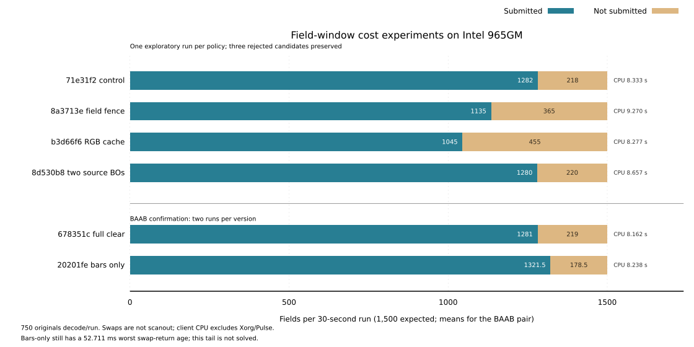
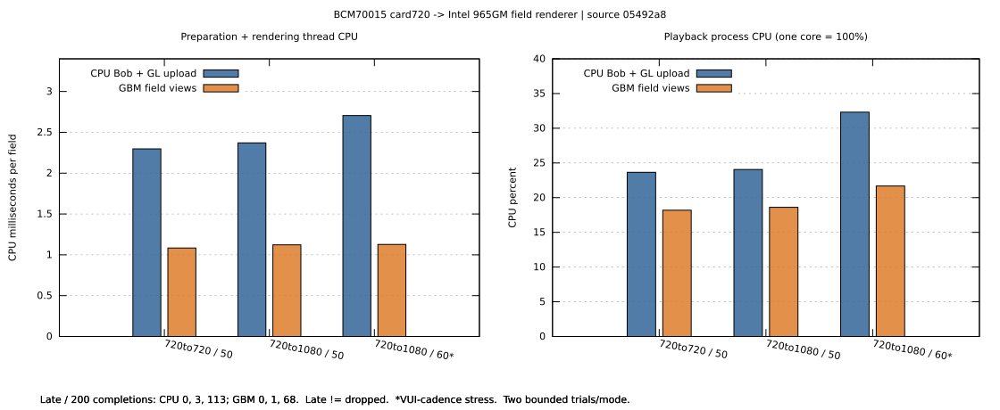

# GPU field-view probe

[#530](https://github.com/ahnhy1324/crystalhd/issues/530) first-stage results:
[source-qualified measurements and failed controls](egl-field-views-20261027.json).
The first stage is a synthetic experiment on Intel 965GM. The subsequent
native integration below uses real CrystalHD output. Neither stage qualifies
a supported frontend, VA Bob replacement or physical presentation.

## Experimental window consumer

`filters/gst/field-output` is an explicit-build, rank-NONE GStreamer sink;
there is no install target. It reuses the field-view helper and one GBM
transfer per picture. One worker owns XCB/EGL, retains the source through
both field uses, and cancels its clock wait on flushing/close. GPU fitting
uses physical-nearest Bob and preserves the input pixel aspect ratio.

The research Player can select it without changing saved settings:

```sh
make -C filters/gst/field-output
field_plugins="$PWD/filters/gst/field-output"
GST_PLUGIN_PATH_1_0="$field_plugins${GST_PLUGIN_PATH_1_0:+:$GST_PLUGIN_PATH_1_0}" \
    scripts/crystalhd-play --video-output field-gpu --scale-width 1280 \
    --software-output-size native /absolute/path/to/video.mkv
```

Run from the source root with a separately qualified CrystalHD GStreamer
decoder/library available. This leaves the default output unchanged. The
sink consumes limited-range YUY2 with BT.601/709 colorimetry. It accepts
progressive or paired fields; ONEFIELD/RFF, reverse playback and live window
replacement are unqualified. It does not add a Kick/readiness policy.

Space, arrows and Q/Escape send application control messages handled by our
Player; F11 toggles its managed window. `GstVideoOverlay` can embed a window
provided before READY; paused expose/resize redraws retain the last field.
Nominal field targets follow pipeline running time, latency and timestamp
offset, including an audio-selected clock. Swaps are submitted with the
reported render lead because a vsynced swap queues/throttles presentation.
Expired fields are skipped, and the sink's lateness limit may drop late
whole buffers. Both counts are reported rather than accumulating an A/V
backlog. Default whole-picture QoS feedback upstream is disabled: each
decoded pair must reach its actual field-deadline owner first.
GPU completion/swap return, including early/late counters, is not physical
scanout or proof of speaker synchronization. `field-stats` distinguishes
timed fields, preroll/redraw, cancellation and retained resources.

`tests/gst-field-output.cpp` exercises window RGB orientation/color/field
identity, EOS/reopen and cancellation. `--card FILE` separately requires a
50-picture H.264 fixture and the real decoder. Synthetic checks are not card,
audio or physical acceptance. This consumer remains experimental.

[Window results](window-field-output-20261027.json) qualify code `915e819`:
36 full RGB comparisons pass (BT.601/709, both parities and progressive,
two source generations, three geometries; maximum error 1/255). Three
synthetic EOS/reopen runs and a second-field wait cancellation retire all
owned resources; the cancellation closes in 28.3 ms. Player tests: 97 PASS.

Real 30-second H.264/AAC playback selects `GstPulseSinkClock`, decodes 750
pictures and delivers 1,408 audio buffers through PulseSink. Automated
pause/resume, forward/backward seek and 0.5×/1×/2× playback reach EOS and clean
close. The maintainer confirms physical A/V, speed/motion, then the actual
window's pause/seek controls without persistent black/stall. An earlier
unobserved control replay remains NOT RUN, not a second acceptance result.

The initial audio-clocked consumer accumulated 3.25 s maximum swap age.
Cost observations exposed refresh throttling after the late swap request.
Earlier swap submission plus expiry/QoS bounds the subsequent ordinary run
to 25.6 ms maximum swap age, with **229/1,500 field skips (15.27%)**. The
fullscreen physical run skips **348/1,500 (23.2%)**. These combined policy
changes are not an isolated GPU speedup measurement or lossless 50/60-field
qualification. Draw timings can include backbuffer acquisition/throttling;
swap return is not scanout. A/V confirmation is subjective, not numeric E2E.

Retaining and reopening the raw H.264 parser graph produces nonmonotonic
early PTS (`0, 80, 120, 120 ms`) in both software and CrystalHD output.
A two-buffer queue does not fix this counterexample. Counts/EOS/resource
checks alone do not make its cadence pass, and the sink does not rewrite
these PTS. Timestamped-container playback above is a separate observation.
Live input, NV12, native i386, long endurance and physical scanout timing
remain unqualified. The installed module, PM, links, pins and AER boundaries
are unchanged; finite playback does not advance #533's nonempty-drain gate.

### Completion and deadline ownership follow-up

[`678351c` results](field-retirement-20261027.json) retain the controlled
completion experiment, failed observers and final qualification. Field draws
now queue with `glFlush`; `glFinish` remains at source retirement, including
exception cleanup, before destroying views, releasing the original sample
or writing the BO again. Forty-four full RGB checks pass, including eight
two-field/FHD-output checks that replace the producer only after retirement.
Three EOS/reopen runs and cancellation close cleanly; 98 Player tests pass.

The final comparison uses ABBA order, two 30-second arms per version, the
same real audio clock and matched 1024×768 fullscreen area. All four decode
750 pictures, deliver all 1,500 fields to the sink and finish with EOS and
zero owned resources. CPU includes Player preroll/close and identical Python
observers; Xorg/audio-server CPU and energy are excluded.

| Metric | `915e819` | `678351c` |
| --- | ---: | ---: |
| Mean client CPU time | 10.748 s | 10.207 s |
| Mean field submissions / 1,500 expected | 1,154 | 1,309.5 |
| Non-submitted fields | 23.07% | 12.70% |
| Worst observed swap-return clock age | 20.675 ms | 52.026 ms |

This bounded comparison has 5.03% lower client CPU and 13.47% more submissions;
it does **not** establish lower latency or lossless presentation. The earlier
small-window comparison changes CPU by only 0.52%, within run variability.

The intermediate upstream QoS policy delivered only 734 of 750 decoded
pictures to this sink: a converter's normal whole-picture QoS handling
dropped 16. The final policy preserves all 750 pairs, then applies local
field expiry/lateness. In the separate diagnostic run, 1,311 submissions +
189 expired fields account for all 1,500; no upstream picture is lost.

The Player also now snapshots BaseSink drops **before** NULL resets them.
A native device-free regression reproduces the old false-zero report and
passes after correction. The count is since the last reset, particularly
after seeks; it is not combined with cumulative field counts as though both
cover the same interval. Automatic pause/seek/0.5×/1×/2×/close passes and
preserves the actual final sink-drop snapshot (23). The original post-NULL
zeros, rejected fullscreen request, initial allocation race and transient
global pin snapshot remain archived. Three final quiescent boundary reads
match the starting state and the scoped kernel error scan is clear.

For the same bounded 30-second/750-picture fixture, use a new results file
outside the source tree and the separately qualified decoder/library
environment. The benchmark verifies the loaded field plugin and actual
fullscreen allocation; it mutes only its audio stream:

```sh
field_plugins="$PWD/filters/gst/field-output"
GST_PLUGIN_PATH_1_0="$field_plugins${GST_PLUGIN_PATH_1_0:+:$GST_PLUGIN_PATH_1_0}" \
    python3 tests/gst-field-output-bench.py /absolute/path/to/fixture.mkv \
    --results /absolute/path/to/new-results.json \
    --expected-plugin "$field_plugins/libgstcrystalhdfield.so" \
    --label local-build --fullscreen
```

The maintainer's physical A/V/control PASS remains scoped to `915e819`.
Physical confirmation of the new completion/deadline policy is **NOT RUN**;
audio-clock equality and automated playback do not replace it. This remains
an optional research output with no installed/default or VA-contract change.

### Swap-stall attribution and redundant clears

[`20201fe` results and rejected policies](swap-tail-20261027.json) distinguish
clock age from actual blocking: the diagnostic control spends **52.930 ms
inside `eglSwapBuffers`** at its worst event. This is not purely an audio-clock
reporting difference; the precise rendering/presentation cause remains open.

Three bounded alternatives were not adopted: per-field completion fences
lower age by omitting more fields; a full-picture RGB cache worsens both count
and age; two producer BOs eliminate retirement waits but move that time into
swap, without increasing submissions. Their code revisions, pixel proofs and
original results remain in the receipt. The final path keeps single-source
retirement and clears only the bars around the opaque video draw. It still
replaces every window pixel, including after resize; it adds no user option.

Matched BAAB uses the same 30-second fixture, real audio clock and fullscreen
geometry, with two runs per version:

| Metric | `678351c` full clear | `20201fe` bars only |
| --- | ---: | ---: |
| Mean submissions / 1,500 expected | 1,281 | 1,321.5 |
| Non-submitted fields | 14.6% | 11.9% |
| Mean client CPU time | 8.162 s | 8.238 s |
| Worst observed swap-return clock age | 68.167 ms | 52.711 ms |

This sample has 3.16% more submissions; the 0.93% CPU increase is small and
does not establish a CPU saving. The remaining roughly 53 ms tail is **not
solved**, and two repetitions do not establish a latency bound. Forty-seven
RGB/retirement/border checks, three EOS/reopens and clock-wait cancellation
pass; final owned resources are zero. Physical A/V for this source is NOT RUN.



## Offscreen EGL field-view probe

One immutable linear YUYV allocation supplies top/bottom EGLImages with
offsets 0/S, pitch 2S and height H/2. Both field uses complete before source
retirement. Two differently patterned allocations alternate by picture;
both parities and TFF/BFF order are checked. CPU producer cache writeback is
specific to this heap test, not a requirement inferred for direct card RX.

The independent per-pixel BT.709 RGB oracle checks physical nearest Bob:
preserve original field-line positions, choose the following line on a
missing-line tie and clamp edges. It differs from the origin-aligned VA
row-duplication helper. At 720→FHD, neighboring output pixels can use different
source chroma pairs, so the oracle does not repack expected output as YUYV.
All 32 final preflight comparisons pass with maximum error 1/255, tolerance 2.
Nearest sampling uses an interior bias derived for each scale ratio;
linear filtering remains unqualified. The intermediate FHD shader rounding
failure at `32db394` and its correction at `c4af844` are retained.

| Source → GPU output | Fields/s | Field-view completions | Late completions | Mean draw + wait | Mean client CPU/field |
| --- | ---: | ---: | ---: | ---: | ---: |
| 720 → 720 (`77d42a7`) | 50 | 400 | 0 | 7.093 ms | 0.410 ms |
| 720 → 720 (`77d42a7`) | 60 | 400 | 0 | 7.040 ms | 0.400 ms |
| FHD → FHD (`77d42a7`) | 50 | 400 | 1 | 15.605 ms | 0.413 ms |
| FHD → FHD (`77d42a7`) | 60 | 400 | 240 | 16.116 ms | 0.376 ms |
| 720 → FHD (`c4af844`) | 50 | 400 | 0 | 14.254 ms | 0.405 ms |
| 720 → FHD (`c4af844`) | 60 | 400 | 67 | 14.695 ms | 0.386 ms |

Each row comprises four bounded arms of 100 fields, two per field order.
Every field is submitted and completed: **late is not dropped**. Late means
completion after the next field's due time. At 720→FHD60, maximum age is
35.743 ms; this is not a lossless 60-field result. Full-image parity shaders
are slower (about 22.9 ms at scaled FHD, all 400 late at each rate).

Earlier same-size CPU row-copy + packed GL upload comparisons and the slower
per-fragment coordinate shader remain in the JSON. They are synthetic
controls, not measurements of the complete production VA/GStreamer path.
There is no CPU-scaler comparison for the scaled case. Source generation,
cache writeback, shader setup and RGB readback are outside the clocked arms.
No frame PTS, decoder readiness, scanout, physical A/V or energy is measured.

From the source root, with EGL/GLES2/GBM/libdrm development packages:

```sh
c++ -std=c++17 -O2 -Wall -Wextra -Werror tests/egl-field-views.cpp \
    $(pkg-config --cflags --libs egl glesv2 gbm libdrm) -o /tmp/chd-field-views
sudo /tmp/chd-field-views
sudo /tmp/chd-field-views --fields 100 --scaled-only
```

The first command run checks pixels at all four geometries. Omit
`--scaled-only` for all clocked geometries; counts must be even and at most
180 per arm. The probe needs Intel `/dev/dri/renderD128`, DMA-heap access,
x86 CLFLUSH/MFENCE, start temperature below 75°C and runtime below 85°C.
Run without concurrent playback or benchmarks.

Native source generation/lifetime, field PTS/media clock, decode-progress
policy, EOS/seek/reopen, NV12 and physical A/V need separate proof. Removing
CPU Bob does not inherit the VA-only auxiliary Kick trigger. No card, module,
firmware, default or ABI was changed by these runs.

On this recorded source, GStreamer's `gst_crystalhd_handle_frame` submits the
real AU through `DtsProcInput`; its finite drain uses `DtsFlushInput(0)`.
It has no VA-style Prefix/Auxiliary policy. In contrast, VA's
`TryH264Auxiliary` requires Bob demand, 100 ms idle and the existing syntax,
generation and ownership predicates. Native integration must qualify its
actual producer/readiness owner rather than transplanting or assuming that
trigger. This is source inspection, not a new runtime or Kick measurement.

## Native finite-file integration

[`gst-field-views.cpp`](../../gst-field-views.cpp) connects the existing
GStreamer decoder to the shared field renderer: BCM70015 → assembled YUY2 →
one owned GBM transfer → two field EGLImages → offscreen GPU output. The
card-to-Gst public copy remains. Each source sample and BO generation stay
owned through both GPU completions; images retire before the next write.
The first actual source is prepared during PAUSED preroll, with one extra
GPU use counted separately from unique timed fields. Output PTS are unchanged.

The final GBM path runs as an ordinary user with card/render-node access.
GBM map/unmap supplies its coherency boundary, including any internal staging
cost, without the heap producer's explicit CLFLUSH. The linear four-byte-pair
storage is imported as YUYV; this is byte layout, not CPU color conversion.
The final BFF/720→FHD proof checks all 50 distinct pictures/100 fields at
maximum RGB error 1/255. Earlier CPU/TFF/BFF proofs remain source-qualified
in the [native receipt](native-field-views-20261027.json).



Final timing source `05492a8`, two 50-picture trials per path in ABBA order:

| Card720 → output; fields/s | Renderer-thread CPU reduction | Playback-process CPU reduction | Late fields, CPU / GBM (each /200) |
| --- | ---: | ---: | ---: |
| 720; 50 | 52.8% | 23.1% | 0 / 0 |
| FHD; 50 | 52.7% | 22.7% | 3 / 1 |
| FHD; 60 cadence stress | 58.3% | 33.0% | 113 / 68 |

Every run completes 50 pictures/100 distinct field uses and natural EOS;
late completions are retained, not dropped. FHD60 has no lossless-deadline
qualification. The 60-field input is a separate VUI-cadence fixture: all
50 VCL payloads/order remain identical, while GStreamer negotiates 30
pictures/s. It is not representative newly encoded 30fps motion content.
Peak RSS in the final matrix is about 154–156 MiB; no power result is claimed.

Both paths use the same physical-nearest field reference and output size.
The CPU control materializes source-size rows and uploads a packed texture; GBM imports
field views. Renderer-thread CPU includes preparation/copy/map/cache/import
and drawing. Playback-process CPU includes decoder/assembly and observers,
but excludes initialization/preroll. Full main lifetime through NULL is
reported separately. These are short headless completion measurements;
physical A/V, scanout, E2E and steady-state endurance remain unqualified.

Full-image RGB checks run separately from timing. The timed observer samples
three YUYV pairs on every active row and compares 50 unique ordered signatures
across arms; it is explicitly sparse, not a full-image hash. Earlier dual-SHA
timed runs, cold first-field work, per-picture thermal-read overhead, and the
rejected GBM bo-write creation flag remain in the receipt. The 85°C stop
threshold is unchanged; thermal sampling is bounded at 250 ms.

Build from the source root with GStreamer app/video development packages:

```sh
c++ -std=c++17 -O2 -Wall -Wextra -Werror tests/gst-field-views.cpp \
    $(pkg-config --cflags --libs gstreamer-app-1.0 gstreamer-video-1.0 \
      egl glesv2 gbm libdrm) -ldl -o /tmp/chd-gst-field-views
/tmp/chd-gst-field-views /absolute/path/to/1080i25-50.h264 \
    50 1280 1080 field verify
/tmp/chd-gst-field-views /absolute/path/to/1080i25-50.h264 \
    50 1280 1080 field clocked
```

Use an independently counted, supported Annex-B H.264 MBAFF fixture and an
idle card. `cpu` selects the matched materialization control. The helper
prints actual loaded library/plugin identities and checks live-process
device FD retirement after NULL. It registers no player output or installed
plugin. Native i386, seek/flush/reopen, network/live input, physical playback
and broader geometry/color support require separate qualification.
