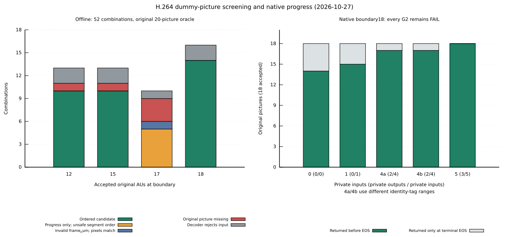
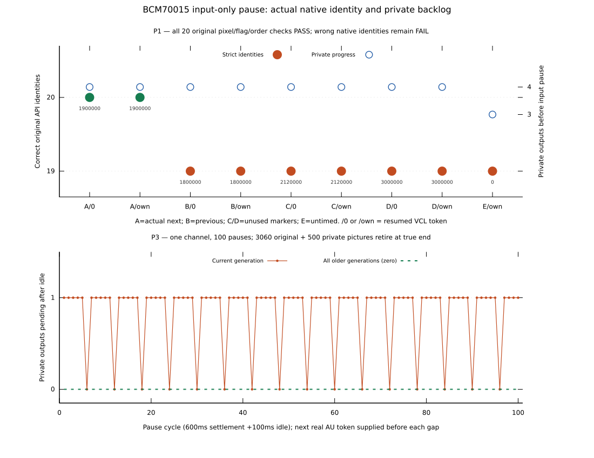
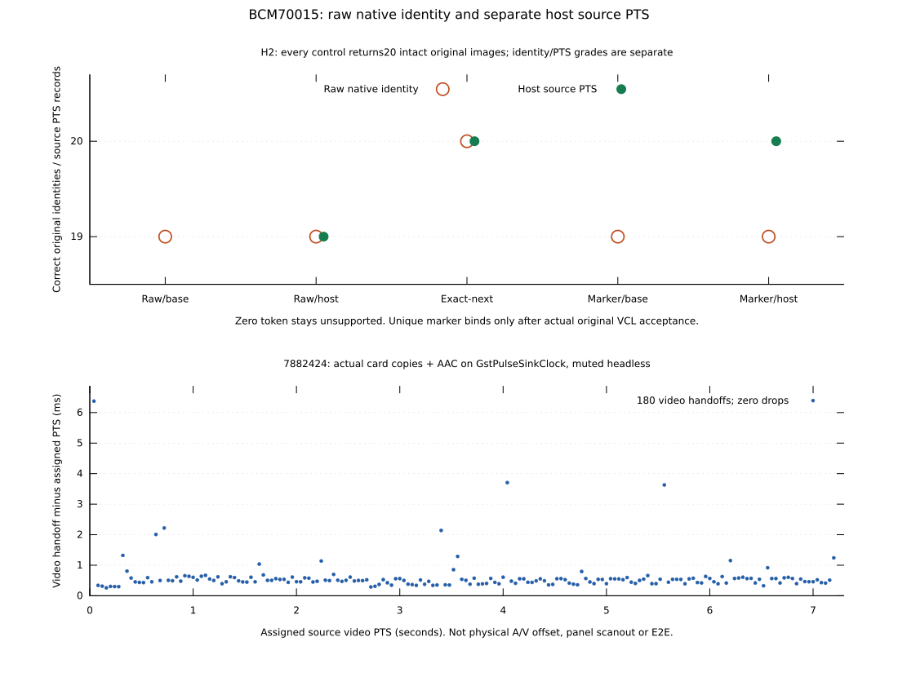
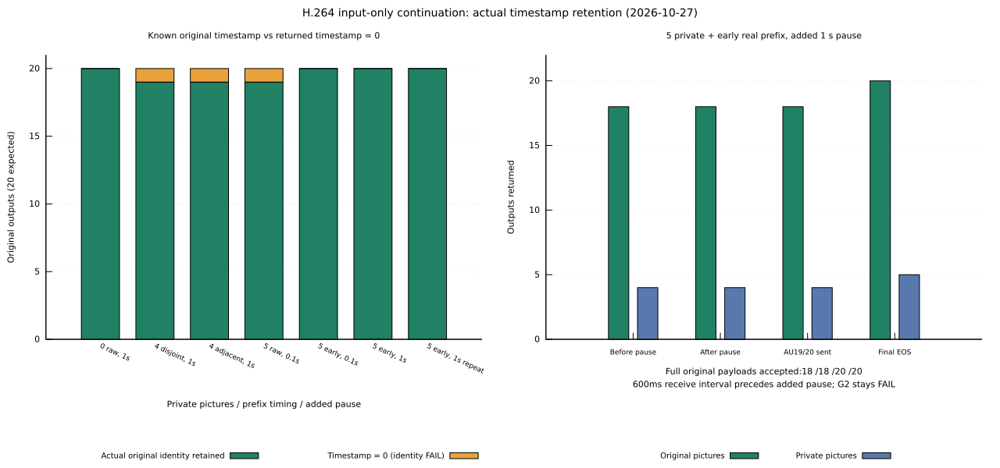

# V4L2 buffer sharing experiment

This opt-in BCM70015 progressive H.264 prototype tests card CAPTURE → EXPBUF →
EGL/GPU rendering against two host copies plus GL upload, following
[#531](https://github.com/ahnhy1324/crystalhd/issues/531). It reuses unmerged
[#115](https://github.com/ahnhy1324/crystalhd/pull/115). Nonempty drained START
still returns `EOPNOTSUPP` for the
[#114 reference-state limitation](https://github.com/ahnhy1324/crystalhd/issues/114);
the Kick/continuation gates in #533 remain separate.

[Memory/render proof](yuy2-interop-20261026.json) and
[native CAPTURE results](native-capture-20261026.json) retain measurements,
source identities, unsuccessful controls and subsequent corrections. The heap
CPU-write proof needed cache writeback; the real CAPTURE GPU consumer performs
neither CPU writes nor cache flushes. The two producers must be distinguished.

## Results

Kernel 7.0.0-38, Mesa 26.0.8, Intel 965GM; six-second 30p H.264 High/B2 fixtures.
Mean render CPU from two arms per mode, in upload/direct/direct/upload order:

| Output | Two copies + GL upload | Direct CAPTURE import | Render CPU reduction |
| --- | ---: | ---: | ---: |
| 640×360 | 0.873 ms/frame | 1.133 ms/frame | **29.8% worse** |
| 1280×720 | 3.675 ms/frame | 1.149 ms/frame | 68.7% |
| 1920×1080 | 8.640 ms/frame | 1.147 ms/frame | 86.7% |

These are render-stage savings. Whole-process CPU in the probe with three SHA
observers decreased only 4.95% at 720p and 6.47% at FHD; 640×360 increased 2.24%.
All 15 cases completed 2,700 pictures with ordered PTS, frozen YUYV and genuine
LAST/EPIPE. The 540 full-frame GPU RGB checks passed at maximum error 1/255
(fixed tolerance 2). Peak temperature was 79°C; starts required less than 75°C.

Performance results retain runtime `4667d31`. Later fixes were qualified
functionally on `830170b`, preserving earlier failures:

- File-owned ioctl handles replace the NULL reserved callback argument used
  by modern kernels; the original port fault and reboot recovery are retained.
- Bounded TX retries use 2 ms instead of a fixed 100 ms host stall. Measured
  median retry time fell from 100.804 to 2.898 ms; absolute deadlines,
  cancellation and legacy 100 ms behavior remain intact.
- Client CAPTURE capacity and index tracking cover up to 32 buffers, separately
  from hardware admission. During drain, one existing queued credit remains
  available until real pictures retire, then receives the genuine EOS marker.
  The capacity-only and index-only intermediate failures remain recorded.

On the final code, unmodified FFmpeg 8.0.1 decoded all 180 pictures with matching
YUYV at each size using default `h264_v4l2m2m` decoder options. Earlier 720p/FHD
runs returned exit 0 with only 79/69 pictures and remain **FAIL**. The final code
also passed 360 pictures with a two-buffer pool and explicit reset recovery,
180 GPU-checked pictures with 32 buffers, legacy/native ownership exclusion,
and 141 real ioctl/MMAP/EXPBUF checks in each ILP32 and LP64 process.
All successful matrix and final cases restored the original 3.10.13 module
and idle/PM/AER state; the first failed port required the recorded reboot.

The benchmark uses 12 buffers with immediate requeue; its results were not
relabeled after the larger-pool and final-credit fixes. Physical A/V, energy,
maximum decoder FPS, native i686/non-SSE playback, other codecs, arbitrary color
metadata and unmodified Kodi integration remain unqualified. This remains an
experimental backend with the nonempty STOP/START limitation above.

## Reproduce

Work from the repository root in a dedicated test session, following the
[idle/recovery prerequisites](../../../BRINGUP.md). Build the experimental
module separately; this does not install or replace the loaded module:

```sh
make -C "/lib/modules/$(uname -r)/build" \
    M="$PWD/driver/linux" CRYSTALHD_V4L2=1 W=1 -j2 modules
```

With that module temporarily loaded under the controlled recovery procedure,
select its QUERYCAP-identified video node. The native probe needs FFmpeg
development libraries; GPU mode additionally needs EGL, GLES2, GBM and libdrm
development libraries and an Intel render node at `/dev/dri/renderD128`.
Use a local progressive H.264 fixture interpreted as limited-range BT.709:

```sh
CRYSTALHD_TEST_GPU=1 sh tests/v4l2-decode.sh \
    --device /dev/video0 --input /absolute/path/to/fixture.mp4 \
    --gpu-check --timeout 90
```

`--gpu-check` checks every image against an independent RGB conversion.
`--gpu-render` draws exported buffers directly; `--gpu-upload` performs two host
copies and packed-texture upload. All retain count, ordered PTS, LAST/EPIPE and
pixel-hash observers. Use `--capture-buffers 2` or `32` for pool boundaries
(default 12). `--repeat 2` checks rejected nonempty START and explicit OUTPUT
STREAMOFF recovery. DMA-BUF export of MMAP buffers works; client DMA-BUF import
through REQBUFS remains unsupported.

Compare upload/direct/direct/upload on the same file without concurrent decode
or tracing. Render timing includes export/import or copies, upload, draw and
`glFinish`; it excludes RGB readback/reference work and shader allocation.
Whole-process time includes initialization, demux, three SHA observers and
drain. Completed draws do not measure physical display or E2E latency.

The stock-FFmpeg full-file check used:

```sh
ffmpeg -nostdin -hide_banner -loglevel verbose \
    -c:v h264_v4l2m2m -i /absolute/path/to/fixture.mp4 -an \
    -c:v rawvideo -pix_fmt yuyv422 -fps_mode passthrough \
    -f hash -hash sha256 -
```

Require the expected picture count and matching decoded pixels, not just exit
0. This checks hardware decode into CPU-visible YUYV; GPU sharing by FFmpeg or
a player is a separate integration question. Application sources and the
installed playback stack were unchanged throughout these experiments.

The standalone heap/render proof requires no card or module:

```sh
c++ -std=c++17 -O2 -Wall -Wextra -Werror \
    $(pkg-config --cflags egl glesv2 gbm libdrm) \
    tests/v4l2-yuy2-interop.cpp \
    $(pkg-config --libs egl glesv2 gbm libdrm) -o /tmp/chd-yuy2-interop
sudo /tmp/chd-yuy2-interop --frames 120
```

It needs `/dev/dma_heap/system` access and x86 CLFLUSH/MFENCE capabilities.
These are probe prerequisites; the driver and `libcrystalhd.so.3` ABI retain
their existing requirements.

## Separate non-destructive Kick discriminator

[The 2026-10-27 G0/G1/G2 record](stop-kick-20261027.json) retains the frozen
17+3-AU experiment, software counterexamples and actual legacy-channel traces.
It does **not** qualify V4L2 STOP/START. The loaded stable 3.10.13 module,
signed firmware and L0s policy were unchanged; idle references, RX pins, PCIe
links and AER returned to their original boundary after every case.

The progressive source is ineligible for the production MBAFF auxiliary
builder. A test-only non-reference I16x16/DC picture with unused PPS254 is
independently software-checked against all 20 original pictures. POC31/33
allows one or two private pictures under the unchanged reorder limit 2;
three exceed it and lose original POC32. Earlier POC35/37 counterexamples are
also preserved. Ineligible cases were not sent to the card.

Before any EOS, no extra input and an untimed AUD/filler delimiter return
12/17 originals; one auxiliary returns 15/17. Prefeeding the actual private
AU's identity, with one or two eligible pictures, still returns **15/17 and
zero private outputs**. G2 therefore **FAILs**. Terminal EOS returns all 17
originals with exact oracle pixels, but is cleanup, not a non-destructive
drain. G3 continuation and G4/G5 integration are **NOT RUN**; no guessed LAST
or successful nonempty START is implemented.

The first checker also rejected private output identity. Follow-up traces
show neutral private pixels with the known Flea 2 ms timestamp quantization:
1750000→1740000 and 1775000→1760000 (100 ns units). Test revision `771c279`
uses exact 2 ms tokens; it was not rerun merely to relabel this diagnostic.
The raw failures remain. Fixing token granularity cannot supply the two
missing pre-EOS originals or make G2 pass. The original destructive-EOS
continuation control was not repeated; #114 remains its historical evidence.

The prefix already contains POC34 while the first continuation has POC32.
Segment completion versus uninterrupted global display order remains a
separate contract question, not silently waived by a pixel match.

For offline G0 only, use the retained Phase 1 `high.mp4` fixture (identity is
checked) and a new output directory outside the source tree:

```sh
python3 -B tests/h264-stop-kick.py /absolute/path/to/high.mp4 \
    /absolute/path/to/new-g0-directory
```

`tests/h264-stop-kick.cpp` is the bounded legacy-channel probe, compiled with
the public headers and `-ldl`. It requires the generated packet container and
an independently captured native reference in a private result directory.
Its `reference`, `none`, `prefix`, `picture`, `prefed-picture`, and
`prefed-pair` modes are research controls, not playback or drain options.
No production syntax predicate, firmware or legacy ioctl behavior changes.

## Input-only idle/resume follow-up

Following [the separate hypothesis](https://github.com/ahnhy1324/crystalhd/issues/533#issuecomment-6429172668),
`28e1116` tests input idle through the existing legacy API. It sends the first
17 original AUs, waits without further input, then sends the actual remaining
three non-IDR AUs on the same handle. There is no Kick, EOS, Stop, reset,
reopen or replay at that boundary. Ordinary terminal EOS follows all 20 AUs.

[Native receipt](input-idle-20261027.json): seven fresh opens / 140 original
pictures, including a new uninterrupted control that matches the retained
oracle byte for byte. The signed firmware, library, module and PM are fixed.
Each of the six idle controls releases 20/20 public RX leases and preserves
every YUYV byte, flag and original token/PTS order. Source POC is associated
by that frozen identity, not read directly from firmware DPB memory.

| Input pause / control | During idle | After real continuation | At terminal EOS | Total |
| --- | ---: | ---: | ---: | ---: |
| 100 ms | 12 | 3 | 5 | 20 |
| 1 s, two fresh sessions | 12 | 3 | 5 | 20 each |
| 1 s without host receiving | 12 after receiving resumes | 3 | 5 | 20 |
| 100 ms after AUs 5/9/13/17 | 0/4/8/12 cumulative | 3 | 5 | 20 |
| 100 ms before the first AU | 0 | 5 | 15 | 20 |


The first 17 AUs include POC34 (AU16); AU18 contains POC32. Holding the boundary preserves
the correct 32-before-34 output order. The empty control is not evidence of a
nonempty zero-reorder case, and host receive withholding is not a V4L2
CAPTURE-starvation qualification. Client/reference/PM/link/AER boundaries
return unchanged. These are bounded fixture results, not endurance or a claim
that pausing an application stops its compressed input.

The probe adds `input-idle-100`, `input-idle-1000`, `input-hold-1000`,
`input-idle-multi` and `input-idle-empty` modes. First run `reference` into a
new private result directory, then use that same directory for comparisons.
The packet fixture and build requirements are unchanged. This establishes
input-idle/resume feasibility; complete-drain G2 remains FAIL and nonempty
drained START remains `EOPNOTSUPP`. Renderer catch-up remains separate.

## Ordered-boundary dummy-picture follow-up

[The source-qualified receipt](dummy-progress-20261027.json) preserves 52
offline combinations and nine native sessions, including four fresh full-file
reference controls. The original 17+3 boundary and its failed G2 are unchanged.
The additional 12/15/18-AU boundaries preserve the original global order;
only combinations within the unchanged reorder restriction admit 3–5 private
pictures to software screening. Of 52 combinations, 40 preserve all 20 original
software pictures, 39 also pass the syntax/reorder screen, and 34 have an
ordered segment boundary. These counts are screening results, not hardware passes.

One invalid repeated-`frame_num` control also preserves every software pixel.
It remains excluded under [H.264 §7.4.3](https://www.itu.int/rec/dologin_pub.asp?id=T-REC-H.264-201201-S%21%21PDF-E&lang=e&type=items):
this progressive no-gap fixture requires the next reference-relative number.
SPS/PPS0, original AU bytes and original identities are untouched; private
non-reference I16x16/DC pictures use PPS254. Reuse the generated G0 directory:

```sh
python3 -B tests/h264-dummy-matrix.py /absolute/path/to/frozen-g0-directory \
    /absolute/path/to/new-offline-matrix
```

At the separately ordered 18-AU boundary, a 600 ms receive phase gives:

| Accepted private pictures | Original pictures before EOS | Private outputs before EOS |
| --- | ---: | ---: |
| 0 | 14/18 | 0/0 |
| 1 | 15/18 | 0/1 |
| 4, two distinct tag placements | 17/18 | 2/4 |
| 5 | **18/18** | **3/5** |

Four pictures leave original POC34 pending; five advance every accepted
original, but two private outputs still require terminal EOS. **G2 remains
FAIL; subsequent non-IDR continuation is NOT RUN.** This establishes limited
output progress, not a complete non-destructive drain or transparent state.
All 170 original and 14 private outputs retire at cleanup, original pixels,
flags and prefix order match, and kernel/ref/pin/PM/link/AER checks pass.
No physical A/V, PPB lease, production policy or #114/#115 change is implied.

The bounded native probe adds `matrix BOUNDARY PRIVATE_COUNT` after its two
directory arguments. Only 12/15/18 and counts 0–5 are admitted; selected inputs
must first pass the offline screen, with the existing packet/prefix files,
the corresponding `kickN.h264` and a fresh native reference. The final probe
reserves distinct 2 ms private identity tags beyond all original tokens; these
are synthetic diagnostic tags, not presentation timestamps. The receipt keeps
the earlier four-picture tag control separately. Terminal EOS is cleanup and
never supplies pre-EOS completion credit.



## Input-only continuation after private progress

The [requested follow-up](https://github.com/ahnhy1324/crystalhd/issues/533#issuecomment-6434700798)
is measured separately in the [continuation receipt](dummy-input-resume-20261027.json),
with original AU19/20 on the same handle and EOS only after all 20 full original
payloads. The raw **18-real/3-private** boundary fails timestamp retention:
AU19's full pixels and flags match the oracle, but its returned timestamp is 0.
Diagnostic pixel matching never repairs that identity or turns the failure into
a PASS. Late prefixes and repeated PTS fail too; all failures are retained.

Binding AU19's original timestamp to its prefix **before** the idle gap works.
This distinct variant returns **18 real/4 private** before pause; AU19's VCL
bytes remain unsubmitted until resume, when its payload consumes the prefed
timestamp. Its codec bytes and original timestamp values are unchanged.

| Input-only control | Before pause: real/private | Final original identity/pixels/flags/order |
| --- | ---: | --- |
| No private picture, added 1 s pause | 14/0 | 20/20 PASS |
| Four private pictures, either tag range, added 1 s | 17/2 | FAIL: AU19 timestamp 0 |
| Five private pictures, raw added 100 ms | 18/3 | FAIL: AU19 timestamp 0 |
| Five + early AU19 prefix, added 100 ms / 1 s / repeated 1 s | 18/4 | **20/20 PASS on each; all 5 private outputs retire** |

Each added pause follows the same 600 ms receive/verification interval. The
three successful total compressed-input gaps are **700.387/1600.448/1602.125 ms**;
these are not 100/1000 ms total gaps. No EOS or channel restart occurs at pause.
The native API tokens are frozen diagnostic identities; the receipt separately
maps the original media PTS/POC. This is not a physical A/V measurement.

The probe adds `matrix-idle-100` and `matrix-idle-1000` with boundary 18 and
private counts 0/4/5. An optional final research control is `raw` (default),
`adjacent` (four private tags), or `prefed` (early actual-next-AU prefix):

```sh
/path/to/h264-stop-kick /absolute/path/to/prepared-inputs \
    /absolute/path/to/private-reference-results matrix-idle-1000 18 5 prefed
```

## Early timestamp ownership and repeated input pause

The [follow-up request](https://github.com/ahnhy1324/crystalhd/issues/533#issuecomment-6436004320)
is measured in two separate source-qualified probes: `2c27857` for the
[early-token matrix](early-token-20261027.json), and `d6edf35` for
[complete-sequence screening and repeated pause](input-cycles-20261027.json).
The previous 20-picture native oracle is reused; a new uninterrupted
180-picture oracle also preserves every one of its original images/flags.

Every tested nonzero early prefix advances four of five private outputs.
That does **not** make an arbitrary marker safe: original AU19 returns the early
prefix's token, even when its resumed VCL carries its correct original token.
Within these controls, only its exact original early token preserves all
20 native identities.
Pixels/flags/order pass in all nine controls; a wrong returned token remains
FAIL, including the duplicate previous-real token. The untimed control still
returns AU19 with token 0. No pixel-based retagging is performed.

| Early prefix | Resumed AU19 token | AU19 actually returned | Strict identity |
| --- | --- | --- | --- |
| Actual AU19: 1900000 | 0 / 1900000 | 1900000 / 1900000 | PASS / PASS |
| Previous AU18: 1800000 | 0 / 1900000 | 1800000 / 1800000 | FAIL / FAIL |
| Reserved: 2120000 | 0 / 1900000 | 2120000 / 2120000 | FAIL / FAIL |
| Reserved: 3000000 | 0 / 1900000 | 3000000 / 3000000 | FAIL / FAIL |
| Untimed: 0 | 1900000 | 0 | FAIL; known raw control |

These are diagnostic API identities, not calibrated media timestamps. The
actual-next-token requirement remains for this strict native gate.
Assigning one token to several private pictures is NOT RUN:
their identical DC128 images do not independently identify those source
pictures once private tokens collide. The optional last-private-prefix arm
is also NOT RUN; the current observer rejects a nonneutral original image
with a private-range token. This is an instrumentation boundary, not proof
that such a control is unmeasurable. No generic marker qualifies for
strict-native-identity cycling. The separate host-source-PTS study below
retains that native FAIL.

**The frozen 18+5 placement cannot be copied into a complete GOP.** Adding
the remaining original B pictures raises its required reorder bound to 4,
above the unchanged limit 2. It was rejected offline. The new
`tests/h264-pause-cycles.py` screens every insertion against its complete GOP,
then strictly software-decodes the entire combined stream, including the
actual AUD/filler prefix transport. Original AU bytes/source PTS, references,
SPS reorder/buffering limits and signed firmware stay unchanged. This is a
syntax-envelope/software screen, not a general conformance or PPB proof.

Six independently qualified positions include source boundary 82 before a
non-IDR AU; the other selected positions precede IDRs. No-dummy and
exact-next-prefix candidates each pass **2, 5, 10 and 100** pauses on their
original physical channel, with no EOS/reset/reopen between pauses. At 100:
3,060 originals pass exact native tokens/full YUYV/flags/order in each arm;
the candidate also retires all 500 distinct private outputs. Source copies
repeat the original 180 AUs; diagnostic identity generations are separate
from their unchanged per-copy source media PTS.

At every candidate idle checkpoint, all accepted originals have returned.
There are 84 checkpoints with one current private output pending and 16 with
none, at source-copy boundaries. Older private generations never remain at
those checkpoints; later original input retires the pending picture.
This does not change the frozen G2 FAIL or establish general LAST/EPIPE or
nonempty STOP/START. For ordinary pause, prefer **no-dummy input idle/resume**;
it does not require a completed drain or next-AU lookahead.

The [compact native trace](input-cycles-20261027.jsonl) retains every input,
actual returned token/flag, whole-reference comparison, RX acquire/release and
phase census. Its header defines columns; private generation IDs remain
distinct. All 18 fresh sessions retire 8,550 observed RX outputs, preserve
module/ref/pin/PM/link/AER boundaries and pass scoped kernel checks; peak 69°C.
The deliberate pauses are 600 ms settlement plus 100 ms idle. Logged latency
is input-call-return to verified output observation, including intentional
input waiting; it is not decoder-only time, live throughput, scanout or E2E.



From the source root, build the probe and prepare a **new directory outside
the source tree**, retaining the frozen G0 inputs. All example paths are
user-selected absolute paths; create the probe's parent directory first.

```sh
g++ -std=c++17 -O2 -Wall -Wextra -Werror -Iinclude \
    -Ilinux_lib/libcrystalhd tests/h264-stop-kick.cpp -ldl \
    -o "/absolute/path/to/h264-stop-kick"
python3 -B tests/h264-pause-cycles.py "/absolute/path/to/high.mp4" \
    "/absolute/path/to/frozen-g0" "/absolute/path/to/new-cycle-inputs"
```

After the existing idle/thermal/identity prerequisites, `cycles-reference 0`
captures `native-cycle-reference.bin` in a private result directory.
`cycles-none 2` and `cycles-next 2` use that same oracle; keep their stdout as
separate traces. Advance to `5`, `10`, then `100` only after both preceding
arms pass. Each command takes input directory, result directory, mode and
count; explicitly select the pinned library with `CRYSTALHD_LEGACY_LIB`.
The `pts-preflight 18 5 POLICY zero|own` mode reads inputs/oracle without
loading a library or opening a device; `pts-idle` performs its bounded native
counterpart. Policies are `next`, `previous`, `reserved-near`, `reserved-far`
and `untimed`. These are experimental probe modes, not player options.

The result identifies an input-transport requirement, not the firmware
instruction that selects a timestamp owner. No new physical A/V,
i686/non-SSE playback, energy or endurance qualification;
no production helper/default, firmware, ABI or external-application change.

## Host source PTS with a reserved native owner

The [separate host-metadata proposal](https://github.com/ahnhy1324/crystalhd/issues/533#issuecomment-6436305327)
has a narrow positive result. A fresh, collision-free native marker can be
reserved **without knowing the next original PTS**. Only after the actual
next original VCL is accepted does the host bind that marker to its saved
source AU/PTS/DTS/timebase. A returned marker then selects that record;
the raw firmware token remains unchanged. Private owners are hidden. Zero,
duplicate, stale, unbound or colliding owners stop metadata publication.
Image hashes, POC rank, picture ordinal and output FIFO position never select
the runtime association. Token 0 remains **UNSUPPORTED**, even with only one
original record left; the first post-resume output can still be private.

[Source-qualified receipt and API audit](host-source-pts-20261027.json),
[actual input/output/RX/host-projection trace](host-source-pts-20261027.jsonl).

| Check | Result and scope |
| --- | --- |
| H0/H1 | Six existing controls map all 20 source PTS offline; previous-real collisions and token 0 fail closed. |
| H2 | Fresh unique-marker native control: raw original identity FAIL, **host source PTS 20/20 PASS**, exact original pixels/flags/order and 5 private outputs retired. |
| H3 native | Synthetic GOP 30/30p and natural GOP 24/25p each pass 2/5/10/100 pauses on one channel. At 100, each maps 3,060 originals and retires 500 private outputs; raw markers remain diagnostic. |
| Source PTS variants | Whole 100-cycle traces replay duplicate/missing/nonmonotonic/wrapped caller metadata **offline only**. Missing PTS stays absent; no inferred timestamp or playback-clock claim. |
| Audio clock | Actual card picture copies plus the MP4's AAC use `GstPulseSinkClock`: 180 video renders, 0 drops, 10 private pictures hidden, natural EOS and clean close. Muted headless test. |
| Physical A/V | NOT RUN; screen/speaker confirmation remains separate from automatic clock scheduling. |
| Consumer errors | Closed/stalled output consumers reach normal cleanup; native deadline bounds the stalled pipe. A fresh 180-picture reopen exactly matches the pre-failure oracle. |

H2 measures mapper `fa1c029` with native probe `2c27857`. H3 uses
`bf05401`, with independently screened natural input from `8e2bd8b`.
Final audio-clock/export qualification is `7882424`; metadata replays use
`4993f37`. Earlier `932c3ed` controls retain their original scope. Focused
Astra review found missing media/timebase binding and a blocking export
write that bypassed the native deadline. Both are fixed and rechecked:
explicit source/remux identity, actual timebase validation, nonblocking pipe
writes and deadline-aware polling. The new error controls preserve their
intentional incomplete decode; cleanup is their acceptance criterion.



`tests/h264-host-pts-map.py` and `tests/h264-host-pts-replay.py` are device-free
mapping/replay tools. `tests/h264-host-pts-player.py` is a separate research
frontend. Its native probe copies actual returned pixels before RX release
and transfers only that owned copy afterwards. The frontend feeds saved
source PTS and packet durations to GStreamer through `appsrc`.
The qualified source must be progressive 640×360 H.264/AAC with 180 original
pictures. After preparing the existing input/oracle prerequisites:

```sh
python3 -B tests/h264-host-pts-player.py \
    "/absolute/path/to/qualified-cycle-inputs" \
    "/absolute/path/to/native-cycle-reference.bin" \
    "/absolute/path/to/qualified-h264-aac.mp4" \
    "/absolute/path/to/new-results" \
    --probe "/absolute/path/to/h264-stop-kick" \
    --library "/absolute/path/to/libcrystalhd.so.3" --headless
```

The media must match the input qualification's content and timebase. A
separately verified video-identical/AAC-prefix remux needs an explicit
`--media-manifest` descriptor, with the source/selected-file identities and
packet relation shown in the receipt. The player never generates or selects
that descriptor automatically. Results and temporary media stay outside the
source tree; no source clips or user photographs are included here.

This eliminates **source-PTS lookahead** for the measured reserved-owner
strategy, not arbitrary H.264 private-picture eligibility. All inserted
sequences still require their complete offline syntax/software screen.
Interlaced mapping, physical A/V calibration and production integration
remain unqualified. G2 FAIL, nonempty drained START=`EOPNOTSUPP`, and
#114/#115 remain unchanged; no physical PPB lease or standalone MFD claim.

Use the qualified `b18-f11-p31-n5` private payload and the fresh native reference
requirements above. Strict success requires all 20 actual returned tokens,
pixels, flags and original order, plus all private RX releases. Ten reference
controls and the complete 22-session history preserve seven timestamp FAILs
and one changed-state precondition abort. Kernel/ref/pin/PM/link/AER checks pass.

**G2 remains FAIL:** one private output is still pending before terminal EOS.
The raw 18/3 failure remains; the successful 18/4 variant is an experimental
input-pause strategy requiring the actual next timestamp in advance. No LAST,
EPIPE, compliant STOP/START, stock-player adoption or production change follows.


