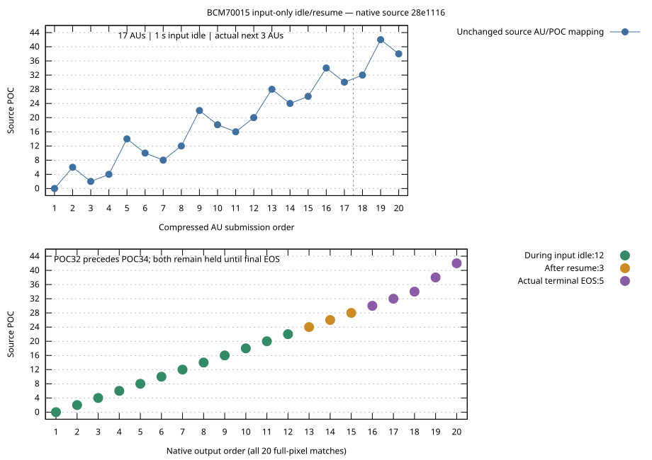

# V4L2 buffer sharing experiment

This opt-in BCM70015 progressive H.264 prototype tests card CAPTURE → EXPBUF →
EGL/GPU rendering against two host copies plus GL upload, following
[#531](https://github.com/ahnhy1324/crystalhd/issues/531). It reuses unmerged
[#115](https://github.com/ahnhy1324/crystalhd/pull/115). Nonempty drained START
still returns `EOPNOTSUPP` for the
[#114 reference-state limitation](https://github.com/ahnhy1324/crystalhd/issues/114);
the Kick/continuation gates in #533 remain separate.

[Memory/render proof](yuy2-interop-20261026.json) and
[native CAPTURE results](native-capture-20261026.json) retain measurements,
source identities, unsuccessful controls and subsequent corrections. The heap
CPU-write proof needed cache writeback; the real CAPTURE GPU consumer performs
neither CPU writes nor cache flushes. The two producers must be distinguished.

## Results

Kernel 7.0.0-38, Mesa 26.0.8, Intel 965GM; six-second 30p H.264 High/B2 fixtures.
Mean render CPU from two arms per mode, in upload/direct/direct/upload order:

| Output | Two copies + GL upload | Direct CAPTURE import | Render CPU reduction |
| --- | ---: | ---: | ---: |
| 640×360 | 0.873 ms/frame | 1.133 ms/frame | **29.8% worse** |
| 1280×720 | 3.675 ms/frame | 1.149 ms/frame | 68.7% |
| 1920×1080 | 8.640 ms/frame | 1.147 ms/frame | 86.7% |

These are render-stage savings. Whole-process CPU in the probe with three SHA
observers decreased only 4.95% at 720p and 6.47% at FHD; 640×360 increased 2.24%.
All 15 cases completed 2,700 pictures with ordered PTS, frozen YUYV and genuine
LAST/EPIPE. The 540 full-frame GPU RGB checks passed at maximum error 1/255
(fixed tolerance 2). Peak temperature was 79°C; starts required less than 75°C.

Performance results retain runtime `4667d31`. Later fixes were qualified
functionally on `830170b`, preserving earlier failures:

- File-owned ioctl handles replace the NULL reserved callback argument used
  by modern kernels; the original port fault and reboot recovery are retained.
- Bounded TX retries use 2 ms instead of a fixed 100 ms host stall. Measured
  median retry time fell from 100.804 to 2.898 ms; absolute deadlines,
  cancellation and legacy 100 ms behavior remain intact.
- Client CAPTURE capacity and index tracking cover up to 32 buffers, separately
  from hardware admission. During drain, one existing queued credit remains
  available until real pictures retire, then receives the genuine EOS marker.
  The capacity-only and index-only intermediate failures remain recorded.

On the final code, unmodified FFmpeg 8.0.1 decoded all 180 pictures with matching
YUYV at each size using default `h264_v4l2m2m` decoder options. Earlier 720p/FHD
runs returned exit 0 with only 79/69 pictures and remain **FAIL**. The final code
also passed 360 pictures with a two-buffer pool and explicit reset recovery,
180 GPU-checked pictures with 32 buffers, legacy/native ownership exclusion,
and 141 real ioctl/MMAP/EXPBUF checks in each ILP32 and LP64 process.
All successful matrix and final cases restored the original 3.10.13 module
and idle/PM/AER state; the first failed port required the recorded reboot.

The benchmark uses 12 buffers with immediate requeue; its results were not
relabeled after the larger-pool and final-credit fixes. Physical A/V, energy,
maximum decoder FPS, native i686/non-SSE playback, other codecs, arbitrary color
metadata and unmodified Kodi integration remain unqualified. This remains an
experimental backend with the nonempty STOP/START limitation above.

## Reproduce

Work from the repository root in a dedicated test session, following the
[idle/recovery prerequisites](../../../BRINGUP.md). Build the experimental
module separately; this does not install or replace the loaded module:

```sh
make -C "/lib/modules/$(uname -r)/build" \
    M="$PWD/driver/linux" CRYSTALHD_V4L2=1 W=1 -j2 modules
```

With that module temporarily loaded under the controlled recovery procedure,
select its QUERYCAP-identified video node. The native probe needs FFmpeg
development libraries; GPU mode additionally needs EGL, GLES2, GBM and libdrm
development libraries and an Intel render node at `/dev/dri/renderD128`.
Use a local progressive H.264 fixture interpreted as limited-range BT.709:

```sh
CRYSTALHD_TEST_GPU=1 sh tests/v4l2-decode.sh \
    --device /dev/video0 --input /absolute/path/to/fixture.mp4 \
    --gpu-check --timeout 90
```

`--gpu-check` checks every image against an independent RGB conversion.
`--gpu-render` draws exported buffers directly; `--gpu-upload` performs two host
copies and packed-texture upload. All retain count, ordered PTS, LAST/EPIPE and
pixel-hash observers. Use `--capture-buffers 2` or `32` for pool boundaries
(default 12). `--repeat 2` checks rejected nonempty START and explicit OUTPUT
STREAMOFF recovery. DMA-BUF export of MMAP buffers works; client DMA-BUF import
through REQBUFS remains unsupported.

Compare upload/direct/direct/upload on the same file without concurrent decode
or tracing. Render timing includes export/import or copies, upload, draw and
`glFinish`; it excludes RGB readback/reference work and shader allocation.
Whole-process time includes initialization, demux, three SHA observers and
drain. Completed draws do not measure physical display or E2E latency.

The stock-FFmpeg full-file check used:

```sh
ffmpeg -nostdin -hide_banner -loglevel verbose \
    -c:v h264_v4l2m2m -i /absolute/path/to/fixture.mp4 -an \
    -c:v rawvideo -pix_fmt yuyv422 -fps_mode passthrough \
    -f hash -hash sha256 -
```

Require the expected picture count and matching decoded pixels, not just exit
0. This checks hardware decode into CPU-visible YUYV; GPU sharing by FFmpeg or
a player is a separate integration question. Application sources and the
installed playback stack were unchanged throughout these experiments.

The standalone heap/render proof requires no card or module:

```sh
c++ -std=c++17 -O2 -Wall -Wextra -Werror \
    $(pkg-config --cflags egl glesv2 gbm libdrm) \
    tests/v4l2-yuy2-interop.cpp \
    $(pkg-config --libs egl glesv2 gbm libdrm) -o /tmp/chd-yuy2-interop
sudo /tmp/chd-yuy2-interop --frames 120
```

It needs `/dev/dma_heap/system` access and x86 CLFLUSH/MFENCE capabilities.
These are probe prerequisites; the driver and `libcrystalhd.so.3` ABI retain
their existing requirements.

## Separate non-destructive Kick discriminator

[The 2026-10-27 G0/G1/G2 record](stop-kick-20261027.json) retains the frozen
17+3-AU experiment, software counterexamples and actual legacy-channel traces.
It does **not** qualify V4L2 STOP/START. The loaded stable 3.10.13 module,
signed firmware and L0s policy were unchanged; idle references, RX pins, PCIe
links and AER returned to their original boundary after every case.

The progressive source is ineligible for the production MBAFF auxiliary
builder. A test-only non-reference I16x16/DC picture with unused PPS254 is
independently software-checked against all 20 original pictures. POC31/33
allows one or two private pictures under the unchanged reorder limit 2;
three exceed it and lose original POC32. Earlier POC35/37 counterexamples are
also preserved. Ineligible cases were not sent to the card.

Before any EOS, no extra input and an untimed AUD/filler delimiter return
12/17 originals; one auxiliary returns 15/17. Prefeeding the actual private
AU's identity, with one or two eligible pictures, still returns **15/17 and
zero private outputs**. G2 therefore **FAILs**. Terminal EOS returns all 17
originals with exact oracle pixels, but is cleanup, not a non-destructive
drain. G3 continuation and G4/G5 integration are **NOT RUN**; no guessed LAST
or successful nonempty START is implemented.

The first checker also rejected private output identity. Follow-up traces
show neutral private pixels with the known Flea 2 ms timestamp quantization:
1750000→1740000 and 1775000→1760000 (100 ns units). Test revision `771c279`
uses exact 2 ms tokens; it was not rerun merely to relabel this diagnostic.
The raw failures remain. Fixing token granularity cannot supply the two
missing pre-EOS originals or make G2 pass. The original destructive-EOS
continuation control was not repeated; #114 remains its historical evidence.

The prefix already contains POC34 while the first continuation has POC32.
Segment completion versus uninterrupted global display order remains a
separate contract question, not silently waived by a pixel match.

For offline G0 only, use the retained Phase 1 `high.mp4` fixture (identity is
checked) and a new output directory outside the source tree:

```sh
python3 -B tests/h264-stop-kick.py /absolute/path/to/high.mp4 \
    /absolute/path/to/new-g0-directory
```

`tests/h264-stop-kick.cpp` is the bounded legacy-channel probe, compiled with
the public headers and `-ldl`. It requires the generated packet container and
an independently captured native reference in a private result directory.
Its `reference`, `none`, `prefix`, `picture`, `prefed-picture`, and
`prefed-pair` modes are research controls, not playback or drain options.
No production syntax predicate, firmware or legacy ioctl behavior changes.

## Input-only idle/resume follow-up

Following [the separate hypothesis](https://github.com/ahnhy1324/crystalhd/issues/533#issuecomment-6429172668),
`28e1116` tests input idle through the existing legacy API. It sends the first
17 original AUs, waits without further input, then sends the actual remaining
three non-IDR AUs on the same handle. There is no Kick, EOS, Stop, reset,
reopen or replay at that boundary. Ordinary terminal EOS follows all 20 AUs.

[Native receipt](input-idle-20261027.json): seven fresh opens / 140 original
pictures, including a new uninterrupted control that matches the retained
oracle byte for byte. The signed firmware, library, module and PM are fixed.
Each of the six idle controls releases 20/20 public RX leases and preserves
every YUYV byte, flag and original token/PTS order. Source POC is associated
by that frozen identity, not read directly from firmware DPB memory.

| Input pause / control | During idle | After real continuation | At terminal EOS | Total |
| --- | ---: | ---: | ---: | ---: |
| 100 ms | 12 | 3 | 5 | 20 |
| 1 s, two fresh sessions | 12 | 3 | 5 | 20 each |
| 1 s without host receiving | 12 after receiving resumes | 3 | 5 | 20 |
| 100 ms after AUs 5/9/13/17 | 0/4/8/12 cumulative | 3 | 5 | 20 |
| 100 ms before the first AU | 0 | 5 | 15 | 20 |



The first 17 AUs include POC34 (AU16); AU18 contains POC32. Holding the boundary preserves
the correct 32-before-34 output order. The empty control is not evidence of a
nonempty zero-reorder case, and host receive withholding is not a V4L2
CAPTURE-starvation qualification. Client/reference/PM/link/AER boundaries
return unchanged. These are bounded fixture results, not endurance or a claim
that pausing an application stops its compressed input.

The probe adds `input-idle-100`, `input-idle-1000`, `input-hold-1000`,
`input-idle-multi` and `input-idle-empty` modes. First run `reference` into a
new private result directory, then use that same directory for comparisons.
The packet fixture and build requirements are unchanged. This establishes
input-idle/resume feasibility; complete-drain G2 remains FAIL and nonempty
drained START remains `EOPNOTSUPP`. Renderer catch-up remains separate.
