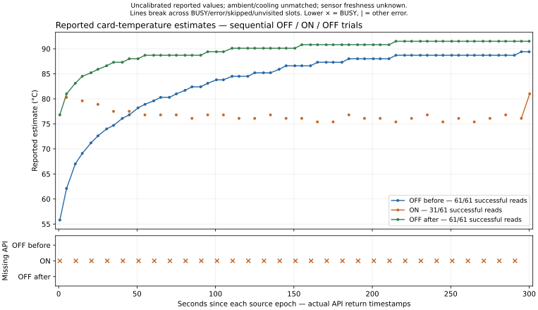

# Wider-resolution playback and card-temperature observations

The additional 1080p30 diagnostic completes all 900 source pictures per OFF/ON
arm with exact pixels, timestamps, once-release, EOS and official 1.3 restoration.
A separate three-arm 720p24 temperature study completes all 21,600 pictures,
with 153 valid same-call sensor readings and 30 preserved BUSY refusals.
Normal PWM remains disabled. These results extend the
[sustained 720p24 study](native-sustained-endurance-20261127.md) for
[#689](https://github.com/ahnhy1324/crystalhd/issues/689).

## 1080p30: complete pictures, measured capture delay

| Measurement | OFF | ON |
| --- | ---: | ---: |
| Source pictures / successful releases | 900 / 900 | 900 / 900 |
| Exact software-reference luma pictures | 900 | 900 |
| Full native YUY2 equal to OFF | Reference | 900 |
| Actual down / wake / FLL cycles | 0 | 64 |
| First input to final owned capture | 40.0310 s | 39.3277 s |

The source contains 30 seconds of progressive H.264 High at 1920×1080, with
original MP4 PTS/DTS and B-picture order. A single primary analysis checks all
1,800 new pictures. Native equality includes chroma; independent software
comparison covers luma. The 30-second source takes about 40 seconds under this
diagnostic's capture and intentional fetch-pressure workload, so this result
does not qualify real-time 30fps or physical display. The unpaired OFF/ON timing
difference does not establish a speedup.

ON reaches its selected 64-attempt limit, with all FLL values restored to 12,
no failed/refused physical transition and no lost ledger record. Seventeen
entries begin after the nominal source interval. Published sleep totals
14.8701 seconds, of which 12.9564 seconds intersects the 30-second source
window; these intervals are not measured electrical savings. Each arm uses
one HANDLE and clock, 19 bounded pressure windows and at most 16 owned slots.
Both workers join and return to the exact FD20 / Threads1 census. Ordinary
180-picture/EOS controls and the complete official baseline pass before/after.

The first diagnostic incorrectly required the SPS coded height of 1088 at
the API boundary, although the returned picture reports the visible height
1080. It captured zero pictures and restored normally. Correcting only our
isolated probe's geometry contract makes the later run pass; PicInfo, driver,
DIL and external firmware are unchanged. The original failure is preserved.

The [immutable FHD evidence](https://github.com/ahnhy1324/crystalhd-firmware-research/blob/a41dd1f75d2d2ff8246c2a7faae9007b9c1b2ef0/results/native-pm-fhd-2026-11-27/README.md)
contains both acquisitions, source/build identities, the single primary pixel
analysis, original payloads and independent reviews. The research module is
the same bounded endurance1 implementation as the preceding 720p24 study;
the selected ON parameters are 64 attempts / 60000 ms. No product default or
published release changes.

## Three five-minute sessions: reported card temperature

The separate 720p24 OFF→ON→OFF acquisition uses 7,200 pictures and one source
clock per arm, with 150 bounded pressure windows. Each fresh-module arm adds
at most one temperature API call at each five-second source target, after
successful picture release and owned-copy publication. There is no native
lease at that call. Missed opportunities do not trigger a retry or forced wake.

| Observation | OFF before | ON | OFF after |
| --- | ---: | ---: | ---: |
| Successful reads / API calls | 61 / 61 | 31 / 61 | 61 / 61 |
| BUSY / missing readings | 0 | 30 | 0 |
| Reported estimate, first → last | 55.8 → 89.4°C | 80.3 → 81.0°C | 76.8 → 91.5°C |
| Reported estimate, minimum–maximum | 55.8–89.4°C | 75.4–81.0°C | 76.8–91.5°C |
| Actual down / wake / FLL cycles | 0 | 150 | 0 |
| Sampled host temperature | 53–55°C | 52–56°C | 52–55°C |

All 183 API calls have a corresponding original typed register command; 153
succeed and 30 return BUSY. Only successful same-call raw values become
temperature estimates. All ON refusals lie inside recorded sleep intervals;
none is treated as a zero reading or interpolated measurement. There are no
skipped or unvisited slots. Actual release-triggered observations can occur
up to 0.968 seconds after the target, so the plot uses actual API timestamps.
ON's slot zero is BUSY; its first valid 80.3°C reading is at source +5.004
seconds, not a simultaneous time-zero baseline for the three arms.

The raw register's nine-bit DATA value exactly reproduces the maintained
float conversion for every successful call. This verifies raw/API
correspondence, not sensor calibration or sample age. Card estimates and host
thermal-zone readings are different measurements; the existing initial host
≤55°C and runtime host <75°C limits remain unchanged.

ON completes 150 down/wake/FLL cycles across its stream, all FLL12, with no
failed/refused physical transition or lost record. Published sleep totals
124.293824 seconds. This is a separate temperature-observer acquisition;
do not substitute its counts or timings for the earlier observer-free study.
Each process reaches EOS, joins both workers and returns to FD55 / Threads1.
Full official 1.3 restoration and ordinary 180-picture/EOS controls pass.

The first joined analysis reads all 21,600 newly captured pictures once. Every
software-reference luma plane matches. First OFF's 7,200 full native YUY2
pictures match the retained native reference after the exact eight-copy input
mapping is checked; all ON and final-OFF pictures match first OFF. Source
timestamps, once-release and complete part extents pass. No additional
pixel replay is used to create the archive or plot.

The lower ON estimates are observed under this sequential setup. Starting
card estimates differ, ambient temperature is unmeasured, automatic fan RPM
varies, and missing readings depend on the power state. This supports a
reported temperature trajectory, not a matched thermal-benefit estimate,
measured watts or a production default-on decision.

The [immutable temperature evidence](https://github.com/ahnhy1324/crystalhd-firmware-research/blob/1ef66c41d56395c7c8113b7bd04f40388fb0330d/results/native-pm-endurance-temperature-2026-11-27/README.md)
preserves the frozen observer/coordinator, original build failure and successful
build, actual raw captures, first analysis, graph data and independent reviews.
All new captures remain locally intact; archive reconstruction references the
retained native 900 payload only after the complete full-byte equality chain
passes. The 7,200 timestamps are continuous, with the existing 900-picture
visual content repeated eight times. This study qualifies those bounded
diagnostic paths and reported observations, with no stock-player, calibrated
thermal, hour-scale reliability or release-promotion claim.
